# TaleemPlus — AI Academy Management System

**Agile Software Design Specification – SDS Phase III**

| Field | Value |
|---|---|
| Project Title | TaleemPlus — AI Academy Management System |
| Document | Agile Software Design Specification – SDS Phase III (v3.0) |
| Product Owner (Supervisor) | [[TO FILL: Supervisor name and designation]] |
| Group ID | [[TO FILL: Group ID]] |
| Student 1 | [[TO FILL: Reg#]] — Muhammad Rakib Akram |
| Student 2 | [[TO FILL: Reg# and name, or remove if solo project]] |
| Faculty | Faculty of Information Technology & Computer Science, University of Central Punjab, Lahore |
| Degree | BS Computer Science |
| Session | [[TO FILL: e.g. Fall 2026]] |
| Repository | github.com/RakibAkram5/Final_Year_Project |
| Live System | Web: taleemplus-111.netlify.app · API: taleemplus.vercel.app/api/v2 |

### Team and Roles

| Member Name | Roles |
|---|---|
| Muhammad Rakib Akram | Scrum Master, Full-stack Developer (Flutter + Node.js), Database Designer, ML Engineer, QA Lead, UI/UX, DevOps (CI/CD, Vercel, Netlify) |
| [[TO FILL: second member or delete row]] | [[TO FILL: roles]] |
| [[TO FILL: Supervisor name]] | Product Owner (Supervisor) |

> Note for examiners: the repository shows a single committing author. If the project is registered as a group, add the remaining members with their roles and update the contribution table in Section 5.2.

### Table of Contents

- [0.1 Revision History & Sprint Log](#01-revision-history--sprint-log)
- [0.2 Previous Phases Feedback](#02-previous-phases-feedback)
- [0.3 Abstract](#03-abstract)
- [1. Introduction and Background](#1-introduction-and-background)
  - [1.1 Product Vision & Problem Context](#11-product-vision--problem-context)
  - [1.2 Stakeholders Identification](#12-stakeholders-identification)
- [2. Sprint Breakdown and History](#2-sprint-breakdown-and-history)
  - [2.1 Completed Work: Sprints 1 & 2](#21-completed-work-sprints-1--2)
  - [2.2 Sprint 1 & 2 Retrospective Key Takeaways](#22-sprint-1--2-retrospective-key-takeaways)
  - [2.3 Sprint-wise Design Evolution](#23-sprint-wise-design-evolution)
- [3. UML Diagrams (Updated)](#3-uml-diagrams-updated)
  - [3.1 Use Case Diagram](#31-use-case-diagram)
  - [3.2 Class Diagram](#32-class-diagram)
  - [3.3 Entity Relationship Diagram](#33-entity-relationship-diagram)
  - [3.4 Database Schema](#34-database-schema)
  - [3.5 Sequence Diagrams](#35-sequence-diagrams)
  - [3.6 Activity Diagram](#36-activity-diagram)
  - [3.7 State Diagram](#37-state-diagram)
  - [3.8 System Architecture / Deployment Diagram](#38-system-architecture--deployment-diagram)
- [4. Active Execution: Sprint 3 & 4](#4-active-execution-sprint-3--4)
  - [4.1 Planned Sprint Overview](#41-planned-sprint-overview)
  - [4.2 User Stories and Product Backlog](#42-user-stories-and-product-backlog)
  - [4.3 Kanban Board / Task Tracking](#43-kanban-board--task-tracking)
- [5. Unit and Integration Testing](#5-unit-and-integration-testing)
  - [5.1 Overview](#51-overview)
  - [5.2 Version Control](#52-version-control)
- [6. Revised Project Plan](#6-revised-project-plan)
- [7. References](#7-references)
- [Appendix A: Glossary](#appendix-a-glossary)
- [Appendix B: Sprint and Phase Retrospective Report](#appendix-b-sprint-and-phase-retrospective-report)
- [Appendix C: Semester-wise SDP Meeting Report](#appendix-c-semester-wise-sdp-meeting-report)
- [Traceability Matrix](#traceability-matrix)
- [Machine-Readable Summary](#machine-readable-summary)
- [Submission Checklist](#submission-checklist)

## 0.1 Revision History & Sprint Log

| Version | Sprint | Date | Changes | Owner |
|---|---|---|---|---|
| v1.0 | — | [[TO FILL: Phase I / Idea Defence date]] | Phase I proposal: problem statement, scope, initial feature list, Firebase-based architecture proposed | Muhammad Rakib Akram |
| v1.1 | Sprint 1 | 2026-07-09 | Sprint 1 started: Flutter skeleton, authentication, branding, role dashboards | Muhammad Rakib Akram |
| v1.2 | Sprint 1 | 2026-09-21 | Sprint 1 closed: attendance, fees, classes, announcements, Student/Parent portals, ML Kit OCR, AI paper grader, GitHub Actions CI | Muhammad Rakib Akram |
| v2.0 | Sprint 2 | [[TO FILL: Phase II SDS submission date]] | Phase II SDS: initial UML, ERD (Firestore collections), sprint plan | Muhammad Rakib Akram |
| v2.1 | Sprint 2 | 2026-10-31 | Design pivot: Firestore replaced by PostgreSQL + Prisma; REST API v2; JWT and refresh tokens; security hardening (PR #1) | Muhammad Rakib Akram |
| v2.2 | Sprint 2 | 2026-11-09 | Releases v1.0.1, v1.1.0, v1.1.1: file storage, assignments, map location, bank details, Excel/PDF reports, exam-paper generator, ML training lifecycle | Muhammad Rakib Akram |
| v3.0 | Sprint 3 | 2026-11-11 | Phase III SDS: updated UML, ERD and 3NF schema, Sprint 3/4 backlog, test plan, revised project plan; parent-link requests and academy branding added to design | Muhammad Rakib Akram |
| v3.1 | Sprint 3 | 2026-11-30 (planned) | Sprint 3 review: branding, parent-link approval, admin challan PDF, ML analytics dashboard | Muhammad Rakib Akram |
| v3.2 | Sprint 4 | 2026-12-31 (planned) | Sprint 4 review: exam documents, in-app quiz, light theme, ML monitor UI, signed release; final report | Muhammad Rakib Akram |

## 0.2 Previous Phases Feedback

### Idea Defence Feedback

[[TO FILL: insert screenshot of the Idea Defence evaluation sheet]]

| Feedback Point | Action Taken | Section Where Addressed | Status |
|---|---|---|---|
| [[TO FILL: feedback point 1 from the Idea Defence panel]] | [[TO FILL: what the team changed]] | [[TO FILL: section]] | [[TO FILL: Done / In Progress]] |
| [[TO FILL: feedback point 2]] | [[TO FILL]] | [[TO FILL]] | [[TO FILL]] |
| Suggested example — "Clarify which features are genuinely AI/ML" | ML moved to a server-side scikit-learn service trained on real academy data; rule-based features are labelled as heuristics in the UI and documentation | 1.1, 2.3, 3.8, EP-11 | Done |

### Phase 2 (SDS) Feedback

[[TO FILL: insert screenshot of the Phase II SDS evaluation sheet]]

| Feedback Point | Action Taken | Section Where Addressed | Status |
|---|---|---|---|
| [[TO FILL: feedback point 1 from the Phase II evaluation]] | [[TO FILL]] | [[TO FILL]] | [[TO FILL]] |
| [[TO FILL: feedback point 2]] | [[TO FILL]] | [[TO FILL]] | [[TO FILL]] |
| Suggested example — "Firestore schema is not normalized; provide a relational ERD" | Database migrated to PostgreSQL; 25 tables in 3NF with FKs, unique constraints and indexes | 3.3, 3.4 | Done |
| Suggested example — "Add integration tests and CI" | 133 backend contract tests, 123 Flutter tests, 55 ML tests; 8 GitHub Actions workflows | 5.1, 5.2 | Done |

## 0.3 Abstract

Private academies in Pakistan still manage attendance, fee collection, examinations and parent communication on paper registers, WhatsApp groups and spreadsheets, which leads to lost fee records, unverifiable attendance, delayed result reporting and parents who learn about problems only after they become serious. TaleemPlus addresses this problem with a multi-tenant academy management system delivered as a single Flutter code base for Android and the Web, backed by a Node.js/Express REST API, a normalized PostgreSQL database and a Python machine-learning service. The system provides four role-based portals (Admin, Teacher, Student, Parent) covering account approval, class and section management, timetable scheduling with clash detection, daily attendance, monthly fee challans with payment-proof verification, quizzes and marks, assignment submission and grading, private file storage for course materials and documents, PDF and Excel reporting, and admin-approved parent-to-child linking. The knowledge areas applied are software architecture, relational database design, RESTful API security (JWT, refresh-token rotation, rate limiting, role-based authorization), mobile and responsive UI engineering, optical character recognition and supervised machine learning. Two scikit-learn models, trained per academy on its own historical records, predict fee-payment risk and student performance; on-device OCR digitises handwritten papers. The project follows Scrum with four sprints; Sprints 1 and 2 delivered a production release (v1.1.1) with 133 backend, 123 Flutter and 55 ML automated tests, while Sprints 3 and 4 add academy branding, parent-link approval, live ML analytics, in-app quizzes and a production-signed release. The expected result is a verified, deployable system that reduces administrative effort and gives parents timely, trustworthy information.

## 1. Introduction and Background

### 1.1 Product Vision & Problem Context

#### Real-world problem

Small and medium private academies (tuition centres, coaching academies and private schools) typically enrol between fifty and a few hundred students and employ a handful of teachers. Their administration is run by one or two people using paper registers, printed fee vouchers and informal messaging. The consequences observed during the project's domain study were:

| Pain Point | Who Suffers | Consequence |
|---|---|---|
| Attendance kept in paper registers | Admin, Parents | No history, no alerts for chronic absence, disputes cannot be resolved |
| Fee vouchers issued and reconciled manually | Admin, Students | Lost receipts, overdue fees discovered late, no audit trail of payments |
| Results shared through chat groups or on paper | Teachers, Students, Parents | Marks leak between students, parents miss results, no per-student history |
| No structured parent channel | Parents | Parents learn of problems only after fees are overdue or exams are failed |
| Exam papers and notes written by hand | Teachers | Repetitive effort, inconsistent marks totals, no reusable question bank |
| Off-the-shelf school ERPs priced for large schools | Academy owners | Unaffordable licences, desktop-only, require IT staff |

#### Target users

- **Academy Admin** (owner or office manager): sets up the academy, approves accounts, manages classes, timetable, fees and reports.
- **Teacher**: marks attendance, shares materials, creates quizzes and assignments, records marks, answers student questions.
- **Student**: views timetable, attendance, fees, results, materials, assignments; submits work and payment proof.
- **Parent**: monitors every linked child (attendance, fees, results, assignments) and contacts the academy.

#### Product Vision Statement

*For academy administrators, teachers, students and parents of small and medium Pakistani academies who need an affordable, trustworthy way to run daily academic operations, TaleemPlus is a cross-platform academy management system that digitises attendance, fees, examinations, assignments and parent communication in one place. Unlike paper registers, chat groups and enterprise school ERPs, our product runs on any phone or browser at no licence cost, isolates every academy's data, and uses machine learning trained on the academy's own records to flag fee-default and academic risk early.*

#### Objectives (SMART)

1. Deliver one Flutter code base that runs on Android and the Web with four role-based portals, verified by an automated responsive-layout suite of 60 screens across 12 viewport and theme configurations, by the end of Sprint 2 (achieved 2026-11-09).
2. Replace the Firestore prototype with a REST API over a normalized PostgreSQL schema (3NF, 25 tables) with JWT authentication, refresh-token rotation, role-based authorization and rate limiting, by 2026-10-31 (achieved, PR #1).
3. Enforce per-academy data isolation so that no API endpoint returns another academy's or another family's records, proven by contract tests covering parents, students, files and reports (133 passing backend tests as of 2026-11-09).
4. Provide monthly fee challans with PDF vouchers, payment-proof upload and admin verification, so that no fee is marked paid without an admin decision (achieved in Sprint 2; admin print/download added in Sprint 3).
5. Train and serve two per-academy ML models (fee-payment risk and student performance) through an authenticated FastAPI service with monitoring and rollback, and surface their predictions in the Admin portal by the end of Sprint 3 (service deployed; UI wiring is US-25).
6. Reach a production-signed Android release and a final documented system with at least 95 % of planned Sprint 3 and 4 story points delivered by 2026-12-31.

#### User research

| Item | Value |
|---|---|
| Method | [[TO FILL: e.g. semi-structured interviews with academy owners and teachers, plus an online questionnaire for parents]] |
| Participants | [[TO FILL: number and type, e.g. 3 academy admins, 6 teachers, 12 parents, 15 students]] |
| Period | [[TO FILL: dates]] |
| Instrument | [[TO FILL: link or appendix reference to the questionnaire]] |

| # | Key Finding | Evidence | Requirement It Shaped |
|---|---|---|---|
| F-1 | Admins want to approve every account before it can see any data | [[TO FILL: e.g. 3 of 3 admins]] | Account status PENDING → ACTIVE approval flow (US-02); parent-link approval (US-22) |
| F-2 | Fee tracking is the most painful monthly task | [[TO FILL: e.g. ranked first by all admins]] | Monthly challan generation, payment-proof verification, ledger and Excel export (US-05, US-12, US-16, US-24) |
| F-3 | Parents mostly use low-end Android phones and want one app for all children | [[TO FILL: e.g. 10 of 12 parents]] | Responsive layout suite at 320 px, multi-child parent portal (US-18) |
| F-4 | Teachers spend hours typing exam papers and totals are often wrong | [[TO FILL]] | Exam-paper generator with live marks validation and answer key (US-17) |
| F-5 | Admins are sceptical of "AI" claims and want explainable outputs | [[TO FILL]] | Heuristics labelled as such; ML models trained per academy with metrics shown (US-19, US-25) |

[[TO FILL: replace the example evidence with real counts from your survey or interviews]]

#### Expected benefits and beneficiaries

| Beneficiary | Benefit |
|---|---|
| Academy owners | Single source of truth for students, fees and results; less clerical work; early warning of fee defaults |
| Teachers | Attendance in seconds, reusable quizzes and generated exam papers, assignment grading in one screen |
| Students | Timetable, materials, assignments, results and fee status on their phone |
| Parents | Real-time visibility of every child; verified fee receipts; direct academy contact and map directions |
| University / research | A documented case of applying per-tenant ML in a low-resource educational setting |

### 1.2 Stakeholders Identification

| Stakeholder | Type (Primary/Secondary/External) | Role | Expectations | Influence (H/M/L) |
|---|---|---|---|---|
| Academy Admin | Primary | Configures and operates the academy tenant | Reliable fee and attendance records, account control, reports | H |
| Teacher | Primary | Day-to-day academic user | Fast attendance, quizzes, materials, grading | H |
| Student | Primary | Consumer of academic information | Accurate timetable, results, fees, assignments | M |
| Parent | Primary | Guardian monitoring children | Trustworthy, timely information; privacy of their child's data | M |
| Supervisor (Product Owner) | Secondary | Owns the product backlog, reviews sprints | Academic rigour, working increments each sprint | H |
| FYP Evaluation Committee | Secondary | Assesses the project | Complete SDS, traceable design, evidence of Agile practice | H |
| Development Team | Secondary | Builds and tests the system | Clear backlog, stable tooling | H |
| Neon (PostgreSQL), Vercel, Netlify | External | Hosting providers | Correct use of free tier limits, security of credentials | M |
| Hugging Face Hub | External | Model artefact storage | Private repository, token-based access | L |
| OpenStreetMap / Nominatim | External | Geocoding provider | Compliance with usage policy (1 request/s, user agent) | L |
| Google ML Kit / Tesseract.js | External | OCR engines | On-device processing, no data leaves the device | L |

## 2. Sprint Breakdown and History

### 2.1 Completed Work: Sprints 1 & 2

| Sprint | Objective / Focus Area | Key Features Delivered | Status | Planned Velocity | Delivered Velocity |
|---|---|---|---|---|---|
| Sprint 1 (2026-07-09 → 2026-09-21) | Working MVP on Firebase: authentication, four portals, core academy records | Academy registration and admin login; account approval; classes, sections and enrolment; teacher attendance; monthly fee challans; quizzes and marks; announcements and notifications; ML Kit OCR; keyword-based AI paper grader; GitHub Actions CI | Completed | 57 | [[TO FILL: delivered story points for Sprint 1]] |
| Sprint 2 (2026-09-22 → 2026-11-09) | Re-architecture and production release: REST API on PostgreSQL, security hardening, files, assignments, ML service, releases v1.0.0 → v1.1.1 | REST API v2 with JWT and refresh tokens; PostgreSQL 3NF schema and migrations; timetable with clash detection; payment-proof verification; private file storage and course materials; assignments; academy map location and bank details; Excel and PDF reports; exam-paper generator; FastAPI ML service with training lifecycle; account lockout and password policy; CI/CD release pipeline for Android and Web | Completed | 96 | [[TO FILL: delivered story points for Sprint 2]] |

**Carried-over work.** The on-device TensorFlow Lite risk model planned in Sprint 1 (originally scheduled for "Week 6") could not be trained on real data and was consciously de-scoped; the requirement was re-planned in Sprint 2 as a server-side scikit-learn service (US-19). The parent self-service child linking shipped in Sprint 2 was found to be a security hole (a parent could attach to any student) and was replaced by an admin-approved request flow carried into Sprint 3 (US-22). The ML dashboard in the Admin portal was built in Sprint 2 but its connection to the deployed service is still pending configuration, so it is carried into Sprint 3 (US-25).

### 2.2 Sprint 1 & 2 Retrospective Key Takeaways

**What went well**

- A single Flutter code base served Android and Web from the first sprint, so every feature was demonstrable on a phone and in a browser without duplicate work.
- The decision to write contract tests against an isolated throwaway PostgreSQL database (never the production Neon database) made the Firestore-to-PostgreSQL migration verifiable: 133 backend tests pass on every pull request.
- Tag-driven CI (GitHub Actions) produces the APK, AAB and web bundle from the same commit, which removed the "works on my machine" release problems seen in Sprint 1.
- Security review in Sprint 2 found and fixed four cross-tenant data leaks (parent self-linking, class roster exposure, teacher cross-class material edits, student cross-class reads) before the public release.

**Improvement areas**

- Sprint 1 relied on Firestore and discovered late that composite-index requirements and client-side security rules could not express per-academy isolation cleanly, which forced a costly re-architecture in Sprint 2.
- Features marketed as "AI" in Sprint 1 (grader, summariser, at-risk prediction) were rule-based; the gap between the README and the implementation had to be corrected for academic honesty.
- Sprint 2 was too long (seven weeks) and bundled three releases; velocity was hard to measure and the burndown was not maintained.
- A backend `.env` file with real secrets was committed in early history and had to be rotated.
- Story points were not consistently recorded per story in Sprints 1 and 2, so delivered velocity must be reconstructed.

**Actions taken**

- AI-01: Migrated to a relational schema with FK constraints and server-side authorization (completed 2026-10-31, PR #1).
- AI-02: Documented every heuristic feature and replaced the synthetic-weight "ML" with per-academy scikit-learn models in the ML service (completed in v1.1.0).
- AI-03: Fixed Sprint 3 and 4 to three to four weeks each with a story-point estimate per story and a daily burndown table (Section 4.3).
- AI-04: Added secret scanning to the contribution guidelines, rotated the leaked credentials and git-ignored all environment files (completed; history purge pending [[TO FILL: date rotated]]).
- AI-05: Adopted a Definition of Ready and Definition of Done (Section 4.2) so that each story has acceptance criteria before it enters a sprint.

### 2.3 Sprint-wise Design Evolution

| Sprint | Features Designed | Design Artefacts Changed (tables/classes/APIs) | Improvements / Reason |
|---|---|---|---|
| Sprint 1 | Authentication, role dashboards, classes, attendance, fees, quizzes, announcements, OCR | Firestore collections `users`, `academies`, `classes`, `attendance`, `fees`, `quizzes`, `announcements`; Flutter providers `AuthProvider`, `ClassProvider`, `AttendanceProvider`, `QuizProvider`; `firestore.rules` | First end-to-end domain model; security rules written late in the sprint after cross-tenant leaks were noticed |
| Sprint 2 | REST API v2, PostgreSQL schema, timetable, payment proofs, files, assignments, map location, bank details, reports, exam-paper generator, ML service, account lifecycle | Added tables (E-01 → E-20 baseline, 2026-10-31): `academies`, `users`, `parent_student_relationships`, `classes`, `class_sections`, `class_section_enrollments`, `student_enrollments`, `attendance_records`, `fee_challans`, `fee_payment_proofs`, `announcements`, `quizzes`, `quiz_questions`, `test_marks`, `shared_resources`, `student_queries`, `ocr_documents`, `notifications`, `timetable_slots`, `refresh_tokens`, `class_reports`, `legacy_id_map`. Added in Sprint 2 (2026-11-09): `stored_files`, `assignments`, `assignment_submissions`; columns `academies.latitude/longitude/locationLabel`, `academies.bankName/bankAccountNumber/bankIban/paymentInstructions`, `quizzes.paperMeta`, `users.failedLoginAttempts/lockedUntil/deactivatedAt/securityQuestion`. Classes: `ApiClient`, `AuthService`, `FileService`, `AssignmentService`, `ExamPaperGenerator`, `MlServiceClient`, `MlFeatureService`. APIs: `/api/v2/*` (19 route groups) | Firestore could not enforce per-academy isolation or relational integrity; a normalized schema with FKs, unique constraints and server-side role checks fixed this. File bytes moved out of the database to Vercel Blob with a metadata table. ML moved server-side so models train on real data |
| Sprint 3 | Admin-approved parent-link requests, academy branding, admin challan PDF, ML analytics dashboard, compact theme | Added in Sprint 3: table `parent_link_requests` (E-04) with enum `LinkRequestStatus`; columns `academies.email/logoData/logoMimeType/logoUpdatedAt`; classes `BrandingService`, `AcademyLogo`, `ChallanActions`, `MlAnalyticsService`; APIs `POST/GET /users/link-requests`, `GET/PUT /academy/branding`, `GET /academy/branding/public`, `GET /admin/ml/analytics` | Self-service linking was a privacy hole; approval makes the admin the gatekeeper. Branding stored as validated image bytes so PDFs render the same logo on every platform. Analytics endpoint aggregates ML outputs for the dashboard |
| Sprint 4 (planned) | Exam documents UI, in-app quiz taking, light theme, ML monitor and rollback UI, signed release | Planned: tables `quiz_submissions` and `quiz_answers` (E-26, E-27, *to be added in Sprint 4*); `StoredFile.category = EXAM_DOCUMENT` surfaced in UI; classes `QuizSubmissionModel`, `AnswerModel` (already defined, unused), `MlMonitorScreen`; APIs `POST /quizzes/:id/submissions`, `GET /quizzes/:id/submissions`, `POST /admin/ml/rollback` (exists, to be exposed in UI) | Students currently take quizzes on paper; an in-app flow reuses the existing question bank and auto-scores MCQs. Model rollback exists in the service but has no admin UI |

**Narrative.** In Sprint 1 the team designed the system around Firebase because it promised a fast MVP: collections mirrored the screens, and security was expected to come from Firestore rules. By the end of Sprint 1 the team realised that per-academy isolation, parent-to-child scoping and relational constraints (one attendance record per student per day, one challan per student per month) could not be expressed reliably in rules and composite indexes, and that the planned on-device TFLite model had no real training data. In Sprint 2 the team therefore redesigned the persistence layer as a normalized PostgreSQL schema behind an Express REST API with JWT, refresh-token rotation and role middleware, migrated the data through a `legacy_id_map` table, and moved machine learning to a server-side FastAPI service that trains on each academy's own records. The same sprint added file storage, assignments, geolocation and reporting once the relational base was stable. Sprint 3 closes the last design gaps exposed by the security review (admin-approved parent linking) and by the user research (academy branding on documents, printable challans, visible ML analytics). Sprint 4 extends the examination module with in-app quiz submissions, the only new entities planned for the remainder of the project.

## 3. UML Diagrams (Updated)

### 3.1 Use Case Diagram

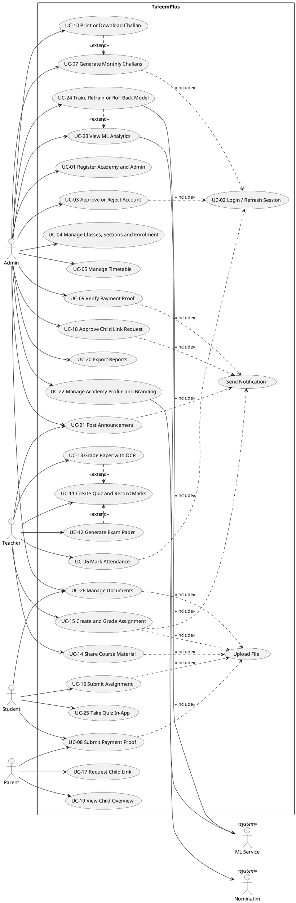

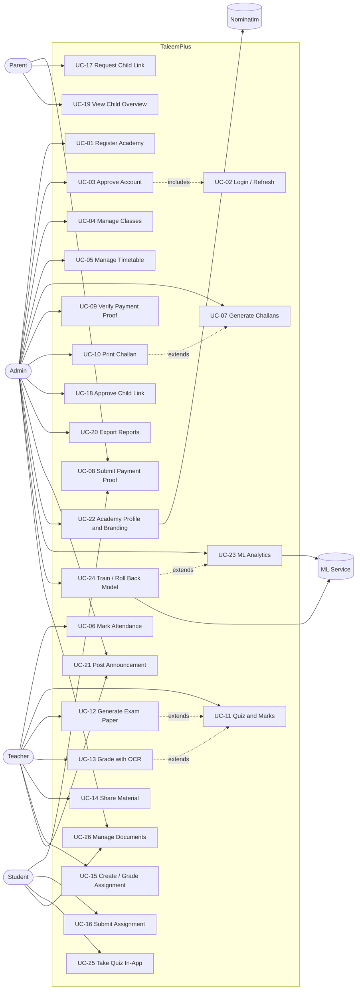

**Explanation.** The system boundary "TaleemPlus" contains twenty-six use cases grouped by the four human actors, plus two external system actors: the FastAPI ML service, which trains and serves per-academy models, and Nominatim, used for address search when an admin sets the academy location. Every protected use case includes UC-02 (session establishment with JWT and refresh token); the diagram shows this once for UC-03, UC-06 and UC-07 to keep it readable. File-bearing use cases (materials, assignments, payment proof, documents) include a shared "Upload File" behaviour that enforces the 4 MB limit and magic-byte type check. Use cases that change another user's state (payment verification, link approval, announcements, grading) include "Send Notification". Extensions model optional continuations: OCR grading and exam-paper generation extend quiz management, printing extends challan generation, and model training extends analytics viewing. UC-25 and UC-26 are the Sprint 4 additions.

#### Use Case Catalogue

| Use Case ID | Name | Actor(s) | Linked User Story |
|---|---|---|---|
| UC-01 | Register Academy and Admin | Admin | US-01 |
| UC-02 | Login / Refresh Session | Admin, Teacher, Student, Parent | US-01, US-10, US-20 |
| UC-03 | Approve or Reject Account | Admin | US-02 |
| UC-04 | Manage Classes, Sections and Enrolment | Admin | US-03 |
| UC-05 | Manage Timetable | Admin | US-11 |
| UC-06 | Mark Attendance | Teacher | US-04 |
| UC-07 | Generate Monthly Challans | Admin | US-05 |
| UC-08 | Submit Payment Proof | Student, Parent | US-12 |
| UC-09 | Verify Payment Proof | Admin | US-12 |
| UC-10 | Print or Download Challan | Admin | US-24 |
| UC-11 | Create Quiz and Record Marks | Teacher | US-06 |
| UC-12 | Generate Exam Paper | Teacher | US-17 |
| UC-13 | Grade Paper with OCR | Teacher | US-08, US-09 |
| UC-14 | Share Course Material | Teacher | US-13 |
| UC-15 | Create and Grade Assignment | Teacher | US-14 |
| UC-16 | Submit Assignment | Student | US-14 |
| UC-17 | Request Child Link | Parent | US-22 |
| UC-18 | Approve Child Link Request | Admin | US-22 |
| UC-19 | View Child Overview | Parent | US-18 |
| UC-20 | Export Reports | Admin | US-16 |
| UC-21 | Post Announcement | Admin, Teacher | US-07 |
| UC-22 | Manage Academy Profile and Branding | Admin | US-15, US-23 |
| UC-23 | View ML Analytics | Admin | US-25 |
| UC-24 | Train, Retrain or Roll Back Model | Admin | US-19, US-30 |
| UC-25 | Take Quiz In-App | Student | US-28 |
| UC-26 | Manage Documents | Admin, Student, Teacher | US-27 |

#### Fully Dressed Use Case: UC-18 Approve Child Link Request

| Field | Content |
|---|---|
| ID | UC-18 |
| Name | Approve Child Link Request |
| Actors | Admin (primary); Parent (secondary, notified) |
| Linked Story | US-22 |
| Pre-conditions | Admin is authenticated with role ADMIN; at least one `parent_link_requests` row with status PENDING exists for the admin's academy |
| Main Flow | 1. Admin opens Parent Approvals. 2. System lists pending requests (child name, e-mail, roll number, parent name) scoped to the admin's academy. 3. Admin selects a request; system shows candidate students matched by e-mail or roll number. 4. Admin confirms the matched student and taps Approve. 5. System validates that the student belongs to the same academy and has role STUDENT. 6. System creates a `parent_student_relationships` row, sets request status APPROVED with `decidedById` and `decidedAt`. 7. System sends a notification to the parent. 8. Parent portal shows the child on next refresh. |
| Alternate Flows | A1 (step 4) Admin taps Reject and enters a note → status REJECTED, note stored, parent notified. A2 (step 5) Student belongs to another academy → 403, request unchanged. A3 (step 6) Link already exists → unique constraint on (parentId, studentId) prevents a duplicate; request marked APPROVED idempotently. A4 Admin session expired → 401, client refreshes token and retries. |
| Post-conditions | Exactly one active link exists for the pair; request is no longer PENDING; an audit trail (decider, time, note) is stored |

#### Fully Dressed Use Case: UC-09 Verify Payment Proof

| Field | Content |
|---|---|
| ID | UC-09 |
| Name | Verify Payment Proof |
| Actors | Admin (primary); Student or Parent (secondary, notified) |
| Linked Story | US-12 |
| Pre-conditions | A `fee_payment_proofs` row with status PENDING exists for a challan of the admin's academy |
| Main Flow | 1. Admin opens Pending Payment Proofs. 2. System lists proofs with challan number, student, amount and submission time. 3. Admin opens the proof image. 4. Admin taps Verify. 5. System sets proof status VERIFIED, `reviewedById`, `reviewedAt`; sets challan status PAID and `paidAt`. 6. System notifies the submitter. |
| Alternate Flows | A1 (step 4) Admin taps Reject → proof REJECTED, challan stays PENDING or OVERDUE, submitter notified to resubmit. A2 Challan already PAID → system returns 409 and refreshes the list. A3 Image fails to load → admin can download it or ask for resubmission. |
| Post-conditions | A challan is PAID only through an admin decision; the proof carries reviewer and time |

#### Fully Dressed Use Case: UC-23 View ML Analytics

| Field | Content |
|---|---|
| ID | UC-23 |
| Name | View ML Analytics |
| Actors | Admin (primary); ML Service (system) |
| Linked Story | US-25 |
| Pre-conditions | Admin authenticated; backend configured with `ML_SERVICE_URL` and `ML_INTERNAL_TOKEN`; academy has at least the minimum training samples |
| Main Flow | 1. Admin opens AI Insights. 2. Client calls `GET /admin/ml/analytics`. 3. Backend builds feature rows from attendance, marks and challans (MlFeatureService). 4. Backend calls `POST /predict/fee-risk/batch` and `POST /predict/performance/batch` on the ML service with the internal token. 5. Backend aggregates risk bands, top at-risk students and model metrics (MlAnalyticsService). 6. Client renders charts and lists with the model version and training date. |
| Alternate Flows | A1 (step 4) ML service unreachable or 503 → backend retries once, then returns `{ "ml_available": false }`; client shows "ML service not available" and the clearly labelled heuristic summary instead. A2 Model not trained (`READY_TO_TRAIN`) → client offers "Train now" (UC-24). A3 Fewer than the minimum samples → client explains the threshold. |
| Post-conditions | No data is written; predictions are not cached beyond the request |

#### Fully Dressed Use Case: UC-25 Take Quiz In-App

| Field | Content |
|---|---|
| ID | UC-25 |
| Name | Take Quiz In-App |
| Actors | Student (primary); Teacher (secondary, grades non-MCQ answers) |
| Linked Story | US-28 |
| Pre-conditions | Student is enrolled in the quiz's class; quiz has `testDate` reached and is published for in-app attempt; student has no submitted attempt |
| Main Flow | 1. Student opens the quiz from My Classroom. 2. System creates a `quiz_submissions` row with status IN_PROGRESS. 3. Student answers each question; answers are saved per question in `quiz_answers`. 4. Student taps Submit. 5. System auto-scores MCQs against `correctIndex`, stores per-answer marks, sets status SUBMITTED. 6. Teacher later grades short and long answers; system totals marks and writes a `test_marks` row. |
| Alternate Flows | A1 (step 3) Connection lost → answers are retried from the local queue when back online. A2 (step 4) Time limit exceeded → system auto-submits the saved answers. A3 Second attempt → 409 unless the teacher allowed resubmission. |
| Post-conditions | One submission per student per quiz; MCQ marks are deterministic; final marks appear in the student and parent result views |

#### Fully Dressed Use Case: UC-06 Mark Attendance

| Field | Content |
|---|---|
| ID | UC-06 |
| Name | Mark Attendance |
| Actors | Teacher (primary) |
| Linked Story | US-04 |
| Pre-conditions | Teacher is the primary teacher of the class or assigned to its section; date is today or in the past |
| Main Flow | 1. Teacher selects class and date. 2. System lists enrolled students with existing status if already marked. 3. Teacher sets PRESENT, ABSENT, LATE or LEAVE per student. 4. Teacher saves. 5. System upserts one `attendance_records` row per (classId, studentId, logDate). |
| Alternate Flows | A1 Future date → 400 "attendance cannot be marked for a future date". A2 Teacher not assigned to class → 403. A3 Correction of an earlier day → existing rows are updated, `markedById` records the corrector. |
| Post-conditions | At most one record per student per class per day; parents see the status in the child overview |

### 3.2 Class Diagram

#### 3.2.1 Domain Model (persisted entities)

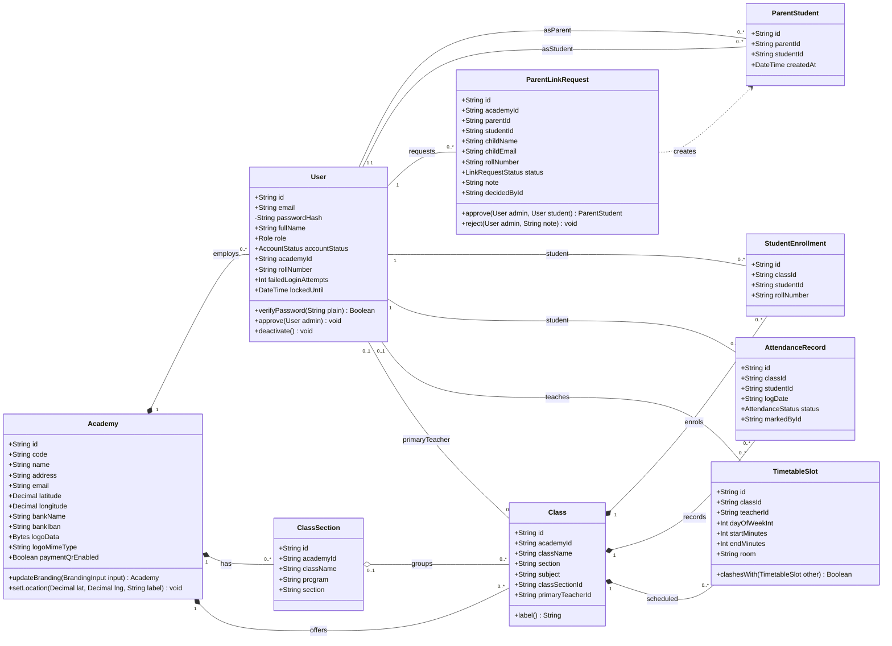

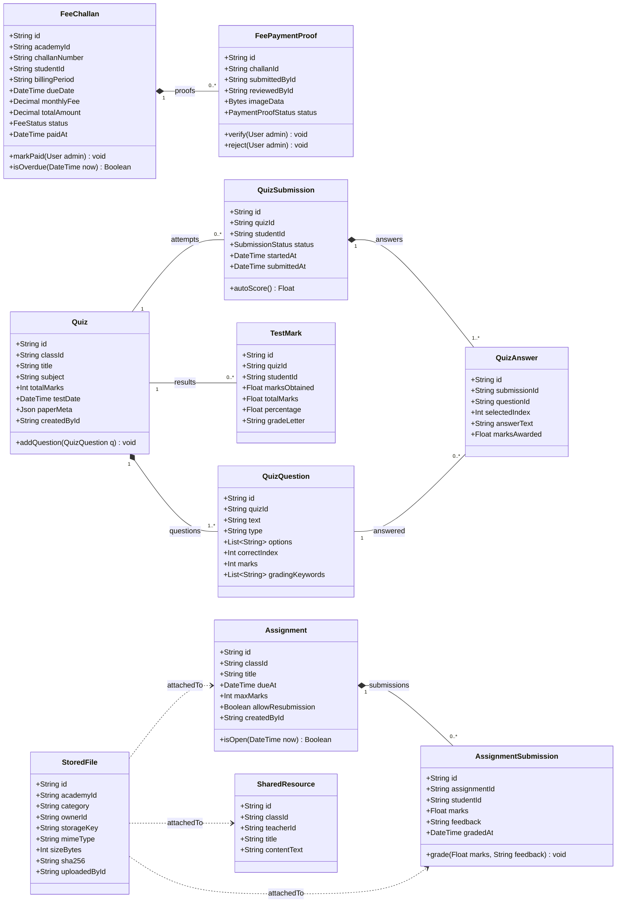

**Explanation.** The domain model is split into two views to stay readable. The first view covers identity and academic structure: an `Academy` is the tenant root that composes users, class sections and subject classes; a `ClassSection` (for example "10th – A") groups several subject `Class` rows, each with an optional primary teacher. Parent–child relationships are an association class `ParentStudent`, created only by approving a `ParentLinkRequest` (added in Sprint 3), which is why the dependency arrow runs from the request to the link. The second view covers transactional records: a `FeeChallan` composes its payment proofs, a `Quiz` composes questions and is associated with marks and, from Sprint 4, with in-app `QuizSubmission` attempts and their `QuizAnswer` rows. `StoredFile` is a polymorphic attachment table: its `category` and `ownerId` point at a resource, assignment, submission, user or quiz, so file bytes live in Blob storage while every other entity stays free of binary columns. Visibility markers show that only the password hash is private to the `User` class; all other attributes are exposed through DTOs.

#### 3.2.2 Backend API Layer

```mermaid
classDiagram
  direction TB
  class ApiServer {
    +Express app
    +registerRoutes() void
    +handleError(Error e) Response
  }
  class AuthMiddleware {
    +authenticateToken(Request req) User
  }
  class RoleMiddleware {
    +authorizeRoles(List~Role~ roles) Handler
  }
  class RateLimiter {
    +authRateLimiter Handler
    +limitTraining Handler
  }
  class AuthController {
    +registerAdmin(Request req) Response
    +login(Request req) TokenPair
    +refresh(Request req) TokenPair
    +logout(Request req) void
  }
  class UserController {
    +createUser(Request req) User
    +approve(String id) User
    +createLinkRequest(Request req) ParentLinkRequest
    +listLinkRequests(String academyId) List~ParentLinkRequest~
    +decideLinkRequest(String id, String decision) ParentLinkRequest
  }
  class FeeController {
    +generateChallans(String period) List~FeeChallan~
    +submitProof(String challanId, Bytes image) FeePaymentProof
    +reviewProof(String id, String decision) FeePaymentProof
    +ledgerStats(String academyId) LedgerStats
  }
  class BrandingController {
    +getBranding(String academyId) Branding
    +updateBranding(Request req) Branding
    +publicBranding(String code) Branding
  }
  class MlController {
    +status() ModelStatus
    +analytics(String academyId) Analytics
    +trainFee(String academyId) JobId
    +rollback(String model) ModelStatus
  }
  class MlFeatureService {
    +buildFeeRiskFeatures(String academyId) DataFrame
    +buildPerformanceFeatures(String academyId) DataFrame
  }
  class MlAnalyticsService {
    +aggregate(List~Prediction~ preds) Analytics
    +riskBands(List~Prediction~ preds) Map
  }
  class MlServiceClient {
    -String baseUrl
    -String internalToken
    +predictBatch(String model, DataFrame rows) List~Prediction~
    +train(String model, String academyId) JobId
    +retryOnColdStart(Function call) Response
  }
  class FileStorage {
    +put(Bytes data, String key) String
    +get(String key) Bytes
    +delete(String key) void
  }
  class ImageValidation {
    +validateImage(Bytes data) ImageInfo
  }
  class PrismaClient {
    +academy Delegate
    +user Delegate
    +feeChallan Delegate
    +parentLinkRequest Delegate
  }
  ApiServer --> AuthMiddleware
  ApiServer --> RoleMiddleware
  ApiServer --> RateLimiter
  ApiServer --> AuthController
  ApiServer --> UserController
  ApiServer --> FeeController
  ApiServer --> BrandingController
  ApiServer --> MlController
  MlController --> MlFeatureService
  MlController --> MlAnalyticsService
  MlController --> MlServiceClient
  BrandingController --> ImageValidation
  FeeController --> FileStorage
  AuthController --> PrismaClient
  UserController --> PrismaClient
  FeeController --> PrismaClient
  BrandingController --> PrismaClient
  MlFeatureService --> PrismaClient
```

**Explanation.** The backend follows a layered Express design: the `ApiServer` mounts route groups guarded by `AuthMiddleware` (JWT verification), `RoleMiddleware` (per-route role list) and `RateLimiter` (login and training endpoints). Controllers hold request validation (zod) and orchestration; persistence goes through the generated `PrismaClient`. The ML path is deliberately isolated: `MlFeatureService` turns raw attendance, marks and challans into feature rows, `MlServiceClient` talks to the FastAPI service with an internal bearer token and retries on cold starts, and `MlAnalyticsService` (added in Sprint 3) aggregates predictions for the dashboard. `FileStorage` abstracts Vercel Blob in production and a local folder in development; `ImageValidation` (Sprint 3) checks magic bytes and dimensions before a logo or QR image is stored.

#### 3.2.3 Flutter Client Layer

```mermaid
classDiagram
  direction TB
  class ApiClient {
    -String baseUrl
    -String accessToken
    +get(String path) Json
    +post(String path, Json body) Json
    +uploadBytes(String path, Bytes data) Json
    +refreshIfExpired() void
  }
  class AuthProvider {
    +AppUser currentUser
    +Academy academy
    +login(String email, String password) Future~void~
    +logout() Future~void~
  }
  class ParentProvider {
    +List~AppUser~ children
    +List~ParentLinkRequest~ requests
    +refresh() Future~void~
    +requestLink(String name, String email, String roll) Future~void~
  }
  class AdminAiProvider {
    +Analytics analytics
    +Boolean mlAvailable
    +loadAnalytics() Future~void~
    +train(String model) Future~void~
  }
  class QuizProvider {
    +List~Quiz~ quizzes
    +createQuiz(Quiz q) Future~Quiz~
    +uploadBulkMarks(List~TestMark~ marks) Future~void~
    +submitAttempt(QuizSubmission s) Future~void~
  }
  class AttendanceProvider {
    +markAttendance(String classId, String date, Map statuses) Future~void~
  }
  class BrandingService {
    +fetchBranding() Future~Branding~
    +updateBranding(Branding b, Bytes logo) Future~Branding~
  }
  class FileService {
    +upload(String category, String ownerId, Bytes data) Future~StoredFile~
    +download(String id) Future~Bytes~
  }
  class ChallanPdfService {
    +buildChallan(FeeChallan c, Branding b) Future~Bytes~
    +print(Bytes pdf) Future~void~
    +share(Bytes pdf) Future~void~
  }
  class ExamPaperGenerator {
    +generate(ExamConfig cfg) ExamPaper
    +validateMarks(ExamConfig cfg) Int
    +answerKey(ExamPaper p) AnswerKey
  }
  class ThemeProvider {
    +ThemeMode mode
    +Boolean compact
    +toggle() void
  }
  class AcademyLogo {
    +Branding branding
    +build(BuildContext ctx) Widget
  }
  AuthProvider --> ApiClient
  ParentProvider --> ApiClient
  AdminAiProvider --> ApiClient
  QuizProvider --> ApiClient
  AttendanceProvider --> ApiClient
  BrandingService --> ApiClient
  FileService --> ApiClient
  ChallanPdfService --> BrandingService
  AcademyLogo --> BrandingService
  QuizProvider --> ExamPaperGenerator
```

**Explanation.** The Flutter client uses the provider pattern: each `*Provider` is a `ChangeNotifier` that owns a slice of UI state and calls the REST API through a single `ApiClient`, which attaches the access token and transparently refreshes it. Services without UI state (`BrandingService`, `FileService`, `ChallanPdfService`) are plain classes injected into providers and widgets. Sprint 3 adds `BrandingService` and the `AcademyLogo` widget so that the logo fetched once is reused by every dashboard and by `ChallanPdfService` when rendering PDFs; `AdminAiProvider` gains an `mlAvailable` flag that drives the fallback message. `ExamPaperGenerator` is pure Dart logic (no I/O) and is unit-tested in isolation.

#### Class Catalogue

| Class ID | Class | Responsibility | Key Relationships |
|---|---|---|---|
| C-01 | Academy | Tenant root; profile, location, bank, branding | composes User, ClassSection, Class |
| C-02 | User | Account for any role; credentials, status, lockout | belongs to Academy; many associations |
| C-03 | ParentStudent | Approved parent–child link | associates two User rows |
| C-04 | ParentLinkRequest | Parent's request awaiting admin decision (Sprint 3) | creates ParentStudent |
| C-05 | ClassSection | Grade + section container | groups Class |
| C-06 | Class | Subject class with teacher | composes StudentEnrollment, AttendanceRecord, TimetableSlot |
| C-07 | StudentEnrollment | Student membership in a subject class | Class, User |
| C-08 | AttendanceRecord | One status per student per class per day | Class, User |
| C-09 | TimetableSlot | Scheduled period with clash detection | Class, User |
| C-10 | FeeChallan | Monthly voucher with status | composes FeePaymentProof |
| C-11 | FeePaymentProof | Uploaded receipt awaiting review | FeeChallan, User |
| C-12 | Quiz | Test definition and exam-paper metadata | composes QuizQuestion |
| C-13 | QuizQuestion | Question with options, keywords, marks | Quiz |
| C-14 | TestMark | Final marks per student per quiz | Quiz, User |
| C-15 | QuizSubmission | In-app attempt (Sprint 4) | Quiz, composes QuizAnswer |
| C-16 | QuizAnswer | Per-question answer and marks (Sprint 4) | QuizSubmission, QuizQuestion |
| C-17 | Assignment | Task with deadline and max marks | composes AssignmentSubmission |
| C-18 | AssignmentSubmission | Student's work and grade | Assignment, User |
| C-19 | StoredFile | File metadata for Blob storage | polymorphic owner |
| C-20 | SharedResource | Course material entry | Class, User, StoredFile |
| C-21 | ApiServer | Express composition root | all controllers |
| C-22 | AuthMiddleware / RoleMiddleware / RateLimiter | Security cross-cutting concerns | ApiServer |
| C-23 | AuthController | Register, login, refresh, logout | PrismaClient |
| C-24 | UserController | Accounts, approval, link requests | PrismaClient |
| C-25 | FeeController | Challans, proofs, ledger | PrismaClient, FileStorage |
| C-26 | BrandingController | Branding read/update (Sprint 3) | ImageValidation, PrismaClient |
| C-27 | MlController | ML status, analytics, training, rollback | MlFeatureService, MlAnalyticsService, MlServiceClient |
| C-28 | MlServiceClient | HTTP client to FastAPI with retries | — |
| C-29 | MlAnalyticsService | Aggregates predictions (Sprint 3) | MlController |
| C-30 | FileStorage / ImageValidation | Blob abstraction, image checks | FeeController, BrandingController |
| C-31 | ApiClient | Flutter HTTP client with token refresh | all providers |
| C-32 | AuthProvider / ParentProvider / AdminAiProvider / QuizProvider / AttendanceProvider / ThemeProvider | UI state per feature | ApiClient |
| C-33 | BrandingService / AcademyLogo | Branding fetch and logo widget (Sprint 3) | ApiClient, ChallanPdfService |
| C-34 | FileService / ChallanPdfService / ExamPaperGenerator | Upload, PDF rendering, paper generation | ApiClient, BrandingService |

### 3.3 Entity Relationship Diagram

#### 3.3.1 Identity, Tenancy and Messaging

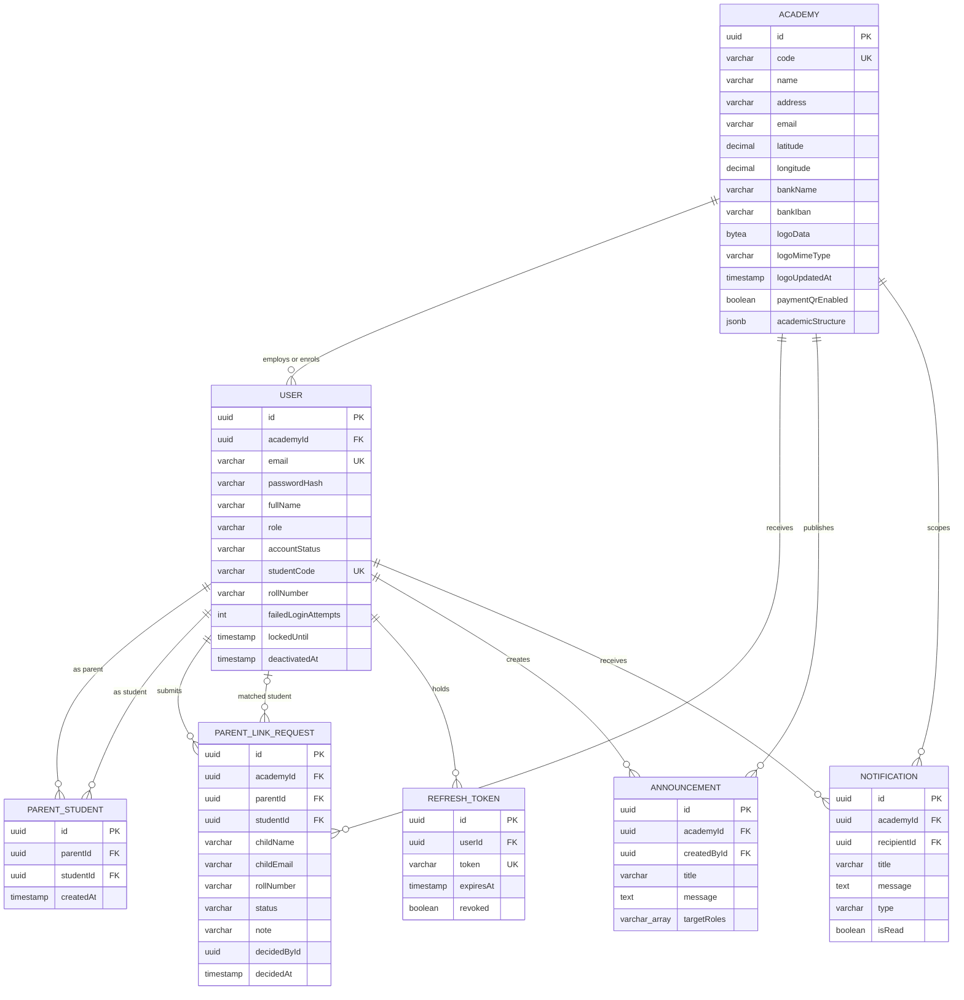

#### 3.3.2 Academic Structure, Attendance and Examinations

```mermaid
erDiagram
  ACADEMY ||--o{ CLASS_SECTION : "has"
  ACADEMY ||--o{ CLASS : "offers"
  CLASS_SECTION o|--o{ CLASS : "groups"
  CLASS_SECTION ||--o{ CLASS_SECTION_ENROLLMENT : "enrols"
  USER ||--o{ CLASS_SECTION_ENROLLMENT : "student"
  CLASS ||--o{ STUDENT_ENROLLMENT : "enrols"
  USER ||--o{ STUDENT_ENROLLMENT : "student"
  USER o|--o{ CLASS : "primary teacher"
  CLASS ||--o{ ATTENDANCE_RECORD : "records"
  USER ||--o{ ATTENDANCE_RECORD : "student"
  USER ||--o{ ATTENDANCE_RECORD : "marked by"
  CLASS o|--o{ TIMETABLE_SLOT : "scheduled"
  USER o|--o{ TIMETABLE_SLOT : "teacher"
  CLASS ||--o{ QUIZ : "assessed by"
  USER ||--o{ QUIZ : "created by"
  QUIZ ||--|{ QUIZ_QUESTION : "contains"
  QUIZ ||--o{ TEST_MARK : "results"
  USER ||--o{ TEST_MARK : "student"
  QUIZ ||--o{ QUIZ_SUBMISSION : "attempted"
  USER ||--o{ QUIZ_SUBMISSION : "student"
  QUIZ_SUBMISSION ||--|{ QUIZ_ANSWER : "answers"
  QUIZ_QUESTION ||--o{ QUIZ_ANSWER : "answered"
  CLASS ||--o{ SHARED_RESOURCE : "materials"
  CLASS ||--o{ STUDENT_QUERY : "questions"

  CLASS_SECTION {
    uuid id PK
    uuid academyId FK
    varchar className
    varchar program
    varchar section
  }
  CLASS {
    uuid id PK
    uuid academyId FK
    uuid classSectionId FK
    uuid primaryTeacherId FK
    varchar className
    varchar section
    varchar subject
  }
  CLASS_SECTION_ENROLLMENT {
    uuid id PK
    uuid sectionId FK
    uuid studentId FK
    varchar rollNumber
  }
  STUDENT_ENROLLMENT {
    uuid id PK
    uuid classId FK
    uuid studentId FK
    varchar rollNumber
  }
  ATTENDANCE_RECORD {
    uuid id PK
    uuid academyId FK
    uuid classId FK
    uuid studentId FK
    uuid markedById FK
    varchar logDate
    varchar status
  }
  TIMETABLE_SLOT {
    uuid id PK
    uuid academyId FK
    uuid classId FK
    uuid teacherId FK
    int dayOfWeekInt
    int startMinutes
    int endMinutes
    varchar subject
    varchar room
  }
  QUIZ {
    uuid id PK
    uuid academyId FK
    uuid classId FK
    uuid createdById FK
    varchar title
    varchar subject
    int totalMarks
    timestamp testDate
    jsonb paperMeta
  }
  QUIZ_QUESTION {
    uuid id PK
    uuid quizId FK
    text text
    varchar type
    varchar_array options
    int correctIndex
    int marks
  }
  TEST_MARK {
    uuid id PK
    uuid quizId FK
    uuid studentId FK
    uuid classId FK
    float marksObtained
    float totalMarks
    float percentage
    varchar gradeLetter
  }
  QUIZ_SUBMISSION {
    uuid id PK
    uuid quizId FK
    uuid studentId FK
    varchar status
    timestamp startedAt
    timestamp submittedAt
  }
  QUIZ_ANSWER {
    uuid id PK
    uuid submissionId FK
    uuid questionId FK
    int selectedIndex
    text answerText
    float marksAwarded
  }
  SHARED_RESOURCE {
    uuid id PK
    uuid academyId FK
    uuid classId FK
    uuid teacherId FK
    varchar title
    text contentText
  }
  STUDENT_QUERY {
    uuid id PK
    uuid academyId FK
    uuid classId FK
    uuid studentId FK
    uuid teacherId FK
    text question
    text answer
    boolean isResolved
  }
```

#### 3.3.3 Fees, Files, Assignments and Reports

```mermaid
erDiagram
  ACADEMY ||--o{ FEE_CHALLAN : "issues"
  USER ||--o{ FEE_CHALLAN : "student"
  FEE_CHALLAN ||--o{ FEE_PAYMENT_PROOF : "proofs"
  USER ||--o{ FEE_PAYMENT_PROOF : "submitted by"
  USER o|--o{ FEE_PAYMENT_PROOF : "reviewed by"
  ACADEMY ||--o{ STORED_FILE : "owns"
  USER ||--o{ STORED_FILE : "uploaded by"
  CLASS ||--o{ ASSIGNMENT : "assigned"
  USER ||--o{ ASSIGNMENT : "created by"
  ASSIGNMENT ||--o{ ASSIGNMENT_SUBMISSION : "submissions"
  USER ||--o{ ASSIGNMENT_SUBMISSION : "student"
  USER ||--o{ OCR_DOCUMENT : "scanned by"
  ACADEMY ||--o{ CLASS_REPORT : "snapshots"

  FEE_CHALLAN {
    uuid id PK
    uuid academyId FK
    uuid studentId FK
    varchar challanNumber UK
    varchar billingPeriod
    timestamp issueDate
    timestamp dueDate
    decimal monthlyFee
    decimal admissionFee
    decimal examFee
    decimal transportFee
    decimal fine
    decimal totalAmount
    varchar status
    timestamp paidAt
  }
  FEE_PAYMENT_PROOF {
    uuid id PK
    uuid academyId FK
    uuid challanId FK
    uuid submittedById FK
    uuid reviewedById FK
    bytea imageData
    varchar mimeType
    varchar status
    timestamp submittedAt
    timestamp reviewedAt
  }
  STORED_FILE {
    uuid id PK
    uuid academyId FK
    uuid uploadedById FK
    varchar category
    uuid ownerId
    varchar originalName
    varchar storageKey UK
    varchar storageDriver
    varchar mimeType
    int sizeBytes
    varchar sha256
  }
  ASSIGNMENT {
    uuid id PK
    uuid academyId FK
    uuid classId FK
    uuid createdById FK
    varchar title
    text instructions
    timestamp dueAt
    int maxMarks
    boolean allowResubmission
  }
  ASSIGNMENT_SUBMISSION {
    uuid id PK
    uuid assignmentId FK
    uuid studentId FK
    text note
    timestamp submittedAt
    float marks
    text feedback
    timestamp gradedAt
  }
  OCR_DOCUMENT {
    uuid id PK
    uuid academyId FK
    uuid createdById FK
    varchar title
    text extractedText
  }
  CLASS_REPORT {
    uuid id PK
    uuid academyId FK
    varchar classLabel
    timestamp generatedAt
    int totalStudents
    int present
    int absent
    decimal feePaidAmount
    decimal feePendingAmount
  }
```

**Explanation.** The ERD is drawn in three views that share the `ACADEMY` and `USER` entities. Every tenant-scoped table carries `academyId` as a foreign key so that row-level isolation is enforced by the query layer and indexed by `(academyId, …)` composite indexes. Cardinalities follow the Prisma schema: a user has zero or many link requests, a challan has zero or many proofs, a quiz has one or many questions, and every attendance row references the student, the class and the teacher who marked it. `STORED_FILE.ownerId` is intentionally not a foreign key because the owner may be a resource, user, assignment, submission or quiz; the `category` column names the owner table, and the application deletes files when the owner is deleted. Tables marked "Sprint 4" in the data dictionary (`quiz_submissions`, `quiz_answers`) appear in the ERD so that the Sprint 4 design is visible now; the migration utility table `legacy_id_map` is omitted from the diagram because it holds no business data.

### 3.4 Database Schema

#### 3.4.1 Data Dictionary

Conventions: all primary keys are UUID v4 generated by the application; all timestamps are `TIMESTAMPTZ`; Prisma maps `String` to `TEXT`, so sizes are the application-validated limits (zod). "Sprint" shows when the table or column was added.

**E-01 `academies`** (Sprint 2; branding columns Sprint 3)

| Column | Data Type | Size | Constraints | Description |
|---|---|---|---|---|
| id | UUID | 36 | PK | Academy identifier |
| code | TEXT | 8 | NOT NULL, UNIQUE | Join code shown to users (e.g. TP-0XC0F) |
| name | TEXT | 120 | NOT NULL | Academy name |
| address | TEXT | 255 | NULL | Postal address |
| phone | TEXT | 20 | NULL | Contact phone |
| email | TEXT | 254 | NULL | Contact e-mail (Sprint 3) |
| logo | TEXT | 255 | NULL | Legacy logo URL |
| logoData | BYTEA | ≤ 512 KB | NULL | Validated PNG/JPEG/WebP bytes (Sprint 3) |
| logoMimeType | TEXT | 32 | NULL | MIME of logoData (Sprint 3) |
| logoUpdatedAt | TIMESTAMPTZ | — | NULL | Cache-busting timestamp (Sprint 3) |
| paymentQrData | BYTEA | ≤ 512 KB | NULL | Payment QR image |
| paymentQrMimeType | TEXT | 32 | NULL | MIME of QR |
| paymentProvider | TEXT | 40 | NULL | e.g. JazzCash, Easypaisa |
| paymentAccountTitle | TEXT | 80 | NULL | Account title |
| paymentAccountDetails | TEXT | 255 | NULL | Free-text account details |
| paymentQrEnabled | BOOLEAN | — | NOT NULL DEFAULT false | Show QR to payers |
| latitude | DECIMAL | (9,6) | NULL, CHECK −90..90 | WGS84 latitude |
| longitude | DECIMAL | (9,6) | NULL, CHECK −180..180 | WGS84 longitude |
| locationLabel | TEXT | 255 | NULL | Human-readable place name |
| bankName | TEXT | 80 | NULL | Bank name |
| bankAccountNumber | TEXT | 34 | NULL | Account number |
| bankIban | TEXT | 34 | NULL, CHECK mod-97 (app) | IBAN |
| paymentInstructions | TEXT | 500 | NULL | Instructions to payers |
| academicStructure | JSONB | — | NULL | Programmes/classes template |
| legacyFirebaseUid | TEXT | 128 | NULL, UNIQUE | Migration key |
| createdAt | TIMESTAMPTZ | — | NOT NULL DEFAULT now() | Created |
| updatedAt | TIMESTAMPTZ | — | NOT NULL | Updated |

**E-02 `users`** (Sprint 2; lockout columns Sprint 2)

| Column | Data Type | Size | Constraints | Description |
|---|---|---|---|---|
| id | UUID | 36 | PK | User identifier |
| academyId | UUID | 36 | FK → academies.id ON DELETE CASCADE, NOT NULL | Tenant |
| email | TEXT | 254 | NOT NULL, UNIQUE | Login e-mail |
| passwordHash | TEXT | 60 | NOT NULL | bcrypt hash |
| fullName | TEXT | 120 | NOT NULL | Display name |
| role | ENUM Role | — | NOT NULL | ADMIN, TEACHER, STUDENT, PARENT |
| accountStatus | ENUM AccountStatus | — | NOT NULL DEFAULT 'PENDING' | ACTIVE, PENDING, REJECTED, INACTIVE |
| studentCode | TEXT | 16 | NULL, UNIQUE | Student code |
| rollNumber | TEXT | 16 | NULL | Roll number |
| phoneNumber | TEXT | 20 | NULL | Phone |
| subject | TEXT | 80 | NULL | Teacher's subject |
| assignedSections | TEXT[] | — | NOT NULL DEFAULT '{}' | Teacher section labels |
| extraInfo | TEXT | 255 | NULL | Notes / seed marker |
| joiningDate | TIMESTAMPTZ | — | NULL | Joining date |
| securityQuestion | TEXT | 120 | NULL | Recovery question |
| securityAnswerHash | TEXT | 60 | NULL | bcrypt hash of answer |
| failedLoginAttempts | INT | — | NOT NULL DEFAULT 0 | Lockout counter |
| lockedUntil | TIMESTAMPTZ | — | NULL | Lockout expiry |
| deactivatedAt | TIMESTAMPTZ | — | NULL | Soft-deactivation time |
| legacyFirebaseUid | TEXT | 128 | NULL, UNIQUE | Migration key |
| createdAt / updatedAt | TIMESTAMPTZ | — | NOT NULL | Audit |

Indexes: `(academyId, role)`, `(academyId, accountStatus, role)`.

**E-03 `parent_student_relationships`** (Sprint 2)

| Column | Data Type | Size | Constraints | Description |
|---|---|---|---|---|
| id | UUID | 36 | PK | Link id |
| parentId | UUID | 36 | FK → users.id CASCADE, NOT NULL | Parent |
| studentId | UUID | 36 | FK → users.id CASCADE, NOT NULL | Student |
| createdAt | TIMESTAMPTZ | — | NOT NULL DEFAULT now() | Linked at |

Constraint: UNIQUE `(parentId, studentId)`.

**E-04 `parent_link_requests`** (Sprint 3)

| Column | Data Type | Size | Constraints | Description |
|---|---|---|---|---|
| id | UUID | 36 | PK | Request id |
| academyId | UUID | 36 | NOT NULL | Tenant (indexed) |
| parentId | UUID | 36 | FK → users.id CASCADE, NOT NULL | Requesting parent |
| studentId | UUID | 36 | FK → users.id SET NULL, NULL | Matched student |
| childName | TEXT | 120 | NOT NULL | Child name typed by parent |
| childEmail | TEXT | 254 | NULL | Child e-mail |
| rollNumber | TEXT | 16 | NULL | Child roll number |
| status | ENUM LinkRequestStatus | — | NOT NULL DEFAULT 'PENDING' | PENDING, APPROVED, REJECTED |
| note | TEXT | 255 | NULL | Admin reason |
| decidedById | UUID | 36 | NULL | Deciding admin |
| decidedAt | TIMESTAMPTZ | — | NULL | Decision time |
| createdAt / updatedAt | TIMESTAMPTZ | — | NOT NULL | Audit |

Indexes: `(academyId, status)`, `(parentId, status)`.

**E-05 `class_sections`** (Sprint 2)

| Column | Data Type | Size | Constraints | Description |
|---|---|---|---|---|
| id | UUID | 36 | PK | Section id |
| academyId | UUID | 36 | FK → academies.id CASCADE, NOT NULL | Tenant |
| className | TEXT | 40 | NOT NULL | e.g. 10th |
| program | TEXT | 40 | NOT NULL DEFAULT '' | e.g. Science |
| section | TEXT | 10 | NOT NULL | e.g. A |
| createdAt / updatedAt | TIMESTAMPTZ | — | NOT NULL | Audit |

Constraint: UNIQUE `(academyId, className, program, section)`.

**E-06 `classes`** (Sprint 2)

| Column | Data Type | Size | Constraints | Description |
|---|---|---|---|---|
| id | UUID | 36 | PK | Subject-class id |
| academyId | UUID | 36 | FK → academies.id CASCADE, NOT NULL | Tenant |
| classSectionId | UUID | 36 | FK → class_sections.id SET NULL, NULL | Parent section |
| primaryTeacherId | UUID | 36 | FK → users.id SET NULL, NULL | Teacher |
| className | TEXT | 40 | NOT NULL | Grade label |
| section | TEXT | 10 | NOT NULL | Section label |
| subject | TEXT | 80 | NOT NULL | Subject |
| program | TEXT | 40 | NULL | Programme |
| createdAt / updatedAt | TIMESTAMPTZ | — | NOT NULL | Audit |

Constraint: UNIQUE `(academyId, className, section, subject)`; index `(academyId, classSectionId)`.

**E-07 `class_section_enrollments`** (Sprint 2)

| Column | Data Type | Size | Constraints | Description |
|---|---|---|---|---|
| id | UUID | 36 | PK | Enrolment id |
| sectionId | UUID | 36 | FK → class_sections.id CASCADE, NOT NULL | Section |
| studentId | UUID | 36 | FK → users.id CASCADE, NOT NULL | Student |
| rollNumber | TEXT | 16 | NULL | Roll in section |
| createdAt / updatedAt | TIMESTAMPTZ | — | NOT NULL | Audit |

Constraints: UNIQUE `(sectionId, studentId)`, UNIQUE `(sectionId, rollNumber)`.

**E-08 `student_enrollments`** (Sprint 2)

| Column | Data Type | Size | Constraints | Description |
|---|---|---|---|---|
| id | UUID | 36 | PK | Enrolment id |
| classId | UUID | 36 | FK → classes.id CASCADE, NOT NULL | Subject class |
| studentId | UUID | 36 | FK → users.id CASCADE, NOT NULL | Student |
| rollNumber | TEXT | 16 | NULL | Roll |
| createdAt | TIMESTAMPTZ | — | NOT NULL | Audit |

Constraint: UNIQUE `(classId, studentId)`.

**E-09 `attendance_records`** (Sprint 2)

| Column | Data Type | Size | Constraints | Description |
|---|---|---|---|---|
| id | UUID | 36 | PK | Record id |
| academyId | UUID | 36 | FK CASCADE, NOT NULL | Tenant |
| classId | UUID | 36 | FK → classes.id CASCADE, NOT NULL | Class |
| studentId | UUID | 36 | FK → users.id CASCADE, NOT NULL | Student |
| markedById | UUID | 36 | FK → users.id CASCADE, NOT NULL | Teacher |
| logDate | TEXT | 10 | NOT NULL, CHECK ISO date, not future (app) | YYYY-MM-DD |
| status | ENUM AttendanceStatus | — | NOT NULL | PRESENT, ABSENT, LATE, LEAVE |
| recordedAt | TIMESTAMPTZ | — | NOT NULL DEFAULT now() | Marked at |

Constraint: UNIQUE `(classId, studentId, logDate)`; indexes `(academyId, logDate)`, `(academyId, classId, logDate)`, `(studentId, logDate)`.

**E-10 `timetable_slots`** (Sprint 2)

| Column | Data Type | Size | Constraints | Description |
|---|---|---|---|---|
| id | UUID | 36 | PK | Slot id |
| academyId | UUID | 36 | FK CASCADE, NOT NULL | Tenant |
| classId | UUID | 36 | FK → classes.id CASCADE, NULL | Class |
| teacherId | UUID | 36 | FK → users.id SET NULL, NULL | Teacher |
| section | TEXT | 40 | NOT NULL | Section label |
| dayOfWeek | TEXT | 10 | NOT NULL | Day name |
| dayOfWeekInt | INT | — | NULL, CHECK 1..7 | Day number |
| startTime / endTime | TEXT | 5 | NOT NULL | HH:MM |
| startMinutes / endMinutes | INT | — | NULL, CHECK end > start | Minutes from midnight |
| subject | TEXT | 80 | NOT NULL | Subject |
| room | TEXT | 40 | NULL | Room |
| semester | TEXT | 40 | NULL | Term |
| isBreak | BOOLEAN | — | NOT NULL DEFAULT false | Break slot |
| effectiveFrom / effectiveTo | TIMESTAMPTZ | — | NULL | Validity |
| createdAt | TIMESTAMPTZ | — | NOT NULL | Audit |

Indexes: `(academyId, classId, dayOfWeekInt)`, `(academyId, teacherId, dayOfWeekInt)`.

**E-11 `fee_challans`** (Sprint 2)

| Column | Data Type | Size | Constraints | Description |
|---|---|---|---|---|
| id | UUID | 36 | PK | Challan id |
| academyId | UUID | 36 | FK CASCADE, NOT NULL | Tenant |
| studentId | UUID | 36 | FK → users.id CASCADE, NOT NULL | Student |
| challanNumber | TEXT | 24 | NOT NULL, UNIQUE | Printed number |
| studentName | TEXT | 120 | NOT NULL | Snapshot |
| fatherName | TEXT | 120 | NULL | Snapshot |
| classLabel | TEXT | 60 | NOT NULL | Snapshot |
| rollNumber | TEXT | 16 | NULL | Snapshot |
| billingPeriod | TEXT | 7 | NULL | YYYY-MM |
| issueDate | TIMESTAMPTZ | — | NOT NULL DEFAULT now() | Issue |
| dueDate | TIMESTAMPTZ | — | NOT NULL | Due |
| monthlyFee | DECIMAL | (10,2) | NOT NULL | Fee |
| admissionFee / examFee / transportFee / fine | DECIMAL | (10,2) | NOT NULL DEFAULT 0 | Components |
| totalAmount | DECIMAL | (10,2) | NOT NULL, CHECK ≥ 0 | Sum |
| status | ENUM FeeStatus | — | NOT NULL DEFAULT 'PENDING' | PENDING, PAID, OVERDUE |
| paidAt | TIMESTAMPTZ | — | NULL | Paid time |
| createdAt / updatedAt | TIMESTAMPTZ | — | NOT NULL | Audit |

Constraint: UNIQUE `(academyId, studentId, billingPeriod)`; index `(academyId, status, dueDate)`.

**E-12 `fee_payment_proofs`** (Sprint 2)

| Column | Data Type | Size | Constraints | Description |
|---|---|---|---|---|
| id | UUID | 36 | PK | Proof id |
| academyId | UUID | 36 | FK CASCADE, NOT NULL | Tenant |
| challanId | UUID | 36 | FK → fee_challans.id CASCADE, NOT NULL | Challan |
| submittedById | UUID | 36 | FK → users.id CASCADE, NOT NULL | Submitter |
| reviewedById | UUID | 36 | FK → users.id SET NULL, NULL | Admin |
| imageData | BYTEA | ≤ 2 MB | NOT NULL | Receipt image |
| mimeType | TEXT | 32 | NOT NULL | MIME |
| status | ENUM PaymentProofStatus | — | NOT NULL DEFAULT 'PENDING' | PENDING, VERIFIED, REJECTED |
| submittedAt | TIMESTAMPTZ | — | NOT NULL DEFAULT now() | Submitted |
| reviewedAt | TIMESTAMPTZ | — | NULL | Reviewed |

Index: `(academyId, status, submittedAt)`.

**E-13 `quizzes`** (Sprint 2; `paperMeta` Sprint 2)

| Column | Data Type | Size | Constraints | Description |
|---|---|---|---|---|
| id | UUID | 36 | PK | Quiz id |
| academyId | UUID | 36 | FK CASCADE, NOT NULL | Tenant |
| classId | UUID | 36 | FK → classes.id CASCADE, NOT NULL | Class |
| createdById | UUID | 36 | FK → users.id CASCADE, NOT NULL | Teacher |
| classLabel | TEXT | 60 | NOT NULL | Snapshot |
| title | TEXT | 120 | NOT NULL | Title |
| subject | TEXT | 80 | NOT NULL | Subject |
| month / session / chapter / difficulty | TEXT | 40 | NULL | Metadata |
| totalMarks | INT | — | NOT NULL, CHECK > 0 | Total |
| testDate | TIMESTAMPTZ | — | NULL | Date |
| instructions | TEXT | 1000 | NULL | Instructions |
| paperMeta | JSONB | — | NULL | Exam layout and answer key |
| createdAt | TIMESTAMPTZ | — | NOT NULL | Audit |

Index: `(academyId, classId, createdAt)`.

**E-14 `quiz_questions`** (Sprint 2)

| Column | Data Type | Size | Constraints | Description |
|---|---|---|---|---|
| id | UUID | 36 | PK | Question id |
| quizId | UUID | 36 | FK → quizzes.id CASCADE, NOT NULL | Quiz |
| text | TEXT | 2000 | NOT NULL | Question text |
| type | TEXT | 10 | NOT NULL DEFAULT 'short', CHECK in (mcq, short, long) | Type |
| options | TEXT[] | — | NOT NULL DEFAULT '{}' | MCQ options |
| correctIndex | INT | — | NULL, CHECK ≥ 0 | Correct option |
| marks | INT | — | NOT NULL DEFAULT 5, CHECK > 0 | Marks |
| gradingKeywords | TEXT[] | — | NOT NULL DEFAULT '{}' | Keywords for grader |

**E-15 `test_marks`** (Sprint 2)

| Column | Data Type | Size | Constraints | Description |
|---|---|---|---|---|
| id | UUID | 36 | PK | Mark id |
| academyId | UUID | 36 | FK CASCADE, NOT NULL | Tenant |
| quizId | UUID | 36 | FK → quizzes.id CASCADE, NOT NULL | Quiz |
| studentId | UUID | 36 | FK → users.id CASCADE, NOT NULL | Student |
| classId | UUID | 36 | FK → classes.id CASCADE, NOT NULL | Class |
| studentName / subject / month | TEXT | 120 | subject NOT NULL | Snapshots |
| marksObtained | FLOAT | — | NOT NULL, CHECK ≤ totalMarks | Obtained |
| totalMarks | FLOAT | — | NOT NULL | Total |
| percentage | FLOAT | — | NOT NULL, CHECK 0..100 | Percentage |
| gradeLetter | TEXT | 2 | NOT NULL | A+, A, B… |
| teacherFeedback | TEXT | 500 | NULL | Feedback |
| updatedAt | TIMESTAMPTZ | — | NOT NULL | Audit |

Constraint: UNIQUE `(quizId, studentId)`; index `(academyId, classId, month)`.

**E-16 `assignments`** (Sprint 2)

| Column | Data Type | Size | Constraints | Description |
|---|---|---|---|---|
| id | UUID | 36 | PK | Assignment id |
| academyId | UUID | 36 | FK CASCADE, NOT NULL | Tenant |
| classId | UUID | 36 | FK → classes.id CASCADE, NOT NULL | Class |
| createdById | UUID | 36 | FK → users.id CASCADE, NOT NULL | Teacher |
| title | TEXT | 120 | NOT NULL | Title |
| instructions | TEXT | 2000 | NULL | Instructions |
| dueAt | TIMESTAMPTZ | — | NOT NULL | Deadline |
| maxMarks | INT | — | NULL, CHECK > 0 | Max marks |
| allowResubmission | BOOLEAN | — | NOT NULL DEFAULT true | Rule |
| createdAt / updatedAt | TIMESTAMPTZ | — | NOT NULL | Audit |

Index: `(academyId, classId, dueAt)`.

**E-17 `assignment_submissions`** (Sprint 2)

| Column | Data Type | Size | Constraints | Description |
|---|---|---|---|---|
| id | UUID | 36 | PK | Submission id |
| assignmentId | UUID | 36 | FK → assignments.id CASCADE, NOT NULL | Assignment |
| studentId | UUID | 36 | FK → users.id CASCADE, NOT NULL | Student |
| note | TEXT | 1000 | NULL | Student note |
| submittedAt / updatedAt | TIMESTAMPTZ | — | NOT NULL | Audit |
| marks | FLOAT | — | NULL, CHECK ≤ assignments.maxMarks (app) | Grade |
| feedback | TEXT | 1000 | NULL | Feedback |
| gradedAt | TIMESTAMPTZ | — | NULL | Graded |

Constraint: UNIQUE `(assignmentId, studentId)`.

**E-18 `stored_files`** (Sprint 2)

| Column | Data Type | Size | Constraints | Description |
|---|---|---|---|---|
| id | UUID | 36 | PK | File id |
| academyId | UUID | 36 | FK CASCADE, NOT NULL | Tenant |
| uploadedById | UUID | 36 | FK → users.id CASCADE, NOT NULL | Uploader |
| category | TEXT | 32 | NOT NULL, CHECK in (COURSE_MATERIAL, STUDENT_DOCUMENT, TEACHER_DOCUMENT, ASSIGNMENT_INSTRUCTION, ASSIGNMENT_SUBMISSION, EXAM_DOCUMENT) | Owner type |
| ownerId | UUID | 36 | NOT NULL | Owner row id |
| originalName | TEXT | 255 | NOT NULL | Original file name |
| storageKey | TEXT | 255 | NOT NULL, UNIQUE | Blob key |
| storageDriver | TEXT | 16 | NOT NULL | blob or local |
| mimeType | TEXT | 64 | NOT NULL | Detected MIME |
| sizeBytes | INT | — | NOT NULL, CHECK ≤ 4194304 | Size |
| sha256 | TEXT | 64 | NOT NULL | Integrity hash |
| description | TEXT | 255 | NULL | Caption |
| createdAt | TIMESTAMPTZ | — | NOT NULL | Audit |

Index: `(academyId, category, ownerId)`.

**E-19 `shared_resources`**, **E-20 `student_queries`**, **E-21 `announcements`**, **E-22 `notifications`**, **E-23 `ocr_documents`**, **E-24 `refresh_tokens`**, **E-25 `class_reports`** (all Sprint 2)

| Table | Column | Data Type | Size | Constraints | Description |
|---|---|---|---|---|---|
| shared_resources | id | UUID | 36 | PK | Material id |
| shared_resources | academyId / classId / teacherId | UUID | 36 | FK CASCADE, NOT NULL | Tenant, class, teacher |
| shared_resources | title | TEXT | 120 | NOT NULL | Title |
| shared_resources | description / contentText / fileUrl / fileName / mimeType | TEXT | 2000 | NULL | Content |
| shared_resources | createdAt / updatedAt | TIMESTAMPTZ | — | NOT NULL | Audit |
| student_queries | id | UUID | 36 | PK | Query id |
| student_queries | academyId / classId / studentId | UUID | 36 | FK CASCADE, NOT NULL | Scope |
| student_queries | teacherId | UUID | 36 | FK SET NULL, NULL | Answering teacher |
| student_queries | question / answer | TEXT | 2000 | question NOT NULL | Text |
| student_queries | isResolved | BOOLEAN | — | NOT NULL DEFAULT false | Resolved |
| student_queries | createdAt / answeredAt | TIMESTAMPTZ | — | createdAt NOT NULL | Audit |
| announcements | id | UUID | 36 | PK | Notice id |
| announcements | academyId / createdById | UUID | 36 | FK CASCADE, NOT NULL | Scope |
| announcements | title / message | TEXT | 2000 | NOT NULL | Content |
| announcements | targetRoles | TEXT[] | — | NOT NULL DEFAULT '{all}' | Audience |
| announcements | createdAt / updatedAt | TIMESTAMPTZ | — | NOT NULL | Audit |
| notifications | id | UUID | 36 | PK | Notification id |
| notifications | academyId / recipientId | UUID | 36 | FK CASCADE, NOT NULL | Scope |
| notifications | title / message | TEXT | 500 | NOT NULL | Content |
| notifications | type | TEXT | 32 | NOT NULL DEFAULT 'general' | Kind |
| notifications | isRead | BOOLEAN | — | NOT NULL DEFAULT false | Read flag |
| notifications | createdAt | TIMESTAMPTZ | — | NOT NULL | Audit |
| ocr_documents | id | UUID | 36 | PK | Document id |
| ocr_documents | academyId | UUID | 36 | FK SET NULL, NULL | Tenant |
| ocr_documents | createdById | UUID | 36 | FK CASCADE, NOT NULL | Owner |
| ocr_documents | title / createdByName | TEXT | 120 | title NOT NULL | Title |
| ocr_documents | extractedText | TEXT | — | NOT NULL | OCR text |
| ocr_documents | createdAt / updatedAt | TIMESTAMPTZ | — | NOT NULL | Audit |
| refresh_tokens | id | UUID | 36 | PK | Token id |
| refresh_tokens | userId | UUID | 36 | FK CASCADE, NOT NULL | Owner |
| refresh_tokens | token | TEXT | 64 | NOT NULL, UNIQUE | SHA-256 of token |
| refresh_tokens | expiresAt | TIMESTAMPTZ | — | NOT NULL | Expiry |
| refresh_tokens | revoked | BOOLEAN | — | NOT NULL DEFAULT false | Rotation flag |
| refresh_tokens | createdAt | TIMESTAMPTZ | — | NOT NULL | Audit |
| class_reports | id | UUID | 36 | PK | Snapshot id |
| class_reports | academyId | UUID | 36 | FK CASCADE, NOT NULL | Tenant |
| class_reports | classLabel | TEXT | 60 | NOT NULL | Class |
| class_reports | generatedAt | TIMESTAMPTZ | — | NOT NULL DEFAULT now() | Generated |
| class_reports | totalStudents / present / absent / feePaid / feePending | INT | — | NOT NULL DEFAULT 0 | Counts |
| class_reports | feePaidAmount / feePendingAmount | DECIMAL | (12,2) | NOT NULL DEFAULT 0 | Amounts |

**E-26 `quiz_submissions`** and **E-27 `quiz_answers`** (planned, Sprint 4)

| Table | Column | Data Type | Size | Constraints | Description |
|---|---|---|---|---|---|
| quiz_submissions | id | UUID | 36 | PK | Attempt id |
| quiz_submissions | quizId | UUID | 36 | FK → quizzes.id CASCADE, NOT NULL | Quiz |
| quiz_submissions | studentId | UUID | 36 | FK → users.id CASCADE, NOT NULL | Student |
| quiz_submissions | status | TEXT | 12 | NOT NULL DEFAULT 'IN_PROGRESS', CHECK in (IN_PROGRESS, SUBMITTED, GRADED) | State |
| quiz_submissions | startedAt | TIMESTAMPTZ | — | NOT NULL DEFAULT now() | Started |
| quiz_submissions | submittedAt / gradedAt | TIMESTAMPTZ | — | NULL | Times |
| quiz_submissions | — | — | — | UNIQUE (quizId, studentId) | One attempt |
| quiz_answers | id | UUID | 36 | PK | Answer id |
| quiz_answers | submissionId | UUID | 36 | FK → quiz_submissions.id CASCADE, NOT NULL | Attempt |
| quiz_answers | questionId | UUID | 36 | FK → quiz_questions.id CASCADE, NOT NULL | Question |
| quiz_answers | selectedIndex | INT | — | NULL | MCQ choice |
| quiz_answers | answerText | TEXT | 4000 | NULL | Written answer |
| quiz_answers | marksAwarded | FLOAT | — | NULL, CHECK ≤ quiz_questions.marks (app) | Marks |
| quiz_answers | — | — | — | UNIQUE (submissionId, questionId) | One answer per question |

#### 3.4.2 SQL DDL (PostgreSQL)

```sql
-- TaleemPlus schema, PostgreSQL 16. Generated from prisma/schema.prisma; Sprint 4 tables at the end.
CREATE TYPE "Role" AS ENUM ('ADMIN','TEACHER','STUDENT','PARENT');
CREATE TYPE "AccountStatus" AS ENUM ('ACTIVE','PENDING','REJECTED','INACTIVE');
CREATE TYPE "AttendanceStatus" AS ENUM ('PRESENT','ABSENT','LATE','LEAVE');
CREATE TYPE "FeeStatus" AS ENUM ('PENDING','PAID','OVERDUE');
CREATE TYPE "PaymentProofStatus" AS ENUM ('PENDING','VERIFIED','REJECTED');
CREATE TYPE "LinkRequestStatus" AS ENUM ('PENDING','APPROVED','REJECTED');

CREATE TABLE academies (
  id UUID PRIMARY KEY,
  code TEXT NOT NULL UNIQUE,
  name TEXT NOT NULL,
  address TEXT, phone TEXT, email TEXT, logo TEXT,
  "logoData" BYTEA, "logoMimeType" TEXT, "logoUpdatedAt" TIMESTAMPTZ,
  "paymentQrData" BYTEA, "paymentQrMimeType" TEXT, "paymentProvider" TEXT,
  "paymentAccountTitle" TEXT, "paymentAccountDetails" TEXT,
  "paymentQrEnabled" BOOLEAN NOT NULL DEFAULT FALSE,
  latitude DECIMAL(9,6) CHECK (latitude BETWEEN -90 AND 90),
  longitude DECIMAL(9,6) CHECK (longitude BETWEEN -180 AND 180),
  "locationLabel" TEXT,
  "bankName" TEXT, "bankAccountNumber" TEXT, "bankIban" TEXT, "paymentInstructions" TEXT,
  "academicStructure" JSONB,
  "legacyFirebaseUid" TEXT UNIQUE,
  "createdAt" TIMESTAMPTZ NOT NULL DEFAULT now(),
  "updatedAt" TIMESTAMPTZ NOT NULL DEFAULT now()
);

CREATE TABLE users (
  id UUID PRIMARY KEY,
  "academyId" UUID NOT NULL REFERENCES academies(id) ON DELETE CASCADE,
  email TEXT NOT NULL UNIQUE,
  "passwordHash" TEXT NOT NULL,
  "fullName" TEXT NOT NULL,
  role "Role" NOT NULL,
  "accountStatus" "AccountStatus" NOT NULL DEFAULT 'PENDING',
  "studentCode" TEXT UNIQUE, "rollNumber" TEXT, "phoneNumber" TEXT, subject TEXT,
  "assignedSections" TEXT[] NOT NULL DEFAULT '{}',
  "extraInfo" TEXT, "joiningDate" TIMESTAMPTZ,
  "securityQuestion" TEXT, "securityAnswerHash" TEXT,
  "failedLoginAttempts" INT NOT NULL DEFAULT 0,
  "lockedUntil" TIMESTAMPTZ, "deactivatedAt" TIMESTAMPTZ,
  "legacyFirebaseUid" TEXT UNIQUE,
  "createdAt" TIMESTAMPTZ NOT NULL DEFAULT now(),
  "updatedAt" TIMESTAMPTZ NOT NULL DEFAULT now()
);
CREATE INDEX users_academy_role_idx ON users ("academyId", role);
CREATE INDEX users_academy_status_role_idx ON users ("academyId", "accountStatus", role);

CREATE TABLE parent_student_relationships (
  id UUID PRIMARY KEY,
  "parentId" UUID NOT NULL REFERENCES users(id) ON DELETE CASCADE,
  "studentId" UUID NOT NULL REFERENCES users(id) ON DELETE CASCADE,
  "createdAt" TIMESTAMPTZ NOT NULL DEFAULT now(),
  UNIQUE ("parentId", "studentId")
);

CREATE TABLE parent_link_requests (                       -- Sprint 3
  id UUID PRIMARY KEY,
  "academyId" UUID NOT NULL,
  "parentId" UUID NOT NULL REFERENCES users(id) ON DELETE CASCADE,
  "studentId" UUID REFERENCES users(id) ON DELETE SET NULL,
  "childName" TEXT NOT NULL, "childEmail" TEXT, "rollNumber" TEXT,
  status "LinkRequestStatus" NOT NULL DEFAULT 'PENDING',
  note TEXT, "decidedById" UUID, "decidedAt" TIMESTAMPTZ,
  "createdAt" TIMESTAMPTZ NOT NULL DEFAULT now(),
  "updatedAt" TIMESTAMPTZ NOT NULL DEFAULT now()
);
CREATE INDEX plr_academy_status_idx ON parent_link_requests ("academyId", status);
CREATE INDEX plr_parent_status_idx ON parent_link_requests ("parentId", status);

CREATE TABLE class_sections (
  id UUID PRIMARY KEY,
  "academyId" UUID NOT NULL REFERENCES academies(id) ON DELETE CASCADE,
  "className" TEXT NOT NULL, program TEXT NOT NULL DEFAULT '', section TEXT NOT NULL,
  "createdAt" TIMESTAMPTZ NOT NULL DEFAULT now(), "updatedAt" TIMESTAMPTZ NOT NULL DEFAULT now(),
  UNIQUE ("academyId", "className", program, section)
);

CREATE TABLE classes (
  id UUID PRIMARY KEY,
  "academyId" UUID NOT NULL REFERENCES academies(id) ON DELETE CASCADE,
  "classSectionId" UUID REFERENCES class_sections(id) ON DELETE SET NULL,
  "primaryTeacherId" UUID REFERENCES users(id) ON DELETE SET NULL,
  "className" TEXT NOT NULL, section TEXT NOT NULL, subject TEXT NOT NULL, program TEXT,
  "createdAt" TIMESTAMPTZ NOT NULL DEFAULT now(), "updatedAt" TIMESTAMPTZ NOT NULL DEFAULT now(),
  UNIQUE ("academyId", "className", section, subject)
);
CREATE INDEX classes_academy_section_idx ON classes ("academyId", "classSectionId");

CREATE TABLE class_section_enrollments (
  id UUID PRIMARY KEY,
  "sectionId" UUID NOT NULL REFERENCES class_sections(id) ON DELETE CASCADE,
  "studentId" UUID NOT NULL REFERENCES users(id) ON DELETE CASCADE,
  "rollNumber" TEXT,
  "createdAt" TIMESTAMPTZ NOT NULL DEFAULT now(), "updatedAt" TIMESTAMPTZ NOT NULL DEFAULT now(),
  UNIQUE ("sectionId", "studentId"), UNIQUE ("sectionId", "rollNumber")
);

CREATE TABLE student_enrollments (
  id UUID PRIMARY KEY,
  "classId" UUID NOT NULL REFERENCES classes(id) ON DELETE CASCADE,
  "studentId" UUID NOT NULL REFERENCES users(id) ON DELETE CASCADE,
  "rollNumber" TEXT,
  "createdAt" TIMESTAMPTZ NOT NULL DEFAULT now(),
  UNIQUE ("classId", "studentId")
);
CREATE INDEX student_enrollments_student_idx ON student_enrollments ("studentId");

CREATE TABLE attendance_records (
  id UUID PRIMARY KEY,
  "academyId" UUID NOT NULL REFERENCES academies(id) ON DELETE CASCADE,
  "classId" UUID NOT NULL REFERENCES classes(id) ON DELETE CASCADE,
  "studentId" UUID NOT NULL REFERENCES users(id) ON DELETE CASCADE,
  "markedById" UUID NOT NULL REFERENCES users(id) ON DELETE CASCADE,
  "logDate" TEXT NOT NULL CHECK ("logDate" ~ '^\d{4}-\d{2}-\d{2}$'),
  status "AttendanceStatus" NOT NULL,
  "recordedAt" TIMESTAMPTZ NOT NULL DEFAULT now(),
  UNIQUE ("classId", "studentId", "logDate")
);
CREATE INDEX attendance_academy_date_idx ON attendance_records ("academyId", "logDate");
CREATE INDEX attendance_academy_class_date_idx ON attendance_records ("academyId", "classId", "logDate");
CREATE INDEX attendance_student_date_idx ON attendance_records ("studentId", "logDate");

CREATE TABLE timetable_slots (
  id UUID PRIMARY KEY,
  "academyId" UUID NOT NULL REFERENCES academies(id) ON DELETE CASCADE,
  "classId" UUID REFERENCES classes(id) ON DELETE CASCADE,
  "teacherId" UUID REFERENCES users(id) ON DELETE SET NULL,
  section TEXT NOT NULL, "dayOfWeek" TEXT NOT NULL,
  "startTime" TEXT NOT NULL, "endTime" TEXT NOT NULL, subject TEXT NOT NULL,
  "dayOfWeekInt" INT CHECK ("dayOfWeekInt" BETWEEN 1 AND 7),
  "startMinutes" INT, "endMinutes" INT CHECK ("endMinutes" > "startMinutes"),
  room TEXT, semester TEXT, "isBreak" BOOLEAN NOT NULL DEFAULT FALSE,
  "effectiveFrom" TIMESTAMPTZ, "effectiveTo" TIMESTAMPTZ,
  "createdAt" TIMESTAMPTZ NOT NULL DEFAULT now()
);
CREATE INDEX timetable_class_day_idx ON timetable_slots ("academyId", "classId", "dayOfWeekInt");
CREATE INDEX timetable_teacher_day_idx ON timetable_slots ("academyId", "teacherId", "dayOfWeekInt");

CREATE TABLE fee_challans (
  id UUID PRIMARY KEY,
  "academyId" UUID NOT NULL REFERENCES academies(id) ON DELETE CASCADE,
  "studentId" UUID NOT NULL REFERENCES users(id) ON DELETE CASCADE,
  "challanNumber" TEXT NOT NULL UNIQUE,
  "studentName" TEXT NOT NULL, "fatherName" TEXT, "classLabel" TEXT NOT NULL, "rollNumber" TEXT,
  "billingPeriod" TEXT,
  "issueDate" TIMESTAMPTZ NOT NULL DEFAULT now(), "dueDate" TIMESTAMPTZ NOT NULL,
  "monthlyFee" DECIMAL(10,2) NOT NULL,
  "admissionFee" DECIMAL(10,2) NOT NULL DEFAULT 0, "examFee" DECIMAL(10,2) NOT NULL DEFAULT 0,
  "transportFee" DECIMAL(10,2) NOT NULL DEFAULT 0, fine DECIMAL(10,2) NOT NULL DEFAULT 0,
  "totalAmount" DECIMAL(10,2) NOT NULL CHECK ("totalAmount" >= 0),
  status "FeeStatus" NOT NULL DEFAULT 'PENDING',
  "paidAt" TIMESTAMPTZ,
  "createdAt" TIMESTAMPTZ NOT NULL DEFAULT now(), "updatedAt" TIMESTAMPTZ NOT NULL DEFAULT now(),
  UNIQUE ("academyId", "studentId", "billingPeriod")
);
CREATE INDEX fee_challans_status_due_idx ON fee_challans ("academyId", status, "dueDate");

CREATE TABLE fee_payment_proofs (
  id UUID PRIMARY KEY,
  "academyId" UUID NOT NULL REFERENCES academies(id) ON DELETE CASCADE,
  "challanId" UUID NOT NULL REFERENCES fee_challans(id) ON DELETE CASCADE,
  "submittedById" UUID NOT NULL REFERENCES users(id) ON DELETE CASCADE,
  "reviewedById" UUID REFERENCES users(id) ON DELETE SET NULL,
  "imageData" BYTEA NOT NULL, "mimeType" TEXT NOT NULL,
  status "PaymentProofStatus" NOT NULL DEFAULT 'PENDING',
  "submittedAt" TIMESTAMPTZ NOT NULL DEFAULT now(), "reviewedAt" TIMESTAMPTZ
);
CREATE INDEX proofs_status_idx ON fee_payment_proofs ("academyId", status, "submittedAt");

CREATE TABLE quizzes (
  id UUID PRIMARY KEY,
  "academyId" UUID NOT NULL REFERENCES academies(id) ON DELETE CASCADE,
  "classId" UUID NOT NULL REFERENCES classes(id) ON DELETE CASCADE,
  "createdById" UUID NOT NULL REFERENCES users(id) ON DELETE CASCADE,
  "classLabel" TEXT NOT NULL, title TEXT NOT NULL, subject TEXT NOT NULL,
  month TEXT, session TEXT, chapter TEXT, difficulty TEXT,
  "totalMarks" INT NOT NULL CHECK ("totalMarks" > 0),
  "testDate" TIMESTAMPTZ, instructions TEXT, "paperMeta" JSONB,
  "createdAt" TIMESTAMPTZ NOT NULL DEFAULT now()
);
CREATE INDEX quizzes_class_idx ON quizzes ("academyId", "classId", "createdAt");

CREATE TABLE quiz_questions (
  id UUID PRIMARY KEY,
  "quizId" UUID NOT NULL REFERENCES quizzes(id) ON DELETE CASCADE,
  text TEXT NOT NULL,
  type TEXT NOT NULL DEFAULT 'short' CHECK (type IN ('mcq','short','long')),
  options TEXT[] NOT NULL DEFAULT '{}',
  "correctIndex" INT CHECK ("correctIndex" >= 0),
  marks INT NOT NULL DEFAULT 5 CHECK (marks > 0),
  "gradingKeywords" TEXT[] NOT NULL DEFAULT '{}'
);

CREATE TABLE test_marks (
  id UUID PRIMARY KEY,
  "academyId" UUID NOT NULL REFERENCES academies(id) ON DELETE CASCADE,
  "quizId" UUID NOT NULL REFERENCES quizzes(id) ON DELETE CASCADE,
  "studentId" UUID NOT NULL REFERENCES users(id) ON DELETE CASCADE,
  "classId" UUID NOT NULL REFERENCES classes(id) ON DELETE CASCADE,
  "studentName" TEXT NOT NULL, subject TEXT NOT NULL, month TEXT,
  "marksObtained" DOUBLE PRECISION NOT NULL,
  "totalMarks" DOUBLE PRECISION NOT NULL,
  percentage DOUBLE PRECISION NOT NULL CHECK (percentage BETWEEN 0 AND 100),
  "gradeLetter" TEXT NOT NULL, "teacherFeedback" TEXT,
  "updatedAt" TIMESTAMPTZ NOT NULL DEFAULT now(),
  UNIQUE ("quizId", "studentId"),
  CHECK ("marksObtained" <= "totalMarks")
);
CREATE INDEX test_marks_class_month_idx ON test_marks ("academyId", "classId", month);

CREATE TABLE assignments (
  id UUID PRIMARY KEY,
  "academyId" UUID NOT NULL REFERENCES academies(id) ON DELETE CASCADE,
  "classId" UUID NOT NULL REFERENCES classes(id) ON DELETE CASCADE,
  "createdById" UUID NOT NULL REFERENCES users(id) ON DELETE CASCADE,
  title TEXT NOT NULL, instructions TEXT,
  "dueAt" TIMESTAMPTZ NOT NULL, "maxMarks" INT CHECK ("maxMarks" > 0),
  "allowResubmission" BOOLEAN NOT NULL DEFAULT TRUE,
  "createdAt" TIMESTAMPTZ NOT NULL DEFAULT now(), "updatedAt" TIMESTAMPTZ NOT NULL DEFAULT now()
);
CREATE INDEX assignments_class_due_idx ON assignments ("academyId", "classId", "dueAt");

CREATE TABLE assignment_submissions (
  id UUID PRIMARY KEY,
  "assignmentId" UUID NOT NULL REFERENCES assignments(id) ON DELETE CASCADE,
  "studentId" UUID NOT NULL REFERENCES users(id) ON DELETE CASCADE,
  note TEXT,
  "submittedAt" TIMESTAMPTZ NOT NULL DEFAULT now(), "updatedAt" TIMESTAMPTZ NOT NULL DEFAULT now(),
  marks DOUBLE PRECISION, feedback TEXT, "gradedAt" TIMESTAMPTZ,
  UNIQUE ("assignmentId", "studentId")
);
CREATE INDEX submissions_student_idx ON assignment_submissions ("studentId");

CREATE TABLE stored_files (
  id UUID PRIMARY KEY,
  "academyId" UUID NOT NULL REFERENCES academies(id) ON DELETE CASCADE,
  "uploadedById" UUID NOT NULL REFERENCES users(id) ON DELETE CASCADE,
  category TEXT NOT NULL CHECK (category IN ('COURSE_MATERIAL','STUDENT_DOCUMENT','TEACHER_DOCUMENT','ASSIGNMENT_INSTRUCTION','ASSIGNMENT_SUBMISSION','EXAM_DOCUMENT')),
  "ownerId" UUID NOT NULL,
  "originalName" TEXT NOT NULL, "storageKey" TEXT NOT NULL UNIQUE, "storageDriver" TEXT NOT NULL,
  "mimeType" TEXT NOT NULL, "sizeBytes" INT NOT NULL CHECK ("sizeBytes" <= 4194304),
  sha256 TEXT NOT NULL, description TEXT,
  "createdAt" TIMESTAMPTZ NOT NULL DEFAULT now()
);
CREATE INDEX stored_files_owner_idx ON stored_files ("academyId", category, "ownerId");

CREATE TABLE shared_resources (
  id UUID PRIMARY KEY,
  "academyId" UUID NOT NULL REFERENCES academies(id) ON DELETE CASCADE,
  "classId" UUID NOT NULL REFERENCES classes(id) ON DELETE CASCADE,
  "teacherId" UUID NOT NULL REFERENCES users(id) ON DELETE CASCADE,
  title TEXT NOT NULL, description TEXT, "fileUrl" TEXT, "contentText" TEXT, "fileName" TEXT, "mimeType" TEXT,
  "createdAt" TIMESTAMPTZ NOT NULL DEFAULT now(), "updatedAt" TIMESTAMPTZ NOT NULL DEFAULT now()
);
CREATE INDEX shared_resources_class_idx ON shared_resources ("academyId", "classId", "createdAt");

CREATE TABLE student_queries (
  id UUID PRIMARY KEY,
  "academyId" UUID NOT NULL REFERENCES academies(id) ON DELETE CASCADE,
  "classId" UUID NOT NULL REFERENCES classes(id) ON DELETE CASCADE,
  "studentId" UUID NOT NULL REFERENCES users(id) ON DELETE CASCADE,
  "teacherId" UUID REFERENCES users(id) ON DELETE SET NULL,
  question TEXT NOT NULL, answer TEXT,
  "isResolved" BOOLEAN NOT NULL DEFAULT FALSE,
  "createdAt" TIMESTAMPTZ NOT NULL DEFAULT now(), "answeredAt" TIMESTAMPTZ
);
CREATE INDEX student_queries_resolved_idx ON student_queries ("academyId", "isResolved", "createdAt");

CREATE TABLE announcements (
  id UUID PRIMARY KEY,
  "academyId" UUID NOT NULL REFERENCES academies(id) ON DELETE CASCADE,
  "createdById" UUID NOT NULL REFERENCES users(id) ON DELETE CASCADE,
  title TEXT NOT NULL, message TEXT NOT NULL,
  "targetRoles" TEXT[] NOT NULL DEFAULT '{all}',
  "createdAt" TIMESTAMPTZ NOT NULL DEFAULT now(), "updatedAt" TIMESTAMPTZ NOT NULL DEFAULT now()
);
CREATE INDEX announcements_academy_idx ON announcements ("academyId", "createdAt");

CREATE TABLE notifications (
  id UUID PRIMARY KEY,
  "academyId" UUID NOT NULL REFERENCES academies(id) ON DELETE CASCADE,
  "recipientId" UUID NOT NULL REFERENCES users(id) ON DELETE CASCADE,
  title TEXT NOT NULL, message TEXT NOT NULL, type TEXT NOT NULL DEFAULT 'general',
  "isRead" BOOLEAN NOT NULL DEFAULT FALSE,
  "createdAt" TIMESTAMPTZ NOT NULL DEFAULT now()
);
CREATE INDEX notifications_recipient_idx ON notifications ("academyId", "recipientId", "createdAt");
CREATE INDEX notifications_unread_idx ON notifications ("academyId", "recipientId", "isRead");

CREATE TABLE ocr_documents (
  id UUID PRIMARY KEY,
  "academyId" UUID REFERENCES academies(id) ON DELETE SET NULL,
  "createdById" UUID NOT NULL REFERENCES users(id) ON DELETE CASCADE,
  "createdByName" TEXT, title TEXT NOT NULL, "extractedText" TEXT NOT NULL,
  "createdAt" TIMESTAMPTZ NOT NULL DEFAULT now(), "updatedAt" TIMESTAMPTZ NOT NULL DEFAULT now()
);
CREATE INDEX ocr_documents_owner_idx ON ocr_documents ("createdById", "createdAt");

CREATE TABLE refresh_tokens (
  id UUID PRIMARY KEY,
  "userId" UUID NOT NULL REFERENCES users(id) ON DELETE CASCADE,
  token TEXT NOT NULL UNIQUE,
  "expiresAt" TIMESTAMPTZ NOT NULL,
  revoked BOOLEAN NOT NULL DEFAULT FALSE,
  "createdAt" TIMESTAMPTZ NOT NULL DEFAULT now()
);
CREATE INDEX refresh_tokens_user_idx ON refresh_tokens ("userId", revoked);

CREATE TABLE class_reports (
  id UUID PRIMARY KEY,
  "academyId" UUID NOT NULL REFERENCES academies(id) ON DELETE CASCADE,
  "classLabel" TEXT NOT NULL,
  "generatedAt" TIMESTAMPTZ NOT NULL DEFAULT now(),
  "totalStudents" INT NOT NULL DEFAULT 0, present INT NOT NULL DEFAULT 0, absent INT NOT NULL DEFAULT 0,
  "feePaid" INT NOT NULL DEFAULT 0, "feePending" INT NOT NULL DEFAULT 0,
  "feePaidAmount" DECIMAL(12,2) NOT NULL DEFAULT 0, "feePendingAmount" DECIMAL(12,2) NOT NULL DEFAULT 0,
  "createdAt" TIMESTAMPTZ NOT NULL DEFAULT now()
);
CREATE INDEX class_reports_academy_idx ON class_reports ("academyId", "generatedAt");

-- Sprint 4 (planned): in-app quiz attempts
CREATE TABLE quiz_submissions (
  id UUID PRIMARY KEY,
  "quizId" UUID NOT NULL REFERENCES quizzes(id) ON DELETE CASCADE,
  "studentId" UUID NOT NULL REFERENCES users(id) ON DELETE CASCADE,
  status TEXT NOT NULL DEFAULT 'IN_PROGRESS' CHECK (status IN ('IN_PROGRESS','SUBMITTED','GRADED')),
  "startedAt" TIMESTAMPTZ NOT NULL DEFAULT now(),
  "submittedAt" TIMESTAMPTZ, "gradedAt" TIMESTAMPTZ,
  UNIQUE ("quizId", "studentId")
);
CREATE TABLE quiz_answers (
  id UUID PRIMARY KEY,
  "submissionId" UUID NOT NULL REFERENCES quiz_submissions(id) ON DELETE CASCADE,
  "questionId" UUID NOT NULL REFERENCES quiz_questions(id) ON DELETE CASCADE,
  "selectedIndex" INT, "answerText" TEXT, "marksAwarded" DOUBLE PRECISION,
  UNIQUE ("submissionId", "questionId")
);
```

#### 3.4.3 DBML (dbdiagram.io)

```dbml
Project TaleemPlus { database_type: 'PostgreSQL' }

Enum Role { ADMIN TEACHER STUDENT PARENT }
Enum AccountStatus { ACTIVE PENDING REJECTED INACTIVE }
Enum AttendanceStatus { PRESENT ABSENT LATE LEAVE }
Enum FeeStatus { PENDING PAID OVERDUE }
Enum PaymentProofStatus { PENDING VERIFIED REJECTED }
Enum LinkRequestStatus { PENDING APPROVED REJECTED }

Table academies {
  id uuid [pk]
  code text [unique, not null]
  name text [not null]
  address text
  phone text
  email text
  logoData bytea
  logoMimeType text
  logoUpdatedAt timestamptz
  paymentQrData bytea
  paymentQrEnabled boolean [not null, default: false]
  latitude decimal(9,6)
  longitude decimal(9,6)
  locationLabel text
  bankName text
  bankAccountNumber text
  bankIban text
  paymentInstructions text
  academicStructure jsonb
  createdAt timestamptz [not null]
  updatedAt timestamptz [not null]
}

Table users {
  id uuid [pk]
  academyId uuid [not null, ref: > academies.id]
  email text [unique, not null]
  passwordHash text [not null]
  fullName text [not null]
  role Role [not null]
  accountStatus AccountStatus [not null, default: 'PENDING']
  studentCode text [unique]
  rollNumber text
  phoneNumber text
  subject text
  assignedSections "text[]" [not null]
  failedLoginAttempts int [not null, default: 0]
  lockedUntil timestamptz
  deactivatedAt timestamptz
  createdAt timestamptz [not null]
  updatedAt timestamptz [not null]
  indexes { (academyId, role) (academyId, accountStatus, role) }
}

Table parent_student_relationships {
  id uuid [pk]
  parentId uuid [not null, ref: > users.id]
  studentId uuid [not null, ref: > users.id]
  createdAt timestamptz [not null]
  indexes { (parentId, studentId) [unique] }
}

Table parent_link_requests {
  id uuid [pk]
  academyId uuid [not null]
  parentId uuid [not null, ref: > users.id]
  studentId uuid [ref: > users.id]
  childName text [not null]
  childEmail text
  rollNumber text
  status LinkRequestStatus [not null, default: 'PENDING']
  note text
  decidedById uuid
  decidedAt timestamptz
  createdAt timestamptz [not null]
  updatedAt timestamptz [not null]
  indexes { (academyId, status) (parentId, status) }
}

Table class_sections {
  id uuid [pk]
  academyId uuid [not null, ref: > academies.id]
  className text [not null]
  program text [not null, default: '']
  section text [not null]
  indexes { (academyId, className, program, section) [unique] }
}

Table classes {
  id uuid [pk]
  academyId uuid [not null, ref: > academies.id]
  classSectionId uuid [ref: > class_sections.id]
  primaryTeacherId uuid [ref: > users.id]
  className text [not null]
  section text [not null]
  subject text [not null]
  program text
  indexes { (academyId, className, section, subject) [unique] }
}

Table class_section_enrollments {
  id uuid [pk]
  sectionId uuid [not null, ref: > class_sections.id]
  studentId uuid [not null, ref: > users.id]
  rollNumber text
  indexes { (sectionId, studentId) [unique] (sectionId, rollNumber) [unique] }
}

Table student_enrollments {
  id uuid [pk]
  classId uuid [not null, ref: > classes.id]
  studentId uuid [not null, ref: > users.id]
  rollNumber text
  indexes { (classId, studentId) [unique] }
}

Table attendance_records {
  id uuid [pk]
  academyId uuid [not null, ref: > academies.id]
  classId uuid [not null, ref: > classes.id]
  studentId uuid [not null, ref: > users.id]
  markedById uuid [not null, ref: > users.id]
  logDate text [not null]
  status AttendanceStatus [not null]
  recordedAt timestamptz [not null]
  indexes { (classId, studentId, logDate) [unique] (academyId, logDate) (studentId, logDate) }
}

Table timetable_slots {
  id uuid [pk]
  academyId uuid [not null, ref: > academies.id]
  classId uuid [ref: > classes.id]
  teacherId uuid [ref: > users.id]
  section text [not null]
  dayOfWeekInt int
  startMinutes int
  endMinutes int
  subject text [not null]
  room text
  isBreak boolean [not null, default: false]
  indexes { (academyId, classId, dayOfWeekInt) (academyId, teacherId, dayOfWeekInt) }
}

Table fee_challans {
  id uuid [pk]
  academyId uuid [not null, ref: > academies.id]
  studentId uuid [not null, ref: > users.id]
  challanNumber text [unique, not null]
  billingPeriod text
  issueDate timestamptz [not null]
  dueDate timestamptz [not null]
  monthlyFee decimal(10,2) [not null]
  admissionFee decimal(10,2) [not null, default: 0]
  examFee decimal(10,2) [not null, default: 0]
  transportFee decimal(10,2) [not null, default: 0]
  fine decimal(10,2) [not null, default: 0]
  totalAmount decimal(10,2) [not null]
  status FeeStatus [not null, default: 'PENDING']
  paidAt timestamptz
  indexes { (academyId, studentId, billingPeriod) [unique] (academyId, status, dueDate) }
}

Table fee_payment_proofs {
  id uuid [pk]
  academyId uuid [not null, ref: > academies.id]
  challanId uuid [not null, ref: > fee_challans.id]
  submittedById uuid [not null, ref: > users.id]
  reviewedById uuid [ref: > users.id]
  imageData bytea [not null]
  mimeType text [not null]
  status PaymentProofStatus [not null, default: 'PENDING']
  submittedAt timestamptz [not null]
  reviewedAt timestamptz
}

Table quizzes {
  id uuid [pk]
  academyId uuid [not null, ref: > academies.id]
  classId uuid [not null, ref: > classes.id]
  createdById uuid [not null, ref: > users.id]
  title text [not null]
  subject text [not null]
  totalMarks int [not null]
  testDate timestamptz
  paperMeta jsonb
  createdAt timestamptz [not null]
}

Table quiz_questions {
  id uuid [pk]
  quizId uuid [not null, ref: > quizzes.id]
  text text [not null]
  type text [not null, default: 'short']
  options "text[]" [not null]
  correctIndex int
  marks int [not null, default: 5]
  gradingKeywords "text[]" [not null]
}

Table test_marks {
  id uuid [pk]
  academyId uuid [not null, ref: > academies.id]
  quizId uuid [not null, ref: > quizzes.id]
  studentId uuid [not null, ref: > users.id]
  classId uuid [not null, ref: > classes.id]
  marksObtained float [not null]
  totalMarks float [not null]
  percentage float [not null]
  gradeLetter text [not null]
  teacherFeedback text
  indexes { (quizId, studentId) [unique] }
}

Table quiz_submissions {
  id uuid [pk]
  quizId uuid [not null, ref: > quizzes.id]
  studentId uuid [not null, ref: > users.id]
  status text [not null, default: 'IN_PROGRESS']
  startedAt timestamptz [not null]
  submittedAt timestamptz
  gradedAt timestamptz
  indexes { (quizId, studentId) [unique] }
  Note: 'Planned for Sprint 4'
}

Table quiz_answers {
  id uuid [pk]
  submissionId uuid [not null, ref: > quiz_submissions.id]
  questionId uuid [not null, ref: > quiz_questions.id]
  selectedIndex int
  answerText text
  marksAwarded float
  indexes { (submissionId, questionId) [unique] }
  Note: 'Planned for Sprint 4'
}

Table assignments {
  id uuid [pk]
  academyId uuid [not null, ref: > academies.id]
  classId uuid [not null, ref: > classes.id]
  createdById uuid [not null, ref: > users.id]
  title text [not null]
  instructions text
  dueAt timestamptz [not null]
  maxMarks int
  allowResubmission boolean [not null, default: true]
}

Table assignment_submissions {
  id uuid [pk]
  assignmentId uuid [not null, ref: > assignments.id]
  studentId uuid [not null, ref: > users.id]
  note text
  submittedAt timestamptz [not null]
  marks float
  feedback text
  gradedAt timestamptz
  indexes { (assignmentId, studentId) [unique] }
}

Table stored_files {
  id uuid [pk]
  academyId uuid [not null, ref: > academies.id]
  uploadedById uuid [not null, ref: > users.id]
  category text [not null]
  ownerId uuid [not null]
  originalName text [not null]
  storageKey text [unique, not null]
  storageDriver text [not null]
  mimeType text [not null]
  sizeBytes int [not null]
  sha256 text [not null]
  description text
  createdAt timestamptz [not null]
  indexes { (academyId, category, ownerId) }
}

Table shared_resources {
  id uuid [pk]
  academyId uuid [not null, ref: > academies.id]
  classId uuid [not null, ref: > classes.id]
  teacherId uuid [not null, ref: > users.id]
  title text [not null]
  description text
  contentText text
}

Table student_queries {
  id uuid [pk]
  academyId uuid [not null, ref: > academies.id]
  classId uuid [not null, ref: > classes.id]
  studentId uuid [not null, ref: > users.id]
  teacherId uuid [ref: > users.id]
  question text [not null]
  answer text
  isResolved boolean [not null, default: false]
}

Table announcements {
  id uuid [pk]
  academyId uuid [not null, ref: > academies.id]
  createdById uuid [not null, ref: > users.id]
  title text [not null]
  message text [not null]
  targetRoles "text[]" [not null]
  createdAt timestamptz [not null]
}

Table notifications {
  id uuid [pk]
  academyId uuid [not null, ref: > academies.id]
  recipientId uuid [not null, ref: > users.id]
  title text [not null]
  message text [not null]
  type text [not null, default: 'general']
  isRead boolean [not null, default: false]
  createdAt timestamptz [not null]
}

Table ocr_documents {
  id uuid [pk]
  academyId uuid [ref: > academies.id]
  createdById uuid [not null, ref: > users.id]
  title text [not null]
  extractedText text [not null]
  createdAt timestamptz [not null]
}

Table refresh_tokens {
  id uuid [pk]
  userId uuid [not null, ref: > users.id]
  token text [unique, not null]
  expiresAt timestamptz [not null]
  revoked boolean [not null, default: false]
}

Table class_reports {
  id uuid [pk]
  academyId uuid [not null, ref: > academies.id]
  classLabel text [not null]
  generatedAt timestamptz [not null]
  totalStudents int [not null, default: 0]
  present int [not null, default: 0]
  absent int [not null, default: 0]
  feePaidAmount decimal(12,2) [not null, default: 0]
  feePendingAmount decimal(12,2) [not null, default: 0]
}
```

#### 3.4.4 Normalization Justification

- **1NF.** Every column holds an atomic value; multi-valued attributes that are genuinely lists of labels (`users.assignedSections`, `quiz_questions.options`, `announcements.targetRoles`) use PostgreSQL arrays, which the application treats as closed value lists, never joined or searched relationally. Repeating groups such as questions, answers, proofs and submissions are separate tables.
- **2NF.** All tables have single-column UUID primary keys, so no partial dependency on a composite key can exist. Natural composite keys are enforced as UNIQUE constraints instead (`(classId, studentId, logDate)`, `(academyId, studentId, billingPeriod)`, `(quizId, studentId)`).
- **3NF.** Non-key attributes depend only on the key. Lookup data (academy name, class label, student name) is referenced by FK rather than repeated, with one deliberate exception: `fee_challans` and `test_marks` store `studentName`, `classLabel` and `rollNumber` snapshots because a printed challan or a result slip must remain historically accurate after a student is renamed or moved; these are documented denormalisations, not transitive dependencies on mutable data.
- **Referential integrity.** All FKs cascade on tenant or parent deletion and set null where the referenced row is optional (primary teacher, reviewer, matched student). `stored_files.ownerId` is polymorphic and therefore enforced in the service layer, with deletion handled by the owning controller.
- **Indexing.** Every list screen queries by `(academyId, …)` so composite indexes lead with the tenant id, which also makes cross-tenant scans impossible to hit by accident.

### 3.5 Sequence Diagrams

#### US-22 — Parent requests a child link and the admin approves it

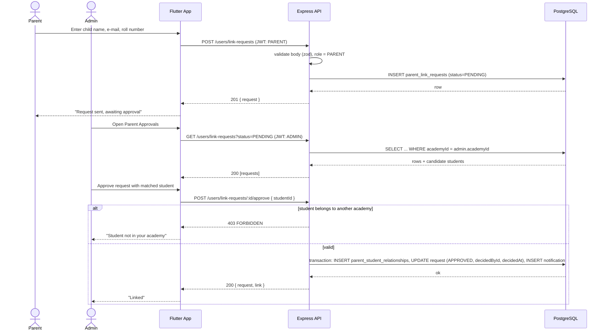

**Explanation.** The flow has two halves separated in time: the parent's submission and the admin's decision. The request is stored with the parent's free-text identifiers so that no student data is revealed before approval; only the admin, whose JWT carries the academy id, sees the candidate list. Approval runs in a single transaction that creates the link, closes the request with an audit trail and queues the parent's notification. The alternate path shows the tenant check that closes the Sprint 2 security hole.

#### US-23 — Admin uploads academy branding

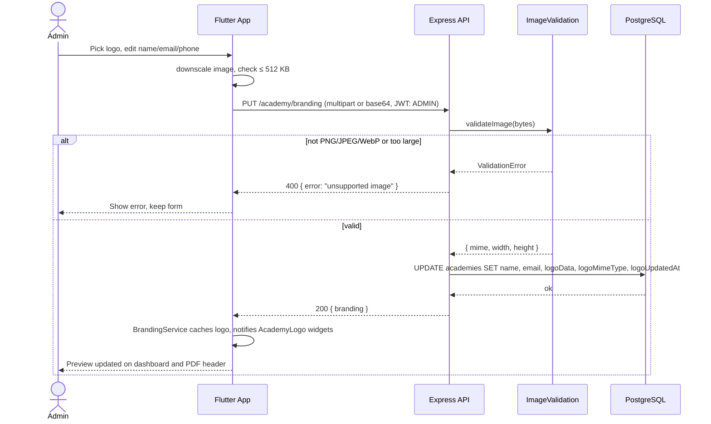

**Explanation.** Branding bytes are validated by magic number, not file extension, before they reach the database; the client pre-shrinks the image to keep the request under the API's body limit. The response feeds a single cached `BrandingService` so that every dashboard header and the challan PDF use the same logo without refetching. The public endpoint `GET /academy/branding/public` lets the login screen show the academy logo before authentication.

#### US-24 — Admin prints or downloads a challan

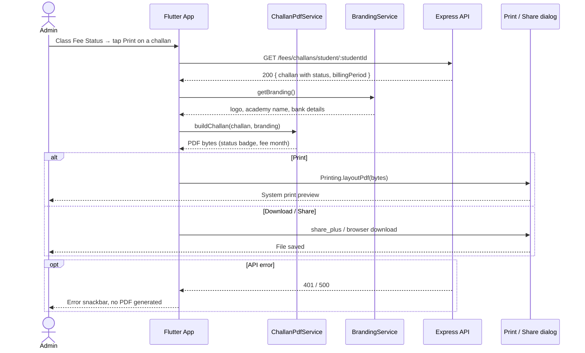

**Explanation.** The PDF is rendered on the client with the `pdf` package so that it works offline once data is loaded and produces identical output on Android and Web. Branding is injected from the cached service, and the status and billing month added in Sprint 3 come straight from the challan record so that the printed voucher never disagrees with the ledger.

#### US-25 — Admin views live ML analytics

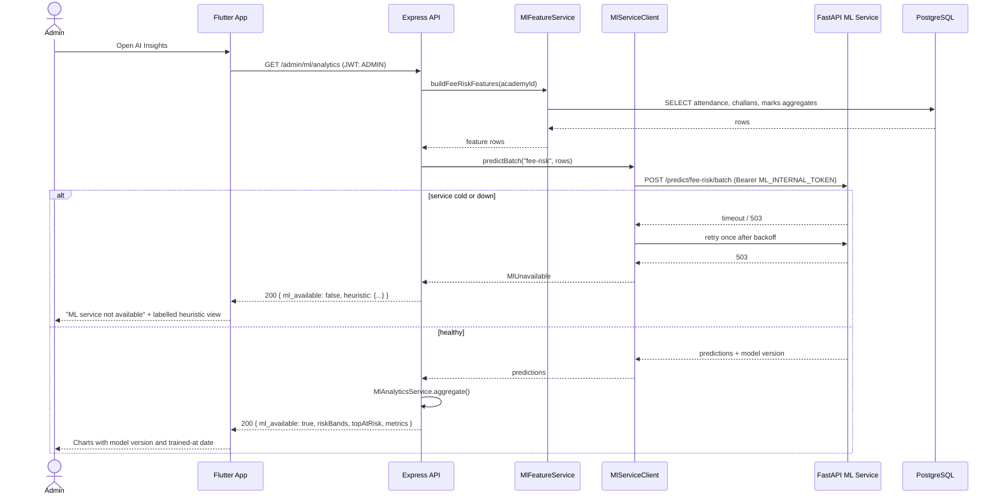

**Explanation.** The backend, not the client, owns the ML credentials, so the Flutter app never talks to the ML service directly. Features are computed from the academy's own records at request time; the ML service only sees numeric rows, never names. The error branch is a first-class path: the dashboard degrades to a clearly labelled heuristic so that no rule-based number is ever presented as a model prediction.

#### US-26 — Compact professional theme

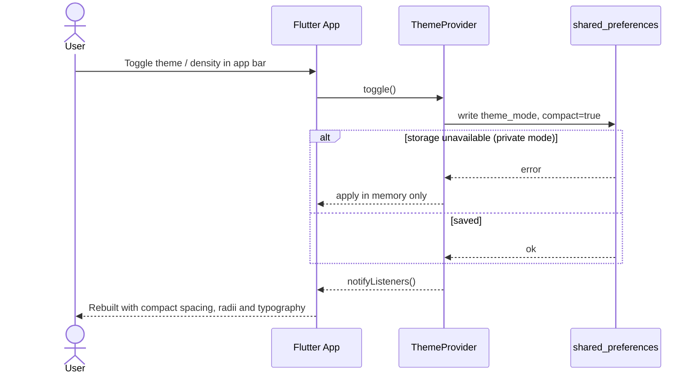

**Explanation.** The theme is a client-only concern persisted per device. The provider applies the change immediately and tolerates storage failure, which the responsive layout test suite exercises across 12 viewport and theme combinations.

#### US-27 — Exam documents and teacher "My Documents"

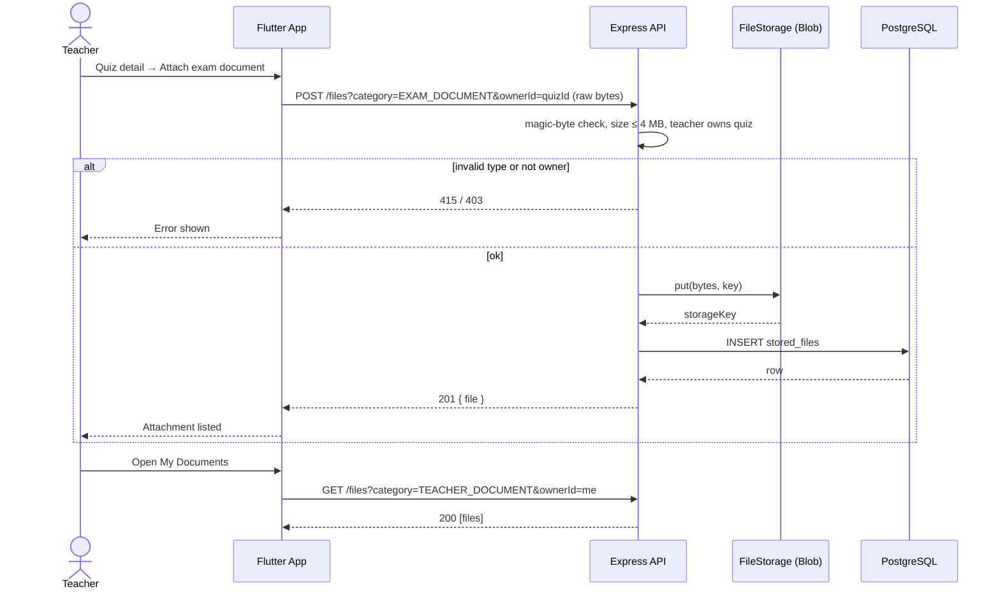

**Explanation.** Sprint 4 adds no new storage mechanism; it exposes the existing `EXAM_DOCUMENT` and `TEACHER_DOCUMENT` categories in the UI. Authorization is evaluated per category by `fileAccess`, so a student can never list a quiz's exam documents before the test date.

#### US-28 — Student takes a quiz in-app

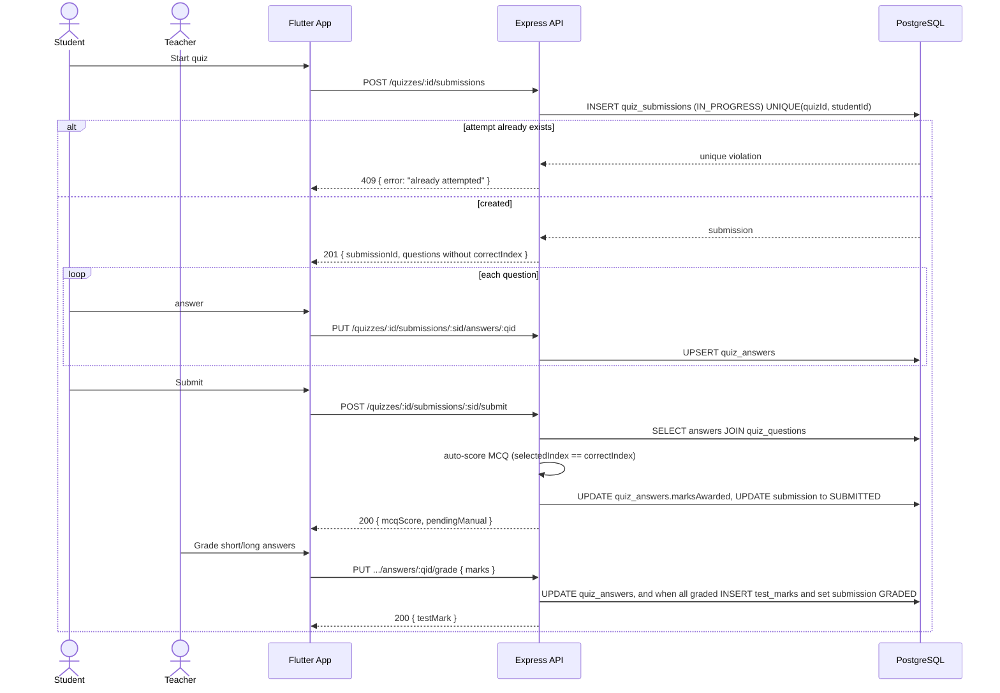

**Explanation.** The server never sends `correctIndex` to the student, scores MCQs deterministically on submit, and defers written answers to the teacher. Writing the final `test_marks` row reuses the existing result views for students and parents, so no new reporting code is required.

#### US-29 — Light theme completion

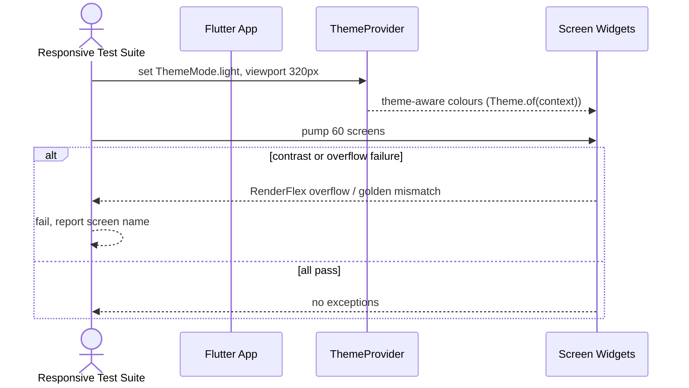

**Explanation.** The story replaces the remaining hard-coded dark colours with theme-aware tokens. Its sequence diagram is driven by the automated suite rather than a user because the acceptance criterion is a passing test matrix, not a manual click path.

#### US-30 — ML retraining monitor and rollback

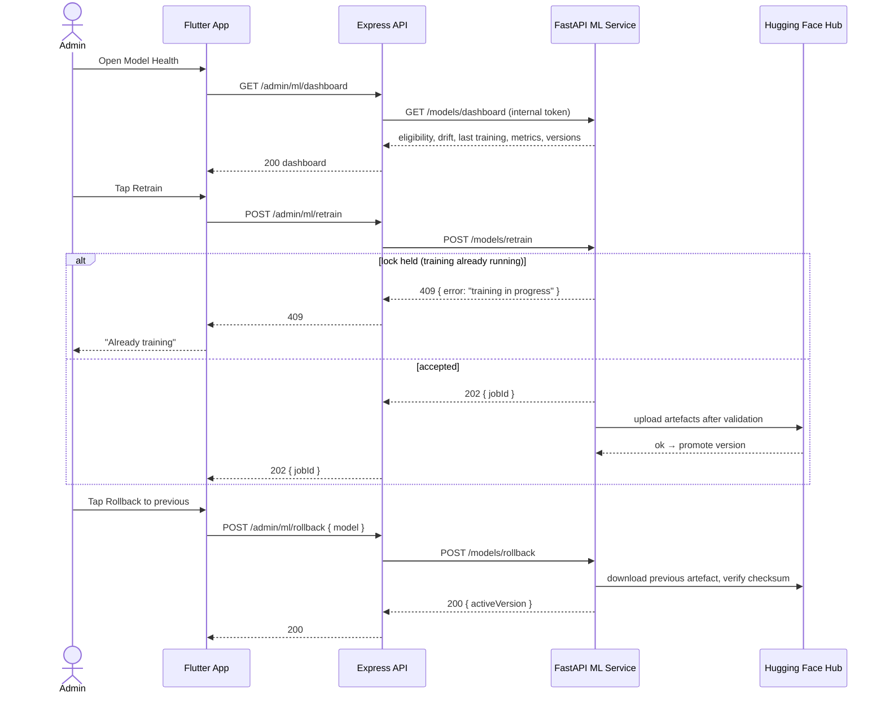

**Explanation.** Training runs asynchronously behind a shared lock so that two admins cannot start concurrent jobs; a model is promoted only after its artefact uploads successfully, and rollback restores the previous verified artefact. Sprint 4 adds the admin UI over endpoints that already exist in the service.

#### US-31 — Production-signed release

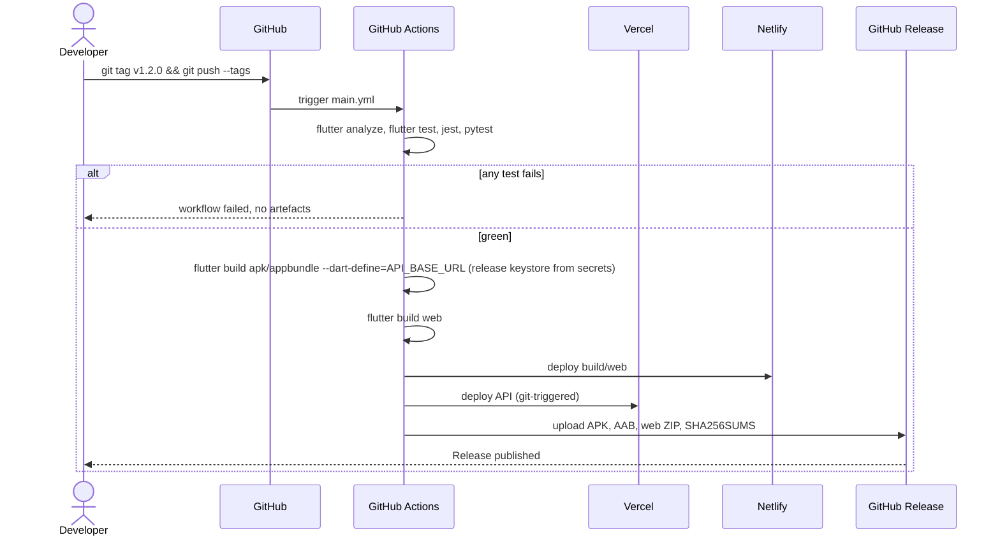

**Explanation.** The release is reproducible from a tag: tests gate the build, the keystore and API URL come from repository secrets, and every artefact is published with a checksum. The error path is simply a red workflow with no artefacts, which prevents the unsigned or mis-configured APK that occurred in Sprint 2.

### 3.6 Activity Diagram

Core business workflow: monthly fee collection.

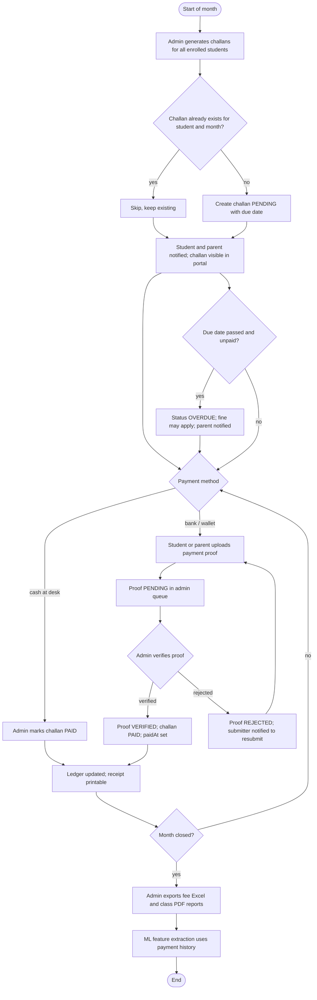

**Explanation.** The workflow starts with idempotent challan generation guarded by the unique constraint on student and billing period. Two payment paths converge on the same post-condition, but only an admin action can set a challan to PAID; an uploaded proof merely enters a review queue. Overdue handling is a loop back into the payment decision, and the month closes with reporting and with the ML service consuming the resulting payment history as training features.

### 3.7 State Diagram

Main stateful entity: `FeeChallan` with its `FeePaymentProof`.

```mermaid
stateDiagram-v2
  [*] --> PENDING : challan generated
  PENDING --> PAID : admin marks paid (cash)
  PENDING --> PROOF_SUBMITTED : student or parent uploads proof
  PENDING --> OVERDUE : due date passed
  OVERDUE --> PROOF_SUBMITTED : proof uploaded
  OVERDUE --> PAID : admin marks paid
  PROOF_SUBMITTED --> PAID : admin verifies proof
  PROOF_SUBMITTED --> PENDING : admin rejects proof (before due)
  PROOF_SUBMITTED --> OVERDUE : admin rejects proof (after due)
  PAID --> [*]
  note right of PROOF_SUBMITTED
    Composite state: challan status unchanged,
    proof.status = PENDING
  end note
```

Secondary stateful entity: `ParentLinkRequest` (Sprint 3) and `User.accountStatus`.

```mermaid
stateDiagram-v2
  state ParentLinkRequest {
    [*] --> PENDING
    PENDING --> APPROVED : admin approves, link created
    PENDING --> REJECTED : admin rejects with note
    APPROVED --> [*]
    REJECTED --> [*]
  }
  state UserAccount {
    [*] --> PENDING_ACCOUNT : registration
    PENDING_ACCOUNT --> ACTIVE : admin approves
    PENDING_ACCOUNT --> REJECTED_ACCOUNT : admin rejects
    ACTIVE --> LOCKED : 5 failed logins
    LOCKED --> ACTIVE : lock expires
    ACTIVE --> INACTIVE : admin deactivates
    INACTIVE --> ACTIVE : admin reactivates
  }
```

**Explanation.** A challan has three persisted statuses; the "proof submitted" condition is shown as a composite state because it is represented by a child `FeePaymentProof` row rather than a challan status, which is what guarantees that a proof upload never marks a fee paid. The link request and account machines are simpler one-way approvals; the account lock is a time-bounded state driven by the lockout counter added in Sprint 2.

### 3.8 System Architecture / Deployment Diagram

```mermaid
flowchart TB
  subgraph Clients
    AND[Android app<br/>Flutter, ML Kit OCR]
    WEB[Web app on Netlify<br/>Flutter Web, Tesseract.js OCR]
  end
  subgraph Vercel_API[Vercel – Node.js Fluid Compute]
    API[Express REST API /api/v2<br/>helmet, cors, zod, JWT, rate limit]
    PR[Prisma Client]
    MLC[MlServiceClient]
    FSD[FileStorage driver]
  end
  subgraph Vercel_ML[Vercel – Python serverless]
    ML[FastAPI ML service<br/>scikit-learn, pandas]
    MON[Monitor and scheduler]
  end
  subgraph Data
    PG[(Neon PostgreSQL<br/>25 tables, 3NF)]
    BLOB[(Vercel Blob<br/>private files)]
    HF[(Hugging Face Hub<br/>model artefacts)]
  end
  subgraph External
    NOM[Nominatim geocoding]
    OSM[OpenStreetMap tiles]
    GHA[GitHub Actions CI/CD]
  end
  AND -- HTTPS + JWT --> API
  WEB -- /api/* proxied by Netlify --> API
  API --> PR --> PG
  API --> FSD --> BLOB
  API -- internal token --> MLC --> ML
  ML -- read-only role --> PG
  ML --> HF
  MON --> ML
  API -- 1 req/s, cached --> NOM
  AND --> OSM
  WEB --> OSM
  GHA -- tag build --> AND
  GHA -- deploy --> WEB
  GHA -- deploy --> API
  GHA -- cron: POST /models/monitor --> ML
```

**Explanation.** The deployment has three tiers. Clients are a single Flutter code base built twice: the Android build performs OCR with ML Kit on the device, the Web build with Tesseract.js, so no image leaves the device for OCR. The Express API on Vercel is the only component with write access to PostgreSQL and the only holder of the ML internal token and Blob token; Netlify proxies `/api/*` so the web app is same-origin. The FastAPI ML service reads the database through a dedicated read-only role, stores model artefacts in a private Hugging Face repository, and is retrained by a scheduled GitHub Actions call gated on data eligibility. All secrets live in platform environment variables; none are in the repository after the Sprint 2 rotation.

## 4. Active Execution: Sprint 3 & 4

### 4.1 Planned Sprint Overview

**Sprint 3**

- **Sprint Goal:** Close the design gaps found by the Sprint 2 security review and user research: admin-approved parent linking, academy branding on every screen and PDF, printable challans, and the Admin AI Insights dashboard connected to the live ML service.
- **Duration:** 2026-11-10 → 2026-11-30 (3 weeks)
- **Estimated story points:** 29
- **Feature description:** Parents request a child link that an admin approves; admins upload a logo and contact details that appear on dashboards, the login screen and generated PDFs; the Class Fee Status screen prints or downloads any challan with its status and month; the AI Insights screen shows real fee-risk and performance predictions with model metadata, degrading to a labelled heuristic when the service is unavailable; the compact professional theme is applied across the web and mobile shells.

**Sprint 4**

- **Sprint Goal:** Complete the examination module with in-app quiz attempts, finish the light theme, give admins control over model retraining and rollback, expose exam and teacher documents, and ship a production-signed release with final documentation.
- **Duration:** 2026-12-01 → 2026-12-31 (4 weeks, includes final report)
- **Estimated story points:** 36
- **Feature description:** Students attempt quizzes inside the app with auto-scored MCQs and teacher-graded written answers; teachers attach exam documents and manage their own documents; every screen passes the responsive suite in light mode; the Model Health screen shows eligibility, drift and history and lets an admin retrain or roll back; the tag-driven pipeline produces a keystore-signed APK and AAB.

| Sprint | Focus Area / Objective | Feature Description | Duration | Estimated Story Points |
|---|---|---|---|---|
| Sprint 3 | Security closure, branding, fees UX, ML visibility | Parent-link approval (US-22), academy branding (US-23), admin challan PDF (US-24), ML analytics dashboard (US-25), compact theme (US-26) | 2026-11-10 → 2026-11-30 | 29 |
| Sprint 4 | Examination completion, model operations, release | Exam and teacher documents (US-27), in-app quiz (US-28), light theme (US-29), ML monitor and rollback UI (US-30), signed release and final docs (US-31) | 2026-12-01 → 2026-12-31 | 36 |

### 4.2 User Stories and Product Backlog

#### Product Backlog (Sprints 3 and 4; Sprints 1 and 2 shown for traceability)

| Backlog ID | Epic | Feature Description | User Story ID | User Story | Priority (MoSCoW) | Estimated Story Points | Status |
|---|---|---|---|---|---|---|---|
| PB-01 | EP-01 Authentication & Account Lifecycle | Academy registration and admin login | US-01 | As an academy owner, I want to register my academy and log in as its admin, so that I can set up my institution privately. | Must | 8 | Done (S1) |
| PB-02 | EP-01 | Account approval | US-02 | As an admin, I want to approve or reject teacher, student and parent sign-ups, so that only known people access academy data. | Must | 5 | Done (S1) |
| PB-03 | EP-03 Academic Structure | Classes, sections, enrolment | US-03 | As an admin, I want to create sections and subject classes and enrol students, so that teaching records are organised. | Must | 8 | Done (S1) |
| PB-04 | EP-04 Attendance | Daily attendance | US-04 | As a teacher, I want to mark attendance per class per day, so that attendance history is reliable. | Must | 5 | Done (S1) |
| PB-05 | EP-05 Fees & Challans | Monthly challans | US-05 | As an admin, I want to generate monthly fee challans, so that every student has a voucher with a due date. | Must | 8 | Done (S1) |
| PB-06 | EP-06 Examinations & Results | Quizzes and marks | US-06 | As a teacher, I want to create quizzes and record marks, so that results are stored per student. | Must | 8 | Done (S1) |
| PB-07 | EP-09 Reports, Exports & Notifications | Announcements | US-07 | As an admin or teacher, I want to post announcements that notify the right roles, so that everyone is informed. | Should | 5 | Done (S1) |
| PB-08 | EP-10 OCR & Document Intelligence | On-device OCR | US-08 | As a teacher, I want to scan a paper and get its text, so that I can digitise notes and answers. | Should | 5 | Done (S1) |
| PB-09 | EP-06 | Keyword paper grader | US-09 | As a teacher, I want suggested marks from a scanned answer against my keywords, so that grading is faster. | Could | 5 | Done (S1) |
| PB-10 | EP-12 Platform, CI/CD & Release | REST API and PostgreSQL | US-10 | As the team, we want a REST API over PostgreSQL with JWT and refresh tokens, so that data is isolated per academy and relationally consistent. | Must | 13 | Done (S2) |
| PB-11 | EP-03 | Timetable | US-11 | As an admin, I want a timetable with clash detection, so that no teacher or room is double-booked. | Should | 8 | Done (S2) |
| PB-12 | EP-05 | Payment proof verification | US-12 | As a student or parent, I want to upload a payment proof that an admin verifies, so that my payment is recorded without visiting the office. | Must | 8 | Done (S2) |
| PB-13 | EP-07 Course Materials, Files & Assignments | Private file storage and materials | US-13 | As a teacher, I want to share PDF, Word and image materials with my class, so that students have the notes. | Must | 13 | Done (S2) |
| PB-14 | EP-07 | Assignments | US-14 | As a teacher, I want to create assignments with deadlines and grade submissions, so that homework is tracked. | Should | 8 | Done (S2) |
| PB-15 | EP-02 Academy Setup & Branding | Location and bank details | US-15 | As an admin, I want to set the academy's map location and bank details, so that parents can find us and pay correctly. | Should | 5 | Done (S2) |
| PB-16 | EP-09 | Excel and PDF reports | US-16 | As an admin, I want Excel exports and class PDF reports, so that I can share records with management. | Should | 5 | Done (S2) |
| PB-17 | EP-06 | Exam-paper generator | US-17 | As a teacher, I want to generate a formatted exam paper and answer key with validated totals, so that paper setting takes minutes. | Should | 8 | Done (S2) |
| PB-18 | EP-08 Parent Portal & Child Linking | Parent portal | US-18 | As a parent, I want to see attendance, fees, results and assignments of every linked child, so that I can act early. | Must | 5 | Done (S2) |
| PB-19 | EP-11 ML Predictions | ML service | US-19 | As an admin, I want fee-risk and performance models trained on my academy's data, so that predictions are genuine and explainable. | Should | 13 | Done (S2) |
| PB-20 | EP-01 | Account security | US-20 | As a user, I want lockout after failed logins, a password policy and rate limiting, so that accounts resist abuse. | Must | 5 | Done (S2) |
| PB-21 | EP-12 | Release pipeline | US-21 | As the team, we want a tag-driven pipeline that builds Android and Web, so that releases are reproducible. | Must | 5 | Done (S2) |
| PB-22 | EP-08 | Admin-approved child linking | US-22 | As a parent, I want to request a link to my child that the academy admin approves, so that only verified parents see a child's data. | Must | 8 | In Progress (S3) |
| PB-23 | EP-02 | Academy branding | US-23 | As an admin, I want to upload our logo and contact details, so that every screen and PDF carries our identity. | Should | 5 | In Progress (S3) |
| PB-24 | EP-05 | Admin challan PDF | US-24 | As an admin, I want to print or download any student's challan showing its status and month, so that I can hand out or re-issue vouchers. | Should | 3 | Done (S3) |
| PB-25 | EP-11 | ML analytics dashboard | US-25 | As an admin, I want the AI Insights screen to show live model predictions with version and metrics, so that I can trust and act on them. | Must | 8 | In Progress (S3) |
| PB-26 | EP-12 | Compact professional theme | US-26 | As a user, I want a compact, consistent theme on web and mobile, so that dense data screens are readable. | Could | 5 | Done (S3) |
| PB-27 | EP-07 | Exam and teacher documents | US-27 | As a teacher, I want to attach exam documents to quizzes and manage my own documents, so that all teaching files are in one place. | Should | 5 | To Do (S4) |
| PB-28 | EP-06 | In-app quiz | US-28 | As a student, I want to attempt a quiz in the app with auto-scored MCQs, so that I get results quickly. | Must | 13 | To Do (S4) |
| PB-29 | EP-12 | Light theme completion | US-29 | As a user, I want the light theme to be fully readable on every screen, so that I can use the app in bright conditions. | Should | 5 | To Do (S4) |
| PB-30 | EP-11 | ML monitor and rollback UI | US-30 | As an admin, I want to see model health and retrain or roll back a model, so that predictions stay accurate. | Should | 8 | To Do (S4) |
| PB-31 | EP-12 | Signed release and final docs | US-31 | As the team, we want a keystore-signed release and final documentation, so that the product can be published. | Must | 5 | To Do (S4) |

#### Acceptance Criteria and Task Breakdown — Sprint 3

**US-22 Admin-approved child linking (PB-22, 8 points)**

- AC-22.1 Given a logged-in parent, when they submit child name, e-mail and roll number, then a request with status PENDING is created and no student data is returned.
- AC-22.2 Given a pending request, when an admin of the same academy approves it with a matched student, then a `parent_student_relationships` row exists and the request is APPROVED with decider and time.
- AC-22.3 Given a matched student from another academy, when the admin approves, then the API returns 403 and nothing changes.
- AC-22.4 Given an approved request, when the parent refreshes the portal, then the child appears within one refresh.
- AC-22.5 Given a rejected request, when the parent views My Requests, then the admin's note is visible.

| Task ID | Task | Assignee | Estimate (hrs) | Status |
|---|---|---|---|---|
| T-01 | Prisma model `ParentLinkRequest`, enum, migration | Muhammad Rakib Akram | 2 | Done |
| T-02 | Endpoints: create, list mine, list pending, approve, reject | Muhammad Rakib Akram | 5 | Done |
| T-03 | Candidate-student matching by e-mail or roll number | Muhammad Rakib Akram | 3 | Done |
| T-04 | Flutter parent request form and My Requests list | Muhammad Rakib Akram | 4 | Done |
| T-05 | Flutter admin Parent Approvals screen with child search | Muhammad Rakib Akram | 5 | Done |
| T-06 | Contract tests `parentLinkRequest.contract.test.js` | Muhammad Rakib Akram | 3 | Done |
| T-07 | Apply migration to production database and verify | Muhammad Rakib Akram | 1 | In Progress |

**US-23 Academy branding (PB-23, 5 points)**

- AC-23.1 Given an admin, when they upload a PNG, JPEG or WebP logo ≤ 512 KB, then it is stored and returned by `GET /academy/branding`.
- AC-23.2 Given any other file type or size, when uploaded, then the API returns 400 and the previous logo remains.
- AC-23.3 Given a stored logo, when any dashboard, the login screen or a challan PDF renders, then the logo and academy name appear.
- AC-23.4 Given a non-admin user, when they call `PUT /academy/branding`, then the API returns 403.

| Task ID | Task | Assignee | Estimate (hrs) | Status |
|---|---|---|---|---|
| T-08 | Migration: `email`, `logoData`, `logoMimeType`, `logoUpdatedAt` | Muhammad Rakib Akram | 1 | Done |
| T-09 | `imageValidation` utility with magic-byte and size checks + unit tests | Muhammad Rakib Akram | 3 | Done |
| T-10 | Branding controller and routes (public, get, put) | Muhammad Rakib Akram | 3 | Done |
| T-11 | Flutter `BrandingService`, `AcademyLogo`, Academy Branding screen | Muhammad Rakib Akram | 5 | Done |
| T-12 | Inject logo into web shell, dashboards, login, challan PDF | Muhammad Rakib Akram | 4 | In Progress |
| T-13 | Contract tests `branding.contract.test.js` | Muhammad Rakib Akram | 2 | Done |

**US-24 Admin challan PDF (PB-24, 3 points)**

- AC-24.1 Given the Class Fee Status screen, when the admin taps Print on a challan, then a PDF with the challan's status badge and fee month opens in the print dialog.
- AC-24.2 Given the same screen, when the admin taps Download, then the PDF is saved or shared with the challan number as file name.
- AC-24.3 Given an API failure, when the admin taps Print, then an error is shown and no PDF is produced.

| Task ID | Task | Assignee | Estimate (hrs) | Status |
|---|---|---|---|---|
| T-14 | Add status and billing month to `ChallanPdfService` layout | Muhammad Rakib Akram | 2 | Done |
| T-15 | `ChallanActions` widget (print, download, share) | Muhammad Rakib Akram | 2 | Done |
| T-16 | Wire actions into Class Fee Status screen | Muhammad Rakib Akram | 1 | Done |
| T-17 | Unit test for PDF content (status, month) | Muhammad Rakib Akram | 2 | To Do |

**US-25 ML analytics dashboard (PB-25, 8 points)**

- AC-25.1 Given `ML_SERVICE_URL` and `ML_INTERNAL_TOKEN` configured, when the admin opens AI Insights, then risk bands, top at-risk students and model metrics are shown with model version and trained-at date.
- AC-25.2 Given the ML service is down, when the admin opens AI Insights, then the screen shows "ML service not available" and a heuristic summary explicitly labelled "not an ML prediction".
- AC-25.3 Given fewer than the minimum training samples, when the admin opens AI Insights, then the screen explains the threshold and offers "Train when eligible".
- AC-25.4 Given the analytics endpoint, when called by a non-admin, then it returns 403.

| Task ID | Task | Assignee | Estimate (hrs) | Status |
|---|---|---|---|---|
| T-18 | `MlAnalyticsService` aggregation (risk bands, top-N, metrics) + unit tests | Muhammad Rakib Akram | 4 | Done |
| T-19 | `GET /admin/ml/analytics` controller and route | Muhammad Rakib Akram | 2 | Done |
| T-20 | Contract test `mlAnalytics.contract.test.js` with mocked ML client | Muhammad Rakib Akram | 3 | Done |
| T-21 | Configure `ML_SERVICE_URL`, `ML_INTERNAL_TOKEN` on backend and ML projects; redeploy | Muhammad Rakib Akram | 1 | To Do |
| T-22 | Flutter `AdminAiProvider.loadAnalytics` and charts (fl_chart) | Muhammad Rakib Akram | 5 | In Progress |
| T-23 | Verify end-to-end on production with demo academy | Muhammad Rakib Akram | 2 | To Do |

**US-26 Compact professional theme (PB-26, 5 points)**

- AC-26.1 Given any portal on web, when rendered at 1280 px, then cards, tables and forms use the compact spacing and radii tokens.
- AC-26.2 Given the responsive suite, when run, then all 60 screens pass at 320 px, 360 px, 768 px and 1280 px in both themes.

| Task ID | Task | Assignee | Estimate (hrs) | Status |
|---|---|---|---|---|
| T-24 | Compact theme tokens and `CompactDialog` | Muhammad Rakib Akram | 3 | Done |
| T-25 | Web shell density, nav items, stat cards | Muhammad Rakib Akram | 4 | Done |
| T-26 | Timetable subject label, student quote block, labelled fields | Muhammad Rakib Akram | 3 | Done |
| T-27 | Run responsive suite, fix regressions, deploy web | Muhammad Rakib Akram | 2 | Done |

#### Acceptance Criteria and Task Breakdown — Sprint 4

**US-27 Exam and teacher documents (PB-27, 5 points)**

- AC-27.1 Given a quiz the teacher owns, when they attach a PDF or image, then it is stored with category EXAM_DOCUMENT and listed on the quiz.
- AC-27.2 Given a student, when they request a quiz's exam documents before `testDate`, then the API returns 403.
- AC-27.3 Given a teacher, when they open My Documents, then only files with category TEACHER_DOCUMENT and their own id are listed.

| Task ID | Task | Assignee | Estimate (hrs) | Status |
|---|---|---|---|---|
| T-28 | `fileAccess` rule for EXAM_DOCUMENT by test date | Muhammad Rakib Akram | 2 | To Do |
| T-29 | Quiz detail attachments section (teacher edit, student read) | Muhammad Rakib Akram | 4 | To Do |
| T-30 | Teacher My Documents screen | Muhammad Rakib Akram | 3 | To Do |
| T-31 | Contract and widget tests | Muhammad Rakib Akram | 3 | To Do |

**US-28 In-app quiz (PB-28, 13 points)**

- AC-28.1 Given an enrolled student and a published quiz, when they start it, then a submission with status IN_PROGRESS is created and questions are returned without `correctIndex`.
- AC-28.2 Given answers saved per question, when the student submits, then MCQs are scored automatically and the status becomes SUBMITTED.
- AC-28.3 Given a second start attempt, when resubmission is not allowed, then the API returns 409.
- AC-28.4 Given all written answers graded by the teacher, when the last grade is saved, then a `test_marks` row is created and visible to student and parent.
- AC-28.5 Given a lost connection, when it returns, then unsaved answers are sent and no answer is lost.

| Task ID | Task | Assignee | Estimate (hrs) | Status |
|---|---|---|---|---|
| T-32 | Migration: `quiz_submissions`, `quiz_answers` | Muhammad Rakib Akram | 2 | To Do |
| T-33 | Endpoints: start, save answer, submit, grade, list | Muhammad Rakib Akram | 8 | To Do |
| T-34 | Auto-scoring service + unit tests | Muhammad Rakib Akram | 3 | To Do |
| T-35 | Flutter TakeQuizScreen with local answer queue | Muhammad Rakib Akram | 8 | To Do |
| T-36 | Teacher grading screen for written answers | Muhammad Rakib Akram | 5 | To Do |
| T-37 | Contract tests for the attempt lifecycle | Muhammad Rakib Akram | 4 | To Do |

**US-29 Light theme completion (PB-29, 5 points)**

- AC-29.1 Given light mode, when the responsive suite runs, then no screen uses a hard-coded dark colour token and all 60 screens pass.
- AC-29.2 Given light mode, when text is rendered on cards, then contrast is at least 4.5:1 for body text.

| Task ID | Task | Assignee | Estimate (hrs) | Status |
|---|---|---|---|---|
| T-38 | Replace remaining `AppColors.textPrimary` uses with theme tokens | Muhammad Rakib Akram | 5 | To Do |
| T-39 | Add light-mode golden checks to the responsive suite | Muhammad Rakib Akram | 3 | To Do |

**US-30 ML monitor and rollback UI (PB-30, 8 points)**

- AC-30.1 Given an admin, when they open Model Health, then eligibility, drift status, last training time, metrics and version history are shown.
- AC-30.2 Given a training already running, when the admin taps Retrain, then a "training in progress" message is shown and no second job starts.
- AC-30.3 Given at least one previous version, when the admin taps Rollback, then the previous artefact becomes active and the dashboard reflects it.

| Task ID | Task | Assignee | Estimate (hrs) | Status |
|---|---|---|---|---|
| T-40 | Backend passthrough for `/dashboard`, `/history`, `/rollback` with role guard | Muhammad Rakib Akram | 3 | To Do |
| T-41 | Flutter Model Health screen | Muhammad Rakib Akram | 6 | To Do |
| T-42 | Contract tests with mocked ML service | Muhammad Rakib Akram | 3 | To Do |

**US-31 Signed release and final docs (PB-31, 5 points)**

- AC-31.1 Given a release keystore in repository secrets, when a tag is pushed, then the pipeline produces a signed APK and AAB whose signature verifies with `apksigner`.
- AC-31.2 Given the release build, when installed on a device, then login succeeds against the production API (API URL baked at build time).
- AC-31.3 Given the final report, when submitted, then it matches the implemented system (schema, endpoints, tests).

| Task ID | Task | Assignee | Estimate (hrs) | Status |
|---|---|---|---|---|
| T-43 | Generate release keystore, store as secrets, update Gradle signing | Muhammad Rakib Akram | 3 | To Do |
| T-44 | Pipeline: `--dart-define=API_BASE_URL`, signature verification step | Muhammad Rakib Akram | 2 | To Do |
| T-45 | Smoke test on physical device; publish release | Muhammad Rakib Akram | 2 | To Do |
| T-46 | Final report, user guides refresh, demo video | Muhammad Rakib Akram | 10 | To Do |

#### Definition of Ready

- The story is written in "As a…, I want…, so that…" form with a named actor from Section 1.1.
- At least three acceptance criteria in Given/When/Then form are agreed with the Product Owner.
- Affected tables, endpoints and screens are identified and linked in the traceability matrix.
- Story points are estimated (Fibonacci) and the story fits within the sprint capacity.
- External dependencies (secrets, hosting configuration, migrations) are listed as tasks.

#### Definition of Done

- Code merged to `main` through a pull request with CI green (`flutter analyze`, `flutter test`, Jest, pytest).
- Every acceptance criterion is covered by at least one automated test (contract, widget or unit).
- Database migrations are additive, committed under `prisma/migrations`, and applied to production.
- No endpoint returns data outside the caller's academy or role (checked by contract tests).
- Documentation updated: API reference, data dictionary, user guide for the affected role, CHANGELOG entry.
- Feature verified on the live web app and on an Android build.

### 4.3 Kanban Board / Task Tracking

- **Tool:** GitHub Projects board linked to the repository issues and pull requests [[VERIFY: tool actually used; replace with Trello/Jira if different]].
- **Columns:** To Do → In Progress → Testing → Done.
- **WIP limits:** In Progress ≤ 3 tasks, Testing ≤ 3 tasks (one developer; limits prevent half-finished stories at sprint end).
- **Policies:** a task moves to Testing when its PR is open and CI is green; it moves to Done when merged and the acceptance criterion it serves is checked off on the story issue.

[[TO FILL: insert screenshot of the real board]]

**Board snapshot — Sprint 3, 2026-11-11**

| To Do | In Progress | Testing | Done |
|---|---|---|---|
| T-17 Challan PDF unit test | T-07 Apply link-request migration to production | — | T-01 ParentLinkRequest model and migration |
| T-21 Configure ML env and redeploy | T-12 Logo on shells, login, PDF | — | T-02 Link-request endpoints |
| T-23 Verify ML end-to-end | T-22 AdminAiProvider analytics and charts | — | T-03 Candidate matching |
| — | — | — | T-04 Parent request form |
| — | — | — | T-05 Admin approvals screen |
| — | — | — | T-06 Link-request contract tests |
| — | — | — | T-08 Branding migration |
| — | — | — | T-09 Image validation + tests |
| — | — | — | T-10 Branding controller and routes |
| — | — | — | T-11 BrandingService, AcademyLogo, screen |
| — | — | — | T-13 Branding contract tests |
| — | — | — | T-14 Challan PDF status and month |
| — | — | — | T-15 ChallanActions widget |
| — | — | — | T-16 Fee status wiring |
| — | — | — | T-18 MlAnalyticsService + tests |
| — | — | — | T-19 Analytics endpoint |
| — | — | — | T-20 Analytics contract test |
| — | — | — | T-24 to T-27 Compact theme |

**Sprint 3 burndown (29 points, 15 working days)**

| Day | Date | Ideal Remaining | Actual Remaining |
|---|---|---|---|
| 0 | 2026-11-10 | 29 | 29 |
| 1 | 2026-11-11 | 27 | 21 |
| 3 | 2026-11-13 | 23 | [[TO FILL]] |
| 5 | 2026-11-17 | 19 | [[TO FILL]] |
| 7 | 2026-11-19 | 15 | [[TO FILL]] |
| 9 | 2026-11-21 | 12 | [[TO FILL]] |
| 11 | 2026-11-25 | 8 | [[TO FILL]] |
| 13 | 2026-11-27 | 4 | [[TO FILL]] |
| 15 | 2026-11-30 | 0 | [[TO FILL]] |

The Day-1 actual (21 remaining) reflects US-24 and US-26 (8 points) merged on 2026-11-10.

## 5. Unit and Integration Testing

### 5.1 Overview

**Strategy.** Testing follows the test pyramid with three automated layers, all run in CI on every pull request: (1) unit tests for pure logic (password policy, token hashing, validation, image checks, ML feature building, exam-paper generation, PDF content); (2) contract tests that run the Express API against an isolated PostgreSQL database created for the test run (Jest + Supertest), asserting status codes, response shapes and, critically, tenant and role isolation; (3) widget and responsive tests that pump real Flutter screens with recorded API responses across 12 viewport and theme configurations. The ML service has its own pytest suite with the Hugging Face hub mocked. Production verification is manual against the demo academy.

**Unit level summary**

- Backend units tested with Jest: authentication helpers, password policy, refresh-token hashing, role middleware, rate limiter, zod validation, image validation (Sprint 3), ML client retry logic, ML feature service, ML analytics aggregation (Sprint 3), AI question service.
- Flutter units tested with `flutter_test`: REST model parsing, core logic (grades, percentages), exam-paper generator and PDF, class-report PDF, responsive widgets.
- ML service units tested with pytest: training pipeline, artefact store, monitoring and drift, scheduler, feature extractor.
- Recorded results (README and `FINAL_TEST_REPORT.md`, 2026-11-09): backend 133/133, Flutter 123/123, ML 53 passing per CHANGELOG v1.1.0 (55 test functions now defined). Sprint 3 additions: [[TO FILL: pass counts after running `npm test` and `flutter test` on the Sprint 3 branch]].

**Integration sequence**

| Order | Sprint | Modules Integrated | Purpose |
|---|---|---|---|
| 1 | S1 | Auth ↔ Role dashboards | Role routing after login |
| 2 | S1 | Classes ↔ Attendance ↔ Fees | Core records on shared class model |
| 3 | S2 | Flutter `ApiClient` ↔ Express API ↔ PostgreSQL | REST migration, token refresh |
| 4 | S2 | Files ↔ Materials ↔ Assignments ↔ Blob | Upload, access rules, viewer |
| 5 | S2 | Parent portal ↔ Users ↔ Attendance/Fees/Marks | Child scoping |
| 6 | S2 | Reports ↔ Attendance/Fees/Marks ↔ exceljs/pdf | Exports |
| 7 | S2 | Backend `MlServiceClient` ↔ FastAPI ↔ Hugging Face | Training and prediction |
| 8 | S3 | Link requests ↔ Users ↔ Notifications | Approval flow |
| 9 | S3 | Branding ↔ Image validation ↔ Flutter shells ↔ PDF | Logo everywhere |
| 10 | S3 | ML analytics ↔ Feature service ↔ ML client ↔ Admin UI | Live dashboard |
| 11 | S4 | Quiz submissions ↔ Questions ↔ Test marks ↔ Parent views | In-app quiz |
| 12 | S4 | ML dashboard/rollback ↔ Admin UI; signed release ↔ production API | Model operations, release |

**Integration results**

| Sprint | Passes | Failures Found | Root Cause | Fix | Retest Sprint |
|---|---|---|---|---|---|
| S2 | Core, files, reports, academy settings suites green (114 → 133 tests) | Parent could link to any student; class list exposed classmates | Missing role check on `/users/link-child` and unscoped roster query | Admin-only linking; roster scoped by role; new contract tests | S2 (closed), replaced by approval flow in S3 |
| S2 | Flutter widget suites green | Parent pull-to-refresh made no API calls | Provider cached children without re-fetch | `ParentProvider.refresh()` with regression test | S2 |
| S2 | ML API tests green | Training ran inside HTTP request and timed out | Synchronous training | Background job with `READY_TO_TRAIN` status and lock | S2 |
| S2 | — | Production login returned 500 (`column academies.latitude does not exist`) | Two migrations not applied to production | `prisma migrate deploy`; migration step added to release checklist | S3 (verify) |
| S3 | [[TO FILL: results of `parentLinkRequest`, `branding`, `mlAnalytics` contract suites]] | Parent Approvals screen returned 500 on production | `parent_link_requests` table missing in production | Migration committed; apply to production (T-07) | S3 |
| S3 | [[TO FILL]] | AI Insights shows "ML service not available" | `ML_SERVICE_URL` / `ML_INTERNAL_TOKEN` not configured on backend | Configure env and redeploy (T-21) | S3 |

#### Unit Test Table

| Test ID | Module / Unit | Framework | Test Case Description | Input | Expected Output | Pass/Fail | Notes |
|---|---|---|---|---|---|---|---|
| UT-01 | Auth (`auth.test.js`) | Jest | Login issues access and refresh tokens; wrong password rejected | Valid and invalid credentials | 200 with token pair; 401 | Pass (2026-11-09) | US-01, US-10 |
| UT-02 | Password policy | Jest | Rejects short, common and no-digit passwords | "abc", "password", "Taleem@2026" | false, false, true | Pass (2026-11-09) | US-20 |
| UT-03 | Refresh-token hashing | Jest | Stored token is SHA-256 of raw; rotation revokes old | Raw token | Hash stored, old revoked | Pass (2026-11-09) | US-10 |
| UT-04 | Role middleware | Jest | Denies roles not in list | STUDENT on ADMIN route | 403 | Pass (2026-11-09) | US-20 |
| UT-05 | Rate limiter | Jest | 6th login attempt in window blocked | 6 requests | 429 on the 6th | Pass (2026-11-09) | US-20 |
| UT-06 | Validation (zod schemas) | Jest | Malformed bodies return 400 not 500 | Oversized/invalid JSON | 400 / 413 | Pass (2026-11-09) | US-10 |
| UT-07 | Image validation (`imageValidation.test.js`) | Jest | Accepts PNG/JPEG/WebP by magic bytes, rejects others and > 512 KB | PNG bytes, PDF bytes, 600 KB PNG | ok, error, error | [[TO FILL]] | US-23, Sprint 3 |
| UT-08 | `MlServiceClient` | Jest | Retries once on 503/timeout then throws MlUnavailable | Mock 503 then 200 | Success after retry | Pass (2026-11-09) | US-19, US-25 |
| UT-09 | `MlFeatureService` | Jest | Builds feature rows from attendance, marks, challans | Seeded rows | Expected numeric columns | Pass (2026-11-09) | US-19 |
| UT-10 | `MlAnalyticsService` (`mlAnalyticsService.test.js`) | Jest | Aggregates predictions into risk bands and top-N | 20 predictions | Bands sum to 20; top 5 sorted | [[TO FILL]] | US-25, Sprint 3 |
| UT-11 | AI question service | Jest | Falls back to offline bank when no API key | No `AI_API_KEY` | Offline questions returned | Pass (2026-11-09) | US-17 |
| UT-12 | `ExamPaperGenerator` (`exam_paper_generator_test.dart`) | flutter_test | Computed total equals configured marks; answer key excludes from paper | Config with 10 MCQ × 1 + 5 short × 2 | Total 20; key separate | Pass (2026-11-09) | US-17 |
| UT-13 | Core logic (`core_logic_test.dart`) | flutter_test | Percentage and grade letter | 45/50 | 90 %, A+ | Pass (2026-11-09) | US-06 |
| UT-14 | REST models (`rest_models_test.dart`, `api_parsing_test.dart`) | flutter_test | JSON → model parsing, null safety | API fixtures | Models populated | Pass (2026-11-09) | US-10 |
| UT-15 | Class report PDF (`class_report_pdf_test.dart`) | flutter_test | PDF contains class label and counts | Report model | Bytes contain strings | Pass (2026-11-09) | US-16 |
| UT-16 | Responsive widgets (`responsive_widgets_test.dart`) | flutter_test | Action tile at 320 px shows full title | Width 320 | No overflow | Pass (2026-11-09) | US-26 |
| UT-17 | ML training (`test_training.py`) | pytest | Trains fee-risk model with class-imbalance guard | Synthetic frame | Model and metrics | Pass (per CHANGELOG 1.1.0) | US-19 |
| UT-18 | ML monitoring and scheduler (`test_monitoring.py`, `test_scheduler.py`) | pytest | Eligibility thresholds, drift detection, lock prevents duplicate job | Thresholds | Correct eligibility, single job | Pass (per CHANGELOG 1.1.0) | US-30 |
| UT-19 | Artifact store (`test_artifact_store.py`) | pytest | Upload with retry, integrity check, promote-after-upload | Mocked hub | Version promoted only on success | Pass (per CHANGELOG 1.1.0) | US-30 |
| UT-20 | Challan PDF (planned) | flutter_test | PDF shows status badge and billing month | PAID challan, 2026-11 | Strings present | Planned | US-24, T-17 |
| UT-21 | Quiz auto-scoring (planned) | Jest | MCQ scored by index; written answers left null | 3 MCQ + 1 short | 2/3 correct scored, short pending | Planned | US-28, T-34 |

#### Integration Test Table

| Test ID | Modules Integrated | Sprint | Test Scenario | Expected Result | Actual Result | Status |
|---|---|---|---|---|---|---|
| IT-01 | Auth → Users → Classes → Attendance → Fees → Quizzes (`contract.test.js`) | S2 | Admin registers academy, creates users, classes, marks attendance, generates challans, records marks | All 2xx; records scoped to academy | 2xx; scoped | Pass (2026-11-09) |
| IT-02 | Parent portal ↔ Users ↔ Records (`parentPortal.contract.test.js`) | S2 | Parent sees only linked children; cannot self-link | 200 for linked, 403 for self-link | As expected | Pass (2026-11-09) |
| IT-03 | Files ↔ Materials ↔ Assignments ↔ Storage (`files.contract.test.js`) | S2 | Upload ≤ 4 MB, type check, per-role download, delete cleanup | 201/200; 415 wrong type; 404 unauthorised id | As expected | Pass (2026-11-09) |
| IT-04 | Reports ↔ Records ↔ exceljs (`reports.contract.test.js`) | S2 | Attendance, results and fee workbooks contain expected rows | Workbook cells match | Match | Pass (2026-11-09) |
| IT-05 | Academy settings ↔ Geo ↔ Bank (`academySettings.contract.test.js`) | S2 | Set location via search and reverse geocode; IBAN validation | 200; 400 on bad IBAN | As expected | Pass (2026-11-09) |
| IT-06 | Student access ↔ Classes ↔ Materials (`studentAccess.test.js`) | S2 | Student cannot read other class materials or rosters | 403 / filtered list | As expected | Pass (2026-11-09) |
| IT-07 | Link requests ↔ Users ↔ Notifications (`parentLinkRequest.contract.test.js`) | S3 | Parent creates request; admin approves; cross-academy student rejected | 201; 200 with link; 403 | [[TO FILL]] | [[TO FILL]] |
| IT-08 | Branding ↔ Image validation ↔ Academy (`branding.contract.test.js`) | S3 | Admin uploads valid/invalid logo; public endpoint returns logo without auth | 200; 400; 200 public | [[TO FILL]] | [[TO FILL]] |
| IT-09 | ML analytics ↔ Feature service ↔ ML client (`mlAnalytics.contract.test.js`) | S3 | Analytics with healthy and failing mocked ML service | Predictions; `ml_available:false` | [[TO FILL]] | [[TO FILL]] |
| IT-10 | ML API ↔ Training ↔ Artefact store (`test_api.py`) | S2 | Health public; all other endpoints need token; train returns 202 | 200; 401; 202 | As expected | Pass (per CHANGELOG 1.1.0) |
| IT-11 | 60 Flutter screens ↔ recorded API (`responsive_layout_test.dart`) | S2 | Pump every screen at 12 viewport/theme configs | No overflow or exceptions | None | Pass (2026-11-09) |
| IT-12 | Parent portal and files UI ↔ fake API (`parent_portal_test.dart`, `files_ui_test.dart`) | S2 | Refresh re-fetches; error card on failure; viewer opens PDF | As specified | As specified | Pass (2026-11-09) |
| IT-13 | Quiz submissions ↔ Questions ↔ Test marks (planned) | S4 | Start, answer, submit, grade; duplicate attempt | 201/200; 409 | — | Planned |
| IT-14 | ML dashboard/rollback ↔ Admin UI (planned) | S4 | Retrain while locked; rollback restores version | 409; 200 | — | Planned |
| IT-15 | Signed APK ↔ Production API (planned) | S4 | Install signed build, log in as demo teacher | 200 login, dashboard loads | — | Planned |

### 5.2 Version Control

- **Tool:** Git with GitHub (repository `RakibAkram5/Final_Year_Project`, default branch `main`).
- **Branching strategy:** trunk-based with short-lived branches. `main` is always releasable; feature and fix branches (`feature/…`, `fix/…`) are merged through pull requests; `release/x.y.z` branches stabilise a release; tags `vX.Y.Z` trigger the release pipeline.
- **Commit convention:** Conventional Commits with the story id in the scope or body, e.g. `feat(fees): admin print/download challan (US-24)`, `fix(parent): approval 500 on missing table (US-22)`, `chore(release): bump version to 1.1.2+6`.
- **Workflow:** `US-xx → feature/US-xx-name → Commit → PR → Review/Test (CI) → Merge to main → Done`.
- **History to date:** 125 commits, 4 pull requests (#1 REST migration and CI repair, merged 2026-10-31; #2 release 1.0.1, merged 2026-11-09; #3 release 1.1.1 into main, merged 2026-11-10; #4 Sprint 3 UI and fees, open), 20 tags up to v1.1.0 plus releases v1.1.1 and v1.1.2.

#### Traceability — US-22 Admin-approved child linking

| Activity | What Students Should Do | Example |
|---|---|---|
| User Story ID | — | US-22 |
| Backlog ID | — | PB-22 |
| Assignee | — | Muhammad Rakib Akram |
| Priority | — | Must |
| Repository | Work in the project repository | `RakibAkram5/Final_Year_Project` |
| Branch | Create a branch named after the story | `fix/parent-link-child-search` (US-22) |
| Commit | Commit with Conventional Commit messages referencing the story | `feat(parent): link requests with admin approval (US-22)` — `4198c99` |
| Pull Request | Open a PR to `main` describing acceptance criteria met | PR #3 / PR #4 |
| Review & Test | CI runs analyze, Flutter, Jest, pytest; supervisor or peer reviews | `parentLinkRequest.contract.test.js` green in CI [[TO FILL: run id]] |
| Merge | Squash-merge after approval | Merged 2026-11-10 (#3); migration apply pending (T-07) |
| Contribution | Record who did what | 100 % Muhammad Rakib Akram [[TO FILL if group]] |

#### Traceability — US-23 Academy branding

| Activity | What Students Should Do | Example |
|---|---|---|
| User Story ID | — | US-23 |
| Backlog ID | — | PB-23 |
| Assignee | — | Muhammad Rakib Akram |
| Priority | — | Should |
| Repository | — | `RakibAkram5/Final_Year_Project` |
| Branch | — | `feature/US-23-academy-branding` [[VERIFY: currently on `fix/parent-link-child-search`]] |
| Commit | — | `feat(academy): branding logo, email and public endpoint (US-23)` |
| Pull Request | — | [[TO FILL: PR number]] |
| Review & Test | — | `branding.contract.test.js`, `imageValidation.test.js` |
| Merge | — | [[TO FILL: date]] |
| Contribution | — | Muhammad Rakib Akram |

#### Traceability — US-24 Admin challan PDF

| Activity | What Students Should Do | Example |
|---|---|---|
| User Story ID | — | US-24 |
| Backlog ID | — | PB-24 |
| Assignee | — | Muhammad Rakib Akram |
| Priority | — | Should |
| Repository | — | `RakibAkram5/Final_Year_Project` |
| Branch | — | `fix/parent-link-child-search` |
| Commit | — | `feat(fees): admin print/download challan + status & month on PDF (P1)` — `4c98233` |
| Pull Request | — | PR #4 (open, 2026-11-10) |
| Review & Test | — | Manual print/download verified on web; UT-20 planned |
| Merge | — | Pending review |
| Contribution | — | Muhammad Rakib Akram |

#### Traceability — US-25 ML analytics dashboard

| Activity | What Students Should Do | Example |
|---|---|---|
| User Story ID | — | US-25 |
| Backlog ID | — | PB-25 |
| Assignee | — | Muhammad Rakib Akram |
| Priority | — | Must |
| Repository | — | `RakibAkram5/Final_Year_Project` |
| Branch | — | `feature/US-25-ml-analytics` [[VERIFY]] |
| Commit | — | `feat(ml): analytics aggregation endpoint and admin charts (US-25)` |
| Pull Request | — | [[TO FILL]] |
| Review & Test | — | `mlAnalyticsService.test.js`, `mlAnalytics.contract.test.js` |
| Merge | — | [[TO FILL]] |
| Contribution | — | Muhammad Rakib Akram |

#### Traceability — US-26 Compact professional theme

| Activity | What Students Should Do | Example |
|---|---|---|
| User Story ID | — | US-26 |
| Backlog ID | — | PB-26 |
| Assignee | — | Muhammad Rakib Akram |
| Priority | — | Could |
| Repository | — | `RakibAkram5/Final_Year_Project` |
| Branch | — | `fix/parent-link-child-search` |
| Commit | — | `fix: global TaleemPlus UI sizing and professional dashboard redesign` — `1b7ff15`; `967cd27` |
| Pull Request | — | PR #4 |
| Review & Test | — | Responsive suite green; live bundle verified |
| Merge | — | Pending review |
| Contribution | — | Muhammad Rakib Akram |

#### Traceability — US-27 to US-31 (Sprint 4, planned)

| Activity | What Students Should Do | US-27 | US-28 | US-29 | US-30 | US-31 |
|---|---|---|---|---|---|---|
| Backlog ID | — | PB-27 | PB-28 | PB-29 | PB-30 | PB-31 |
| Assignee | — | Muhammad Rakib Akram | Muhammad Rakib Akram | Muhammad Rakib Akram | Muhammad Rakib Akram | Muhammad Rakib Akram |
| Priority | — | Should | Must | Should | Should | Must |
| Branch | Create per story | `feature/US-27-exam-docs` | `feature/US-28-inapp-quiz` | `feature/US-29-light-theme` | `feature/US-30-ml-monitor` | `release/1.2.0` |
| Commit | Conventional Commits with story id | `feat(files): exam documents on quiz (US-27)` | `feat(quiz): in-app submissions and auto-score (US-28)` | `fix(theme): light-mode tokens on all screens (US-29)` | `feat(ml): model health and rollback UI (US-30)` | `chore(release): signed 1.2.0 (US-31)` |
| Pull Request | One PR per story | [[TO FILL]] | [[TO FILL]] | [[TO FILL]] | [[TO FILL]] | [[TO FILL]] |
| Review & Test | CI green plus tests listed in 5.1 | IT-13 widget tests | UT-21, IT-13 | Responsive suite light mode | IT-14 | IT-15, apksigner verify |
| Merge | Squash-merge to main | [[TO FILL]] | [[TO FILL]] | [[TO FILL]] | [[TO FILL]] | [[TO FILL]] |

#### Contribution Table

| Member | Commits | PRs | Stories Owned |
|---|---|---|---|
| Muhammad Rakib Akram | 125 (as of 2026-11-10) [[TO FILL: update at submission]] | 4 (3 merged, 1 open) [[TO FILL]] | US-01 → US-31 [[TO FILL if shared]] |
| [[TO FILL: second member]] | [[TO FILL]] | [[TO FILL]] | [[TO FILL]] |

## 6. Revised Project Plan

### 6.1 Gantt Chart

```mermaid
gantt
  title TaleemPlus — Revised Project Plan (Phase I to Final Submission)
  dateFormat YYYY-MM-DD
  axisFormat %b %d
  section Phase I
    Idea proposal and defence        :done, p1, 2026-06-15, 2026-07-08
    Project start (repo created)     :milestone, m0, 2026-07-09, 0d
  section Sprint 1 (Firebase MVP)
    Skeleton, auth, branding         :done, s1a, 2026-07-09, 2026-07-31
    Classes, attendance, fees, quizzes :done, s1b, 2026-08-01, 2026-08-31
    Student and parent portals, OCR, grader :done, s1c, 2026-09-01, 2026-09-21
    Sprint 1 review and retrospective :milestone, m1, 2026-09-21, 0d
  section Sprint 2 (REST migration and release)
    CI/CD pipeline                   :done, s2a, 2026-09-22, 2026-10-05
    Phase II SDS submission          :milestone, m2, 2026-10-10, 0d
    PostgreSQL schema, REST API, security :done, s2b, 2026-10-06, 2026-10-31
    Files, assignments, maps, reports :done, s2c, 2026-11-01, 2026-11-08
    Exam generator, ML lifecycle, releases v1.0.x-1.1.1 :done, s2d, 2026-11-04, 2026-11-09
    Sprint 2 review and retrospective :milestone, m3, 2026-11-09, 0d
  section Sprint 3 (Security closure, branding, ML visibility)
    Phase III SDS submission         :milestone, m4, 2026-11-11, 0d
    US-24 Admin challan PDF, US-26 theme :done, s3a, 2026-11-10, 2026-11-11
    US-22 Parent-link approval       :active, s3b, 2026-11-10, 2026-11-16
    US-23 Academy branding           :active, s3c, 2026-11-12, 2026-11-19
    US-25 ML analytics dashboard     :s3d, 2026-11-17, 2026-11-27
    Sprint 3 review and retrospective :milestone, m5, 2026-11-30, 0d
  section Sprint 4 (Examination completion and release)
    US-28 In-app quiz                :s4a, 2026-12-01, 2026-12-14
    US-27 Exam and teacher documents :s4b, 2026-12-08, 2026-12-12
    US-30 ML monitor and rollback UI :s4c, 2026-12-12, 2026-12-19
    US-29 Light theme completion     :s4d, 2026-12-15, 2026-12-19
    US-31 Signed release and final docs :s4e, 2026-12-18, 2026-12-29
    Sprint 4 review and retrospective :milestone, m6, 2026-12-30, 0d
  section Final
    Final report and viva            :crit, f1, 2026-12-22, 2026-12-31
    Final submission                 :milestone, m7, 2026-12-31, 0d
```

**Explanation.** The chart spans the whole project from the Idea Defence to final submission. Sprints 1 and 2 are shown as completed with their actual commit-derived dates; Sprint 2 is deliberately long because it contained the re-architecture and three releases. Sprint 3 is in progress: two stories merged on day one, two active, and the ML dashboard scheduled last because it depends on hosting configuration. Sprint 4 front-loads the largest story (in-app quiz) and ends with the signed release, overlapping the final report. Phase I and II dates are placeholders to confirm. [[VERIFY: Phase I, Phase II and final submission dates]]

### 6.2 Milestones

| Milestone | Planned Date (Proposal) | Actual / Revised Date | Status | Reason for Deviation |
|---|---|---|---|---|
| Idea Defence | [[TO FILL]] | [[TO FILL]] | Done | — |
| Repository created / project start | [[TO FILL]] | 2026-07-09 | Done | — |
| Sprint 1 MVP (Firebase) | [[TO FILL: e.g. 2026-08-31]] | 2026-09-21 | Done | Firestore rules and index issues extended the sprint |
| On-device TFLite risk model ("Week 6") | ~2026-08-20 | De-scoped; replaced by server ML on 2026-11-09 | Re-planned | No real training data; synthetic model would not be defensible |
| Phase II SDS | [[TO FILL]] | [[TO FILL]] | Done | — |
| REST + PostgreSQL migration (PR #1) | — (not in proposal) | 2026-10-31 | Done | Added after Sprint 1 security findings |
| First production release v1.0.0 | [[TO FILL]] | 2026-11-08 | Done | — |
| v1.1.1 live on Netlify and Vercel | — | 2026-11-09 | Done | — |
| Phase III SDS | [[TO FILL]] | 2026-11-11 | In Progress | — |
| Sprint 3 review | — | 2026-11-30 | Planned | — |
| Sprint 4 review | — | 2026-12-30 | Planned | — |
| Final submission and viva | [[TO FILL]] | 2026-12-31 [[VERIFY]] | Planned | — |

### 6.3 Plan Table (for MS Project / Excel)

| Task | Start | End | Duration | Dependency | % Complete |
|---|---|---|---|---|---|
| Idea proposal and defence | 2026-06-15 | 2026-07-08 | 24 d | — | 100 |
| Sprint 1: skeleton, auth, branding | 2026-07-09 | 2026-07-31 | 23 d | Idea defence | 100 |
| Sprint 1: classes, attendance, fees, quizzes | 2026-08-01 | 2026-08-31 | 31 d | Skeleton | 100 |
| Sprint 1: portals, OCR, grader, CI | 2026-09-01 | 2026-09-21 | 21 d | Core records | 100 |
| Sprint 2: CI/CD pipeline | 2026-09-22 | 2026-10-05 | 14 d | Sprint 1 | 100 |
| Phase II SDS | 2026-09-25 | 2026-10-10 | 16 d | Sprint 1 | 100 |
| Sprint 2: PostgreSQL schema, REST API, security | 2026-10-06 | 2026-10-31 | 26 d | CI/CD | 100 |
| Sprint 2: files, assignments, maps, reports | 2026-11-01 | 2026-11-08 | 8 d | REST API | 100 |
| Sprint 2: exam generator, ML lifecycle, releases | 2026-11-04 | 2026-11-09 | 6 d | REST API | 100 |
| Phase III SDS | 2026-11-09 | 2026-11-11 | 3 d | Sprint 2 | 90 |
| US-24 Admin challan PDF | 2026-11-10 | 2026-11-10 | 1 d | Sprint 2 | 100 |
| US-26 Compact theme | 2026-11-10 | 2026-11-11 | 2 d | Sprint 2 | 100 |
| US-22 Parent-link approval | 2026-11-10 | 2026-11-16 | 7 d | Sprint 2 | 85 |
| US-23 Academy branding | 2026-11-12 | 2026-11-19 | 8 d | Sprint 2 | 70 |
| US-25 ML analytics dashboard | 2026-11-17 | 2026-11-27 | 11 d | ML env configured | 50 |
| Sprint 3 review and retrospective | 2026-11-30 | 2026-11-30 | 1 d | US-22, US-23, US-25 | 0 |
| US-28 In-app quiz | 2026-12-01 | 2026-12-14 | 14 d | Sprint 3 | 0 |
| US-27 Exam and teacher documents | 2026-12-08 | 2026-12-12 | 5 d | Sprint 3 | 0 |
| US-30 ML monitor and rollback UI | 2026-12-12 | 2026-12-19 | 8 d | US-25 | 0 |
| US-29 Light theme completion | 2026-12-15 | 2026-12-19 | 5 d | US-26 | 0 |
| US-31 Signed release and final docs | 2026-12-18 | 2026-12-29 | 12 d | US-27, US-28, US-30 | 0 |
| Sprint 4 review and retrospective | 2026-12-30 | 2026-12-30 | 1 d | US-31 | 0 |
| Final report and viva | 2026-12-22 | 2026-12-31 | 10 d | Sprint 4 | 0 |

### 6.4 Risk Register

| Risk ID | Risk | Probability | Impact | Mitigation |
|---|---|---|---|---|
| R-01 | Free-tier hosting limits (Vercel function size, Neon compute, Netlify bandwidth) are exceeded during the demo | Medium | High | Keep API stateless and small; cache geocoding; demo academy data kept under 100 students; monitor usage before viva |
| R-02 | ML models are not eligible to train because the demo academy has too few real records | High | Medium | Seeded demo academy with 250 attendance rows, 50 challans and marks; eligibility thresholds configurable; dashboard shows labelled heuristic when the model is not ready |
| R-03 | Production database drifts from migrations (as happened on 2026-11-09 and 2026-11-10) | Medium | High | `prisma migrate deploy` is a mandatory release-checklist step; CI job checks `migrate status` against production before deploy |
| R-04 | Single developer becomes unavailable (illness, exams) | Medium | High | Trunk is always releasable; every feature behind a PR; documentation and user guides kept current so the supervisor can demo without the developer |
| R-05 | Unsigned or mis-configured APK fails on real devices (API URL not baked) | Medium | High | Pipeline enforces `--dart-define=API_BASE_URL`; signature verified with apksigner; smoke-test login on a device before each release |
| R-06 | Leaked credentials in early git history are exploited | Low | High | All secrets rotated; environment files git-ignored; history purge scheduled; secret scanning in CI |
| R-07 | Sprint 4 scope (13-point in-app quiz) slips past the final deadline | Medium | Medium | Quiz story front-loaded on day one; MCQ-only fallback defined if written-answer grading is late; documentation starts in parallel |
| R-08 | Nominatim or Hugging Face usage policy changes break geocoding or model storage | Low | Medium | Geocoding results cached; location can be set by tapping the map without search; model artefacts also kept locally in the service's storage |
| R-09 | Examiners question the authenticity of "AI" features | Medium | High | Every heuristic is labelled in the UI and documented; ML metrics, training date and sample counts are displayed; `ML_DOCUMENTATION.md` states what is and is not ML |

## 7. References

[1] K. Schwaber and J. Sutherland, *The Scrum Guide: The Definitive Guide to Scrum*, Scrum.org, Nov. 2020. [Online]. Available: https://scrumguides.org/scrum-guide.html

[2] I. Sommerville, *Software Engineering*, 10th ed. Harlow, U.K.: Pearson, 2016.

[3] R. S. Pressman and B. R. Maxim, *Software Engineering: A Practitioner's Approach*, 9th ed. New York, NY, USA: McGraw-Hill, 2020.

[4] G. Booch, J. Rumbaugh, and I. Jacobson, *The Unified Modeling Language User Guide*, 2nd ed. Boston, MA, USA: Addison-Wesley, 2005.

[5] M. Cohn, *User Stories Applied: For Agile Software Development*. Boston, MA, USA: Addison-Wesley, 2004.

[6] Google LLC, "Flutter documentation," 2026. [Online]. Available: https://docs.flutter.dev

[7] OpenJS Foundation, "Express 4.x API reference," 2026. [Online]. Available: https://expressjs.com/en/4x/api.html

[8] Prisma Data, Inc., "Prisma ORM documentation," 2026. [Online]. Available: https://www.prisma.io/docs

[9] The PostgreSQL Global Development Group, *PostgreSQL 16 Documentation*, 2026. [Online]. Available: https://www.postgresql.org/docs/16/

[10] S. Ramírez, "FastAPI documentation," 2026. [Online]. Available: https://fastapi.tiangolo.com

[11] F. Pedregosa et al., "Scikit-learn: Machine learning in Python," *Journal of Machine Learning Research*, vol. 12, pp. 2825–2830, 2011.

[12] M. Jones, J. Bradley, and N. Sakimura, "JSON Web Token (JWT)," IETF RFC 7519, May 2015. [Online]. Available: https://www.rfc-editor.org/rfc/rfc7519

[13] OWASP Foundation, *OWASP Application Security Verification Standard 4.0.3*, 2021. [Online]. Available: https://owasp.org/www-project-application-security-verification-standard/

[14] Google LLC, "ML Kit text recognition v2," 2026. [Online]. Available: https://developers.google.com/ml-kit/vision/text-recognition/v2

[15] Tesseract.js contributors, "Tesseract.js: Pure JavaScript OCR," 2026. [Online]. Available: https://tesseract.projectnaptha.com

[16] Vercel Inc., "Vercel documentation," 2026. [Online]. Available: https://vercel.com/docs

[17] Netlify Inc., "Netlify documentation," 2026. [Online]. Available: https://docs.netlify.com

[18] Neon Inc., "Neon serverless Postgres documentation," 2026. [Online]. Available: https://neon.tech/docs

[19] Hugging Face, "Hugging Face Hub documentation," 2026. [Online]. Available: https://huggingface.co/docs/hub

[20] OpenStreetMap Foundation, "Nominatim usage policy," 2026. [Online]. Available: https://operations.osmfoundation.org/policies/nominatim/

[21] E. F. Codd, "A relational model of data for large shared data banks," *Communications of the ACM*, vol. 13, no. 6, pp. 377–387, 1970.

[22] S. B. Kotsiantis, C. J. Pierrakeas, and P. E. Pintelas, "Predicting students' performance in distance learning using machine learning techniques," *Applied Artificial Intelligence*, vol. 18, no. 5, pp. 411–426, 2004. [[VERIFY: volume and pages]]

[23] A. M. Shahiri, W. Husain, and N. A. Rashid, "A review on predicting student's performance using data mining techniques," *Procedia Computer Science*, vol. 72, pp. 414–422, 2015. [[VERIFY]]

[24] C. Romero and S. Ventura, "Educational data mining and learning analytics: An updated survey," *WIREs Data Mining and Knowledge Discovery*, vol. 10, no. 3, e1355, 2020. [[VERIFY]]

[25] Conventional Commits contributors, "Conventional Commits 1.0.0," 2026. [Online]. Available: https://www.conventionalcommits.org/en/v1.0.0/

## Appendix A: Glossary

| Term / Acronym | Definition |
|---|---|
| Academy | A tenant in TaleemPlus: one institution with its own users, classes, fees and models |
| Acceptance Criteria (AC) | Testable conditions, written as Given/When/Then, that a user story must satisfy |
| API | Application Programming Interface; here the REST interface under `/api/v2` |
| APK / AAB | Android Package / Android App Bundle, the installable and store-upload formats |
| Backlog | Ordered list of product work items (PB-xx) owned by the Product Owner |
| bcrypt | Adaptive password-hashing function used for stored credentials |
| Blob | Vercel Blob, private object storage for uploaded files |
| Burndown | Chart or table of remaining story points per day in a sprint |
| Challan | Fee voucher issued to a student for a billing period |
| CI/CD | Continuous Integration / Continuous Delivery; GitHub Actions workflows that test, build and deploy |
| Contract test | Integration test that calls the real API over HTTP against a test database and asserts responses |
| Crow's foot | ERD notation for cardinality (one, many, optional) |
| DDL | Data Definition Language; `CREATE TABLE` statements |
| Definition of Done (DoD) | Team agreement on what "complete" means for a story |
| Definition of Ready (DoR) | Team agreement on what a story needs before it enters a sprint |
| DBML | Database Markup Language, used by dbdiagram.io |
| Drift (model) | Change in feature distribution that degrades a trained model |
| Epic | Large body of work (EP-xx) broken into user stories |
| ERD | Entity Relationship Diagram |
| FK / PK / UK | Foreign Key / Primary Key / Unique Key |
| Fluid Compute | Vercel's function runtime that reuses instances across requests |
| IBAN | International Bank Account Number, validated with the mod-97 checksum |
| JWT | JSON Web Token, the signed access token sent as a Bearer header |
| Kanban | Visual workflow board with columns and WIP limits |
| MCQ | Multiple-choice question |
| ML Kit | Google's on-device machine-learning SDK, used for OCR on Android |
| MoSCoW | Prioritisation: Must, Should, Could, Won't |
| Multi-tenant | One deployment serving many academies with isolated data |
| Nominatim | OpenStreetMap geocoding service |
| OCR | Optical Character Recognition |
| ORM | Object-Relational Mapper (Prisma) |
| Payment proof | Image of a receipt uploaded for admin verification |
| Product Owner | Role that owns the backlog; the supervisor in this FYP |
| Provider | Flutter state-management pattern based on `ChangeNotifier` |
| Rate limiting | Restricting request frequency per client to resist brute force |
| Refresh token | Long-lived token exchanged for a new access token; rotated on every use |
| Retrospective | Sprint-end meeting to inspect process and agree action items |
| Scrum Master | Role that facilitates Scrum events and removes impediments |
| Sprint | Time-boxed iteration producing a usable increment |
| Story Point | Relative size estimate of a user story (Fibonacci scale) |
| 3NF | Third Normal Form; every non-key attribute depends only on the key |
| Traceability | Ability to link a requirement to design, code and tests |
| Velocity | Story points completed per sprint |
| WIP | Work In Progress; limited per Kanban column |
| zod | TypeScript/JavaScript schema validation library used for request bodies |

## Appendix B: Sprint and Phase Retrospective Report

### Sprint 1 Retrospective

| Field | Value |
|---|---|
| Team / Project Name | TaleemPlus |
| Phase | Phase I → II (MVP) |
| Sprint Number | 1 |
| Date | 2026-09-21 [[VERIFY]] |
| Facilitator | Muhammad Rakib Akram |
| Attendees | Muhammad Rakib Akram [[TO FILL: others]] |
| Supervisor Present | [[TO FILL: Yes/No]] |

| Type | Item / Artefact ID | Description | Status | If Not Achieved, Why |
|---|---|---|---|---|
| Epic | EP-01 | Authentication and account approval | Achieved | — |
| Epic | EP-03, EP-04, EP-05, EP-06 | Classes, attendance, fees, quizzes on Firestore | Achieved | — |
| User Story | US-01 → US-09 | Sprint 1 stories | Achieved | — |
| Architecture | Firebase/Firestore | Client-side rules and indexes | Partially Achieved | Cross-tenant leaks found late; rules added in final commits |
| UML Diagrams | Use case, initial class diagram | Phase II draft | Achieved | — |
| Other | TFLite risk model | On-device model (Week 6) | Not Achieved | No real training data; de-scoped |

| Item / Artefact ID | Description | New Target Sprint | Notes |
|---|---|---|---|
| TFLite risk model | At-risk prediction | Sprint 2 (as server-side ML, US-19) | Heuristic shipped meanwhile and labelled |
| Security rules | Per-academy isolation | Sprint 2 (US-10) | Moved to server-side authorization |

| # | Action Item | Owner | Status | Notes |
|---|---|---|---|---|
| — | No previous retrospective | — | — | First sprint |

**Start:** writing tests before marking a story done; documenting what each "AI" feature actually does.
**Stop:** relying on client-side security rules for tenant isolation; committing environment files.
**Continue:** single Flutter code base for Android and Web; weekly supervisor check-ins.

| # | Action | Owner | Due Date | Linked To | Status |
|---|---|---|---|---|---|
| AI-01 | Migrate to relational schema with server-side authorization | Muhammad Rakib Akram | 2026-10-31 | US-10 | Done |
| AI-02 | Document heuristics and replace synthetic "ML" | Muhammad Rakib Akram | 2026-11-09 | US-19 | Done |

| Planned Points | Completed Points | Carried Over | Blockers Logged | Notes |
|---|---|---|---|---|
| 57 | [[TO FILL]] | TFLite model (re-planned) | Firestore index errors, CI secrets | — |

### Sprint 2 Retrospective

| Field | Value |
|---|---|
| Team / Project Name | TaleemPlus |
| Phase | Phase II (SDS) → III |
| Sprint Number | 2 |
| Date | 2026-11-09 [[VERIFY]] |
| Facilitator | [[TO FILL: Supervisor or second member; rotate]] |
| Attendees | Muhammad Rakib Akram [[TO FILL]] |
| Supervisor Present | [[TO FILL]] |

| Type | Item / Artefact ID | Description | Status | If Not Achieved, Why |
|---|---|---|---|---|
| Epic | EP-12 | REST API, PostgreSQL, CI/CD, releases | Achieved | — |
| Epic | EP-07, EP-09 | Files, assignments, reports | Achieved | — |
| Epic | EP-11 | ML service with training lifecycle | Partially Achieved | Service deployed; backend wiring to it pending (carried to US-25) |
| User Story | US-10 → US-21 | Sprint 2 stories | Achieved | — |
| Architecture | 3-tier with ML service | Deployed on Vercel/Netlify/Neon | Achieved | — |
| UML Diagrams | ERD, class, sequence | Updated for relational schema | Achieved | — |
| Other | Parent self-linking | Shipped then found insecure | Not Achieved | Replaced by approval flow (US-22) |

| Item / Artefact ID | Description | New Target Sprint | Notes |
|---|---|---|---|
| US-25 | ML dashboard wired to live service | Sprint 3 | Needs env configuration |
| US-22 | Admin-approved linking | Sprint 3 | Security fix |
| History purge | Remove leaked `.env` from history | Sprint 3 | Secrets already rotated |

| # | Action Item | Owner | Status | Notes |
|---|---|---|---|---|
| AI-01 | Relational migration | Muhammad Rakib Akram | Done | PR #1 |
| AI-02 | Document heuristics, real ML | Muhammad Rakib Akram | Done | ML_DOCUMENTATION.md |

**Start:** per-story branches and PRs; release checklist including `migrate deploy`.
**Stop:** seven-week sprints bundling several releases; building release APKs without the API URL define.
**Continue:** contract tests on an isolated database; responsive suite on every PR.

| # | Action | Owner | Due Date | Linked To | Status |
|---|---|---|---|---|---|
| AI-03 | Three-to-four-week sprints with burndown | Muhammad Rakib Akram | 2026-11-10 | Section 4.3 | Done |
| AI-04 | Secret rotation and history purge | Muhammad Rakib Akram | 2026-11-30 | R-06 | In Progress |
| AI-05 | Definition of Ready and Done adopted | Muhammad Rakib Akram | 2026-11-10 | Section 4.2 | Done |
| AI-06 | Release checklist with migration and dart-define steps | Muhammad Rakib Akram | 2026-11-15 | R-03, R-05 | In Progress |

| Planned Points | Completed Points | Carried Over | Blockers Logged | Notes |
|---|---|---|---|---|
| 96 | [[TO FILL]] | US-22 (8), US-25 (8) | Production migration drift; ML env not set | — |

### Sprint 3 Retrospective (to be completed on 2026-11-30)

| Field | Value |
|---|---|
| Team / Project Name | TaleemPlus |
| Phase | Phase III |
| Sprint Number | 3 |
| Date | 2026-11-30 |
| Facilitator | Muhammad Rakib Akram [[TO FILL: rotate if group]] |
| Attendees | [[TO FILL]] |
| Supervisor Present | [[TO FILL]] |

| Type | Item / Artefact ID | Description | Status | If Not Achieved, Why |
|---|---|---|---|---|
| Epic | EP-08 | Parent-link approval | [[TO FILL]] | [[TO FILL]] |
| Epic | EP-02 | Academy branding | [[TO FILL]] | [[TO FILL]] |
| Epic | EP-05 | Admin challan PDF | Achieved | — |
| Epic | EP-11 | ML analytics dashboard | [[TO FILL]] | [[TO FILL]] |
| User Story | US-22, US-23, US-24, US-25, US-26 | Sprint 3 stories | US-24, US-26 Achieved; others [[TO FILL]] | [[TO FILL]] |
| Architecture | E-04, branding columns | Schema additions | Achieved (committed) | Production apply pending |
| UML Diagrams | Section 3 | Updated for Sprint 3 | Achieved | — |

| Item / Artefact ID | Description | New Target Sprint | Notes |
|---|---|---|---|
| [[TO FILL]] | [[TO FILL]] | Sprint 4 | [[TO FILL]] |

| # | Action Item | Owner | Status | Notes |
|---|---|---|---|---|
| AI-03 | Shorter sprints with burndown | Muhammad Rakib Akram | Done | — |
| AI-04 | Secret rotation and history purge | Muhammad Rakib Akram | [[TO FILL]] | — |
| AI-05 | DoR and DoD | Muhammad Rakib Akram | Done | — |
| AI-06 | Release checklist | Muhammad Rakib Akram | [[TO FILL]] | — |

**Start:** [[TO FILL]]. **Stop:** [[TO FILL]]. **Continue:** [[TO FILL]].

| # | Action | Owner | Due Date | Linked To | Status |
|---|---|---|---|---|---|
| AI-07 | [[TO FILL]] | [[TO FILL]] | [[TO FILL]] | [[TO FILL]] | Open |

| Planned Points | Completed Points | Carried Over | Blockers Logged | Notes |
|---|---|---|---|---|
| 29 | [[TO FILL]] | [[TO FILL]] | [[TO FILL]] | — |

### Sprint 4 Retrospective (to be completed on 2026-12-30)

| Field | Value |
|---|---|
| Team / Project Name | TaleemPlus |
| Phase | Phase III → Final |
| Sprint Number | 4 |
| Date | 2026-12-30 |
| Facilitator | [[TO FILL: rotate]] |
| Attendees | [[TO FILL]] |
| Supervisor Present | [[TO FILL]] |

| Type | Item / Artefact ID | Description | Status | If Not Achieved, Why |
|---|---|---|---|---|
| Epic | EP-06 | In-app quiz | [[TO FILL]] | [[TO FILL]] |
| Epic | EP-07 | Exam and teacher documents | [[TO FILL]] | [[TO FILL]] |
| Epic | EP-11 | ML monitor and rollback UI | [[TO FILL]] | [[TO FILL]] |
| Epic | EP-12 | Light theme, signed release, final docs | [[TO FILL]] | [[TO FILL]] |
| User Story | US-27 → US-31 | Sprint 4 stories | [[TO FILL]] | [[TO FILL]] |
| Architecture | E-26, E-27 | Quiz submission tables | [[TO FILL]] | — |

| Item / Artefact ID | Description | New Target Sprint | Notes |
|---|---|---|---|
| [[TO FILL]] | [[TO FILL]] | Post-FYP | [[TO FILL]] |

| # | Action Item | Owner | Status | Notes |
|---|---|---|---|---|
| AI-07 | [[TO FILL from Sprint 3]] | [[TO FILL]] | [[TO FILL]] | — |

**Start:** [[TO FILL]]. **Stop:** [[TO FILL]]. **Continue:** [[TO FILL]].

| # | Action | Owner | Due Date | Linked To | Status |
|---|---|---|---|---|---|
| AI-08 | [[TO FILL]] | [[TO FILL]] | [[TO FILL]] | [[TO FILL]] | Open |

| Planned Points | Completed Points | Carried Over | Blockers Logged | Notes |
|---|---|---|---|---|
| 36 | [[TO FILL]] | [[TO FILL]] | [[TO FILL]] | — |

## Appendix C: Semester-wise SDP Meeting Report

| Sr. | Date | Student 1 (P/A/L) | Student 2 (P/A/L) | Student 3 (P/A/L) | Agenda Items | Notes |
|---|---|---|---|---|---|---|
| 1 | [[TO FILL]] | [[TO FILL]] | [[TO FILL]] | [[TO FILL]] | Project kick-off; scope, roles, Firebase MVP plan; Sprint 1 backlog | — |
| 2 | [[TO FILL]] | [[TO FILL]] | [[TO FILL]] | [[TO FILL]] | Sprint 1 progress: auth, dashboards, branding | — |
| 3 | [[TO FILL]] | [[TO FILL]] | [[TO FILL]] | [[TO FILL]] | Classes, attendance, fees demo; Firestore index issues | — |
| 4 | [[TO FILL]] | [[TO FILL]] | [[TO FILL]] | [[TO FILL]] | Student and parent portals; OCR and grader demo; TFLite de-scoping decision | — |
| 5 | [[TO FILL]] | [[TO FILL]] | [[TO FILL]] | [[TO FILL]] | Sprint 1 review and retrospective; CI/CD setup | — |
| 6 | [[TO FILL]] | [[TO FILL]] | [[TO FILL]] | [[TO FILL]] | Phase II SDS review; decision to migrate to PostgreSQL and REST | — |
| 7 | [[TO FILL]] | [[TO FILL]] | [[TO FILL]] | [[TO FILL]] | Schema walkthrough (ERD, 3NF); security findings | — |
| 8 | [[TO FILL]] | [[TO FILL]] | [[TO FILL]] | [[TO FILL]] | REST migration merged (PR #1); release v1.0.0 | — |
| 9 | [[TO FILL]] | [[TO FILL]] | [[TO FILL]] | [[TO FILL]] | Files, assignments, maps, reports demo; ML service design | — |
| 10 | [[TO FILL]] | [[TO FILL]] | [[TO FILL]] | [[TO FILL]] | Sprint 2 review: v1.1.1 live; retrospective; Sprint 3 planning | — |
| 11 | [[TO FILL]] | [[TO FILL]] | [[TO FILL]] | [[TO FILL]] | Phase III SDS review; parent-link approval and branding demo | — |
| 12 | [[TO FILL]] | [[TO FILL]] | [[TO FILL]] | [[TO FILL]] | ML analytics dashboard live; Sprint 3 review; Sprint 4 planning | — |
| 13 | [[TO FILL]] | [[TO FILL]] | [[TO FILL]] | [[TO FILL]] | In-app quiz, model health, signed release; final report readiness | — |

## Traceability Matrix

| Epic | Backlog ID | User Story ID | Use Case ID | Classes | DB Tables | Sequence Diagram | Unit Tests | Integration Tests | Sprint | Status |
|---|---|---|---|---|---|---|---|---|---|---|
| EP-01 | PB-01 | US-01 | UC-01, UC-02 | C-01, C-02, C-23, C-31, C-32 | E-01, E-02, E-24 | — (S1) | UT-01 | IT-01 | 1 | Done |
| EP-01 | PB-02 | US-02 | UC-03 | C-02, C-24 | E-02, E-22 | — (S1) | UT-04 | IT-01 | 1 | Done |
| EP-03 | PB-03 | US-03 | UC-04 | C-05, C-06, C-07 | E-05, E-06, E-07, E-08 | — (S1) | UT-14 | IT-01, IT-06 | 1 | Done |
| EP-04 | PB-04 | US-04 | UC-06 | C-08, C-32 | E-09 | — (S1) | UT-14 | IT-01 | 1 | Done |
| EP-05 | PB-05 | US-05 | UC-07 | C-10, C-25 | E-11 | — (S1) | UT-14 | IT-01 | 1 | Done |
| EP-06 | PB-06 | US-06 | UC-11 | C-12, C-13, C-14, C-32 | E-13, E-14, E-15 | — (S1) | UT-13 | IT-01 | 1 | Done |
| EP-09 | PB-07 | US-07 | UC-21 | C-02 | E-21, E-22 | — (S1) | UT-14 | IT-01 | 1 | Done |
| EP-10 | PB-08 | US-08 | UC-13 | C-32 | E-23 | — (S1) | — | IT-11 | 1 | Done |
| EP-06 | PB-09 | US-09 | UC-13 | C-32 | E-14, E-15 | — (S1) | UT-13 | IT-11 | 1 | Done |
| EP-12 | PB-10 | US-10 | UC-02 | C-21, C-22, C-23, C-31 | E-02, E-24 | — (S2) | UT-01, UT-03, UT-06 | IT-01 | 2 | Done |
| EP-03 | PB-11 | US-11 | UC-05 | C-09 | E-10 | — (S2) | UT-14 | IT-01 | 2 | Done |
| EP-05 | PB-12 | US-12 | UC-08, UC-09 | C-10, C-11, C-25 | E-11, E-12 | — (S2) | UT-14 | IT-01 | 2 | Done |
| EP-07 | PB-13 | US-13 | UC-14 | C-19, C-20, C-30, C-34 | E-18, E-19 | — (S2) | — | IT-03, IT-06, IT-12 | 2 | Done |
| EP-07 | PB-14 | US-14 | UC-15, UC-16 | C-17, C-18, C-19 | E-16, E-17, E-18 | — (S2) | — | IT-03 | 2 | Done |
| EP-02 | PB-15 | US-15 | UC-22 | C-01 | E-01 | — (S2) | — | IT-05 | 2 | Done |
| EP-09 | PB-16 | US-16 | UC-20 | C-34 | E-09, E-11, E-15, E-25 | — (S2) | UT-15 | IT-04 | 2 | Done |
| EP-06 | PB-17 | US-17 | UC-12 | C-12, C-34 | E-13, E-14 | — (S2) | UT-11, UT-12 | — | 2 | Done |
| EP-08 | PB-18 | US-18 | UC-19 | C-03, C-32 | E-03, E-09, E-11, E-15 | — (S2) | — | IT-02, IT-12 | 2 | Done |
| EP-11 | PB-19 | US-19 | UC-24 | C-27, C-28 | E-09, E-11, E-15 | — (S2) | UT-08, UT-09, UT-17, UT-19 | IT-10 | 2 | Done |
| EP-01 | PB-20 | US-20 | UC-02 | C-02, C-22 | E-02 | — (S2) | UT-02, UT-04, UT-05 | IT-01 | 2 | Done |
| EP-12 | PB-21 | US-21 | — | — | — | — (S2) | — | IT-11 | 2 | Done |
| EP-08 | PB-22 | US-22 | UC-17, UC-18 | C-03, C-04, C-24, C-32 | E-03, E-04, E-22 | 3.5 US-22 | — | IT-07 | 3 | In Progress |
| EP-02 | PB-23 | US-23 | UC-22 | C-01, C-26, C-30, C-33 | E-01 | 3.5 US-23 | UT-07 | IT-08 | 3 | In Progress |
| EP-05 | PB-24 | US-24 | UC-10 | C-10, C-33, C-34 | E-11 | 3.5 US-24 | UT-20 | — | 3 | Done |
| EP-11 | PB-25 | US-25 | UC-23 | C-27, C-28, C-29, C-32 | E-09, E-11, E-15 | 3.5 US-25 | UT-08, UT-10 | IT-09 | 3 | In Progress |
| EP-12 | PB-26 | US-26 | — | C-32 | — | 3.5 US-26 | UT-16 | IT-11 | 3 | Done |
| EP-07 | PB-27 | US-27 | UC-26 | C-19, C-30, C-34 | E-18, E-13 | 3.5 US-27 | — | IT-13 | 4 | To Do |
| EP-06 | PB-28 | US-28 | UC-25 | C-12, C-13, C-14, C-15, C-16, C-32 | E-13, E-14, E-15, E-26, E-27 | 3.5 US-28 | UT-21 | IT-13 | 4 | To Do |
| EP-12 | PB-29 | US-29 | — | C-32 | — | 3.5 US-29 | UT-16 | IT-11 | 4 | To Do |
| EP-11 | PB-30 | US-30 | UC-24 | C-27, C-28, C-32 | — | 3.5 US-30 | UT-18, UT-19 | IT-14 | 4 | To Do |
| EP-12 | PB-31 | US-31 | — | — | — | 3.5 US-31 | — | IT-15 | 4 | To Do |

## Machine-Readable Summary

```yaml
project:
  title: "TaleemPlus — AI Academy Management System"
  document: "Agile SDS Phase III v3.0"
  repository: "github.com/RakibAkram5/Final_Year_Project"
  platform: "Flutter (Android, Web) + Express REST API + FastAPI ML service"
  database: "PostgreSQL 16 (Neon)"
  hosting: ["Vercel (API, ML)", "Netlify (web)", "Vercel Blob (files)", "Hugging Face Hub (models)"]
  start_date: "2026-07-09"
  end_date: "2026-12-31"
  team:
    - { name: "Muhammad Rakib Akram", reg_no: "[[TO FILL]]", roles: ["Scrum Master", "Developer", "DB", "ML", "QA", "UI/UX", "DevOps"] }
  product_owner: "[[TO FILL: Supervisor]]"
  group_id: "[[TO FILL]]"

actors:
  - { name: Admin, type: human, description: "Academy owner or office manager" }
  - { name: Teacher, type: human }
  - { name: Student, type: human }
  - { name: Parent, type: human }
  - { name: MLService, type: system, description: "FastAPI scikit-learn service" }
  - { name: Nominatim, type: system, description: "OpenStreetMap geocoding" }
  - { name: VercelBlob, type: system, description: "Private file storage" }

epics:
  - { id: EP-01, name: "Authentication & Account Lifecycle" }
  - { id: EP-02, name: "Academy Setup & Branding" }
  - { id: EP-03, name: "Academic Structure" }
  - { id: EP-04, name: "Attendance" }
  - { id: EP-05, name: "Fees & Challans" }
  - { id: EP-06, name: "Examinations & Results" }
  - { id: EP-07, name: "Course Materials, Files & Assignments" }
  - { id: EP-08, name: "Parent Portal & Child Linking" }
  - { id: EP-09, name: "Reports, Exports & Notifications" }
  - { id: EP-10, name: "OCR & Document Intelligence" }
  - { id: EP-11, name: "ML Predictions" }
  - { id: EP-12, name: "Platform, CI/CD & Release" }

user_stories:
  - { id: US-01, backlog: PB-01, epic: EP-01, story: "As an academy owner, I want to register my academy and log in as its admin, so that I can set up my institution privately.", points: 8, sprint: 1, priority: Must, status: Done, use_cases: [UC-01, UC-02] }
  - { id: US-02, backlog: PB-02, epic: EP-01, story: "As an admin, I want to approve or reject sign-ups, so that only known people access academy data.", points: 5, sprint: 1, priority: Must, status: Done, use_cases: [UC-03] }
  - { id: US-03, backlog: PB-03, epic: EP-03, story: "As an admin, I want to create sections and subject classes and enrol students, so that teaching records are organised.", points: 8, sprint: 1, priority: Must, status: Done, use_cases: [UC-04] }
  - { id: US-04, backlog: PB-04, epic: EP-04, story: "As a teacher, I want to mark attendance per class per day, so that attendance history is reliable.", points: 5, sprint: 1, priority: Must, status: Done, use_cases: [UC-06] }
  - { id: US-05, backlog: PB-05, epic: EP-05, story: "As an admin, I want to generate monthly fee challans, so that every student has a voucher with a due date.", points: 8, sprint: 1, priority: Must, status: Done, use_cases: [UC-07] }
  - { id: US-06, backlog: PB-06, epic: EP-06, story: "As a teacher, I want to create quizzes and record marks, so that results are stored per student.", points: 8, sprint: 1, priority: Must, status: Done, use_cases: [UC-11] }
  - { id: US-07, backlog: PB-07, epic: EP-09, story: "As an admin or teacher, I want to post announcements that notify the right roles, so that everyone is informed.", points: 5, sprint: 1, priority: Should, status: Done, use_cases: [UC-21] }
  - { id: US-08, backlog: PB-08, epic: EP-10, story: "As a teacher, I want to scan a paper and get its text, so that I can digitise notes and answers.", points: 5, sprint: 1, priority: Should, status: Done, use_cases: [UC-13] }
  - { id: US-09, backlog: PB-09, epic: EP-06, story: "As a teacher, I want suggested marks from a scanned answer against my keywords, so that grading is faster.", points: 5, sprint: 1, priority: Could, status: Done, use_cases: [UC-13] }
  - { id: US-10, backlog: PB-10, epic: EP-12, story: "As the team, we want a REST API over PostgreSQL with JWT and refresh tokens, so that data is isolated per academy and relationally consistent.", points: 13, sprint: 2, priority: Must, status: Done, use_cases: [UC-02] }
  - { id: US-11, backlog: PB-11, epic: EP-03, story: "As an admin, I want a timetable with clash detection, so that no teacher or room is double-booked.", points: 8, sprint: 2, priority: Should, status: Done, use_cases: [UC-05] }
  - { id: US-12, backlog: PB-12, epic: EP-05, story: "As a student or parent, I want to upload a payment proof that an admin verifies, so that my payment is recorded without visiting the office.", points: 8, sprint: 2, priority: Must, status: Done, use_cases: [UC-08, UC-09] }
  - { id: US-13, backlog: PB-13, epic: EP-07, story: "As a teacher, I want to share PDF, Word and image materials with my class, so that students have the notes.", points: 13, sprint: 2, priority: Must, status: Done, use_cases: [UC-14] }
  - { id: US-14, backlog: PB-14, epic: EP-07, story: "As a teacher, I want to create assignments with deadlines and grade submissions, so that homework is tracked.", points: 8, sprint: 2, priority: Should, status: Done, use_cases: [UC-15, UC-16] }
  - { id: US-15, backlog: PB-15, epic: EP-02, story: "As an admin, I want to set the academy's map location and bank details, so that parents can find us and pay correctly.", points: 5, sprint: 2, priority: Should, status: Done, use_cases: [UC-22] }
  - { id: US-16, backlog: PB-16, epic: EP-09, story: "As an admin, I want Excel exports and class PDF reports, so that I can share records with management.", points: 5, sprint: 2, priority: Should, status: Done, use_cases: [UC-20] }
  - { id: US-17, backlog: PB-17, epic: EP-06, story: "As a teacher, I want to generate a formatted exam paper and answer key with validated totals, so that paper setting takes minutes.", points: 8, sprint: 2, priority: Should, status: Done, use_cases: [UC-12] }
  - { id: US-18, backlog: PB-18, epic: EP-08, story: "As a parent, I want to see attendance, fees, results and assignments of every linked child, so that I can act early.", points: 5, sprint: 2, priority: Must, status: Done, use_cases: [UC-19] }
  - { id: US-19, backlog: PB-19, epic: EP-11, story: "As an admin, I want fee-risk and performance models trained on my academy's data, so that predictions are genuine and explainable.", points: 13, sprint: 2, priority: Should, status: Done, use_cases: [UC-24] }
  - { id: US-20, backlog: PB-20, epic: EP-01, story: "As a user, I want lockout after failed logins, a password policy and rate limiting, so that accounts resist abuse.", points: 5, sprint: 2, priority: Must, status: Done, use_cases: [UC-02] }
  - { id: US-21, backlog: PB-21, epic: EP-12, story: "As the team, we want a tag-driven pipeline that builds Android and Web, so that releases are reproducible.", points: 5, sprint: 2, priority: Must, status: Done, use_cases: [] }
  - { id: US-22, backlog: PB-22, epic: EP-08, story: "As a parent, I want to request a link to my child that the academy admin approves, so that only verified parents see a child's data.", points: 8, sprint: 3, priority: Must, status: In Progress, use_cases: [UC-17, UC-18] }
  - { id: US-23, backlog: PB-23, epic: EP-02, story: "As an admin, I want to upload our logo and contact details, so that every screen and PDF carries our identity.", points: 5, sprint: 3, priority: Should, status: In Progress, use_cases: [UC-22] }
  - { id: US-24, backlog: PB-24, epic: EP-05, story: "As an admin, I want to print or download any student's challan showing its status and month, so that I can hand out or re-issue vouchers.", points: 3, sprint: 3, priority: Should, status: Done, use_cases: [UC-10] }
  - { id: US-25, backlog: PB-25, epic: EP-11, story: "As an admin, I want the AI Insights screen to show live model predictions with version and metrics, so that I can trust and act on them.", points: 8, sprint: 3, priority: Must, status: In Progress, use_cases: [UC-23] }
  - { id: US-26, backlog: PB-26, epic: EP-12, story: "As a user, I want a compact, consistent theme on web and mobile, so that dense data screens are readable.", points: 5, sprint: 3, priority: Could, status: Done, use_cases: [] }
  - { id: US-27, backlog: PB-27, epic: EP-07, story: "As a teacher, I want to attach exam documents to quizzes and manage my own documents, so that all teaching files are in one place.", points: 5, sprint: 4, priority: Should, status: To Do, use_cases: [UC-26] }
  - { id: US-28, backlog: PB-28, epic: EP-06, story: "As a student, I want to attempt a quiz in the app with auto-scored MCQs, so that I get results quickly.", points: 13, sprint: 4, priority: Must, status: To Do, use_cases: [UC-25] }
  - { id: US-29, backlog: PB-29, epic: EP-12, story: "As a user, I want the light theme to be fully readable on every screen, so that I can use the app in bright conditions.", points: 5, sprint: 4, priority: Should, status: To Do, use_cases: [] }
  - { id: US-30, backlog: PB-30, epic: EP-11, story: "As an admin, I want to see model health and retrain or roll back a model, so that predictions stay accurate.", points: 8, sprint: 4, priority: Should, status: To Do, use_cases: [UC-24] }
  - { id: US-31, backlog: PB-31, epic: EP-12, story: "As the team, we want a keystore-signed release and final documentation, so that the product can be published.", points: 5, sprint: 4, priority: Must, status: To Do, use_cases: [] }

entities:
  - id: E-01
    name: academies
    sprint_added: 2
    attributes:
      - { name: id, type: uuid, pk: true, nullable: false }
      - { name: code, type: text, unique: true, nullable: false }
      - { name: name, type: text, nullable: false }
      - { name: address, type: text, nullable: true }
      - { name: phone, type: text, nullable: true }
      - { name: email, type: text, nullable: true, sprint_added: 3 }
      - { name: logoData, type: bytea, nullable: true, sprint_added: 3 }
      - { name: logoMimeType, type: text, nullable: true, sprint_added: 3 }
      - { name: logoUpdatedAt, type: timestamptz, nullable: true, sprint_added: 3 }
      - { name: paymentQrData, type: bytea, nullable: true }
      - { name: paymentQrEnabled, type: boolean, nullable: false, default: false }
      - { name: latitude, type: "decimal(9,6)", nullable: true }
      - { name: longitude, type: "decimal(9,6)", nullable: true }
      - { name: locationLabel, type: text, nullable: true }
      - { name: bankName, type: text, nullable: true }
      - { name: bankAccountNumber, type: text, nullable: true }
      - { name: bankIban, type: text, nullable: true }
      - { name: paymentInstructions, type: text, nullable: true }
      - { name: academicStructure, type: jsonb, nullable: true }
      - { name: createdAt, type: timestamptz, nullable: false }
      - { name: updatedAt, type: timestamptz, nullable: false }
    relationships:
      - { to: users, cardinality: "1..0..*" }
      - { to: class_sections, cardinality: "1..0..*" }
      - { to: classes, cardinality: "1..0..*" }
      - { to: fee_challans, cardinality: "1..0..*" }
      - { to: stored_files, cardinality: "1..0..*" }
  - id: E-02
    name: users
    sprint_added: 2
    attributes:
      - { name: id, type: uuid, pk: true, nullable: false }
      - { name: academyId, type: uuid, fk: academies.id, nullable: false }
      - { name: email, type: text, unique: true, nullable: false }
      - { name: passwordHash, type: text, nullable: false }
      - { name: fullName, type: text, nullable: false }
      - { name: role, type: "enum Role", nullable: false }
      - { name: accountStatus, type: "enum AccountStatus", nullable: false, default: PENDING }
      - { name: studentCode, type: text, unique: true, nullable: true }
      - { name: rollNumber, type: text, nullable: true }
      - { name: phoneNumber, type: text, nullable: true }
      - { name: subject, type: text, nullable: true }
      - { name: assignedSections, type: "text[]", nullable: false }
      - { name: failedLoginAttempts, type: int, nullable: false, default: 0 }
      - { name: lockedUntil, type: timestamptz, nullable: true }
      - { name: deactivatedAt, type: timestamptz, nullable: true }
      - { name: createdAt, type: timestamptz, nullable: false }
      - { name: updatedAt, type: timestamptz, nullable: false }
    relationships:
      - { to: academies, cardinality: "0..*..1" }
      - { to: parent_student_relationships, cardinality: "1..0..*", role: parent }
      - { to: parent_student_relationships, cardinality: "1..0..*", role: student }
      - { to: refresh_tokens, cardinality: "1..0..*" }
  - id: E-03
    name: parent_student_relationships
    sprint_added: 2
    attributes:
      - { name: id, type: uuid, pk: true, nullable: false }
      - { name: parentId, type: uuid, fk: users.id, nullable: false }
      - { name: studentId, type: uuid, fk: users.id, nullable: false }
      - { name: createdAt, type: timestamptz, nullable: false }
    unique: [[parentId, studentId]]
  - id: E-04
    name: parent_link_requests
    sprint_added: 3
    attributes:
      - { name: id, type: uuid, pk: true, nullable: false }
      - { name: academyId, type: uuid, nullable: false }
      - { name: parentId, type: uuid, fk: users.id, nullable: false }
      - { name: studentId, type: uuid, fk: users.id, nullable: true }
      - { name: childName, type: text, nullable: false }
      - { name: childEmail, type: text, nullable: true }
      - { name: rollNumber, type: text, nullable: true }
      - { name: status, type: "enum LinkRequestStatus", nullable: false, default: PENDING }
      - { name: note, type: text, nullable: true }
      - { name: decidedById, type: uuid, nullable: true }
      - { name: decidedAt, type: timestamptz, nullable: true }
      - { name: createdAt, type: timestamptz, nullable: false }
      - { name: updatedAt, type: timestamptz, nullable: false }
    relationships:
      - { to: users, cardinality: "0..*..1", role: parent }
      - { to: users, cardinality: "0..*..0..1", role: student }
  - id: E-05
    name: class_sections
    sprint_added: 2
    attributes:
      - { name: id, type: uuid, pk: true }
      - { name: academyId, type: uuid, fk: academies.id, nullable: false }
      - { name: className, type: text, nullable: false }
      - { name: program, type: text, nullable: false, default: "" }
      - { name: section, type: text, nullable: false }
    unique: [[academyId, className, program, section]]
  - id: E-06
    name: classes
    sprint_added: 2
    attributes:
      - { name: id, type: uuid, pk: true }
      - { name: academyId, type: uuid, fk: academies.id, nullable: false }
      - { name: classSectionId, type: uuid, fk: class_sections.id, nullable: true }
      - { name: primaryTeacherId, type: uuid, fk: users.id, nullable: true }
      - { name: className, type: text, nullable: false }
      - { name: section, type: text, nullable: false }
      - { name: subject, type: text, nullable: false }
      - { name: program, type: text, nullable: true }
    unique: [[academyId, className, section, subject]]
  - id: E-07
    name: class_section_enrollments
    sprint_added: 2
    attributes:
      - { name: id, type: uuid, pk: true }
      - { name: sectionId, type: uuid, fk: class_sections.id, nullable: false }
      - { name: studentId, type: uuid, fk: users.id, nullable: false }
      - { name: rollNumber, type: text, nullable: true }
    unique: [[sectionId, studentId], [sectionId, rollNumber]]
  - id: E-08
    name: student_enrollments
    sprint_added: 2
    attributes:
      - { name: id, type: uuid, pk: true }
      - { name: classId, type: uuid, fk: classes.id, nullable: false }
      - { name: studentId, type: uuid, fk: users.id, nullable: false }
      - { name: rollNumber, type: text, nullable: true }
    unique: [[classId, studentId]]
  - id: E-09
    name: attendance_records
    sprint_added: 2
    attributes:
      - { name: id, type: uuid, pk: true }
      - { name: academyId, type: uuid, fk: academies.id, nullable: false }
      - { name: classId, type: uuid, fk: classes.id, nullable: false }
      - { name: studentId, type: uuid, fk: users.id, nullable: false }
      - { name: markedById, type: uuid, fk: users.id, nullable: false }
      - { name: logDate, type: text, nullable: false }
      - { name: status, type: "enum AttendanceStatus", nullable: false }
      - { name: recordedAt, type: timestamptz, nullable: false }
    unique: [[classId, studentId, logDate]]
  - id: E-10
    name: timetable_slots
    sprint_added: 2
    attributes:
      - { name: id, type: uuid, pk: true }
      - { name: academyId, type: uuid, fk: academies.id, nullable: false }
      - { name: classId, type: uuid, fk: classes.id, nullable: true }
      - { name: teacherId, type: uuid, fk: users.id, nullable: true }
      - { name: section, type: text, nullable: false }
      - { name: dayOfWeekInt, type: int, nullable: true }
      - { name: startMinutes, type: int, nullable: true }
      - { name: endMinutes, type: int, nullable: true }
      - { name: subject, type: text, nullable: false }
      - { name: room, type: text, nullable: true }
      - { name: isBreak, type: boolean, nullable: false, default: false }
  - id: E-11
    name: fee_challans
    sprint_added: 2
    attributes:
      - { name: id, type: uuid, pk: true }
      - { name: academyId, type: uuid, fk: academies.id, nullable: false }
      - { name: studentId, type: uuid, fk: users.id, nullable: false }
      - { name: challanNumber, type: text, unique: true, nullable: false }
      - { name: billingPeriod, type: text, nullable: true }
      - { name: issueDate, type: timestamptz, nullable: false }
      - { name: dueDate, type: timestamptz, nullable: false }
      - { name: monthlyFee, type: "decimal(10,2)", nullable: false }
      - { name: admissionFee, type: "decimal(10,2)", nullable: false, default: 0 }
      - { name: examFee, type: "decimal(10,2)", nullable: false, default: 0 }
      - { name: transportFee, type: "decimal(10,2)", nullable: false, default: 0 }
      - { name: fine, type: "decimal(10,2)", nullable: false, default: 0 }
      - { name: totalAmount, type: "decimal(10,2)", nullable: false }
      - { name: status, type: "enum FeeStatus", nullable: false, default: PENDING }
      - { name: paidAt, type: timestamptz, nullable: true }
    unique: [[academyId, studentId, billingPeriod]]
    relationships:
      - { to: fee_payment_proofs, cardinality: "1..0..*" }
  - id: E-12
    name: fee_payment_proofs
    sprint_added: 2
    attributes:
      - { name: id, type: uuid, pk: true }
      - { name: academyId, type: uuid, fk: academies.id, nullable: false }
      - { name: challanId, type: uuid, fk: fee_challans.id, nullable: false }
      - { name: submittedById, type: uuid, fk: users.id, nullable: false }
      - { name: reviewedById, type: uuid, fk: users.id, nullable: true }
      - { name: imageData, type: bytea, nullable: false }
      - { name: mimeType, type: text, nullable: false }
      - { name: status, type: "enum PaymentProofStatus", nullable: false, default: PENDING }
      - { name: submittedAt, type: timestamptz, nullable: false }
      - { name: reviewedAt, type: timestamptz, nullable: true }
  - id: E-13
    name: quizzes
    sprint_added: 2
    attributes:
      - { name: id, type: uuid, pk: true }
      - { name: academyId, type: uuid, fk: academies.id, nullable: false }
      - { name: classId, type: uuid, fk: classes.id, nullable: false }
      - { name: createdById, type: uuid, fk: users.id, nullable: false }
      - { name: title, type: text, nullable: false }
      - { name: subject, type: text, nullable: false }
      - { name: totalMarks, type: int, nullable: false }
      - { name: testDate, type: timestamptz, nullable: true }
      - { name: paperMeta, type: jsonb, nullable: true }
      - { name: createdAt, type: timestamptz, nullable: false }
    relationships:
      - { to: quiz_questions, cardinality: "1..1..*" }
      - { to: test_marks, cardinality: "1..0..*" }
      - { to: quiz_submissions, cardinality: "1..0..*" }
  - id: E-14
    name: quiz_questions
    sprint_added: 2
    attributes:
      - { name: id, type: uuid, pk: true }
      - { name: quizId, type: uuid, fk: quizzes.id, nullable: false }
      - { name: text, type: text, nullable: false }
      - { name: type, type: text, nullable: false, default: short }
      - { name: options, type: "text[]", nullable: false }
      - { name: correctIndex, type: int, nullable: true }
      - { name: marks, type: int, nullable: false, default: 5 }
      - { name: gradingKeywords, type: "text[]", nullable: false }
  - id: E-15
    name: test_marks
    sprint_added: 2
    attributes:
      - { name: id, type: uuid, pk: true }
      - { name: academyId, type: uuid, fk: academies.id, nullable: false }
      - { name: quizId, type: uuid, fk: quizzes.id, nullable: false }
      - { name: studentId, type: uuid, fk: users.id, nullable: false }
      - { name: classId, type: uuid, fk: classes.id, nullable: false }
      - { name: marksObtained, type: float, nullable: false }
      - { name: totalMarks, type: float, nullable: false }
      - { name: percentage, type: float, nullable: false }
      - { name: gradeLetter, type: text, nullable: false }
      - { name: teacherFeedback, type: text, nullable: true }
    unique: [[quizId, studentId]]
  - id: E-16
    name: assignments
    sprint_added: 2
    attributes:
      - { name: id, type: uuid, pk: true }
      - { name: academyId, type: uuid, fk: academies.id, nullable: false }
      - { name: classId, type: uuid, fk: classes.id, nullable: false }
      - { name: createdById, type: uuid, fk: users.id, nullable: false }
      - { name: title, type: text, nullable: false }
      - { name: instructions, type: text, nullable: true }
      - { name: dueAt, type: timestamptz, nullable: false }
      - { name: maxMarks, type: int, nullable: true }
      - { name: allowResubmission, type: boolean, nullable: false, default: true }
    relationships:
      - { to: assignment_submissions, cardinality: "1..0..*" }
  - id: E-17
    name: assignment_submissions
    sprint_added: 2
    attributes:
      - { name: id, type: uuid, pk: true }
      - { name: assignmentId, type: uuid, fk: assignments.id, nullable: false }
      - { name: studentId, type: uuid, fk: users.id, nullable: false }
      - { name: note, type: text, nullable: true }
      - { name: submittedAt, type: timestamptz, nullable: false }
      - { name: marks, type: float, nullable: true }
      - { name: feedback, type: text, nullable: true }
      - { name: gradedAt, type: timestamptz, nullable: true }
    unique: [[assignmentId, studentId]]
  - id: E-18
    name: stored_files
    sprint_added: 2
    attributes:
      - { name: id, type: uuid, pk: true }
      - { name: academyId, type: uuid, fk: academies.id, nullable: false }
      - { name: uploadedById, type: uuid, fk: users.id, nullable: false }
      - { name: category, type: text, nullable: false }
      - { name: ownerId, type: uuid, nullable: false }
      - { name: originalName, type: text, nullable: false }
      - { name: storageKey, type: text, unique: true, nullable: false }
      - { name: storageDriver, type: text, nullable: false }
      - { name: mimeType, type: text, nullable: false }
      - { name: sizeBytes, type: int, nullable: false }
      - { name: sha256, type: text, nullable: false }
      - { name: description, type: text, nullable: true }
      - { name: createdAt, type: timestamptz, nullable: false }
  - id: E-19
    name: shared_resources
    sprint_added: 2
    attributes:
      - { name: id, type: uuid, pk: true }
      - { name: academyId, type: uuid, fk: academies.id, nullable: false }
      - { name: classId, type: uuid, fk: classes.id, nullable: false }
      - { name: teacherId, type: uuid, fk: users.id, nullable: false }
      - { name: title, type: text, nullable: false }
      - { name: description, type: text, nullable: true }
      - { name: contentText, type: text, nullable: true }
  - id: E-20
    name: student_queries
    sprint_added: 2
    attributes:
      - { name: id, type: uuid, pk: true }
      - { name: academyId, type: uuid, fk: academies.id, nullable: false }
      - { name: classId, type: uuid, fk: classes.id, nullable: false }
      - { name: studentId, type: uuid, fk: users.id, nullable: false }
      - { name: teacherId, type: uuid, fk: users.id, nullable: true }
      - { name: question, type: text, nullable: false }
      - { name: answer, type: text, nullable: true }
      - { name: isResolved, type: boolean, nullable: false, default: false }
  - id: E-21
    name: announcements
    sprint_added: 2
    attributes:
      - { name: id, type: uuid, pk: true }
      - { name: academyId, type: uuid, fk: academies.id, nullable: false }
      - { name: createdById, type: uuid, fk: users.id, nullable: false }
      - { name: title, type: text, nullable: false }
      - { name: message, type: text, nullable: false }
      - { name: targetRoles, type: "text[]", nullable: false }
      - { name: createdAt, type: timestamptz, nullable: false }
  - id: E-22
    name: notifications
    sprint_added: 2
    attributes:
      - { name: id, type: uuid, pk: true }
      - { name: academyId, type: uuid, fk: academies.id, nullable: false }
      - { name: recipientId, type: uuid, fk: users.id, nullable: false }
      - { name: title, type: text, nullable: false }
      - { name: message, type: text, nullable: false }
      - { name: type, type: text, nullable: false, default: general }
      - { name: isRead, type: boolean, nullable: false, default: false }
      - { name: createdAt, type: timestamptz, nullable: false }
  - id: E-23
    name: ocr_documents
    sprint_added: 2
    attributes:
      - { name: id, type: uuid, pk: true }
      - { name: academyId, type: uuid, fk: academies.id, nullable: true }
      - { name: createdById, type: uuid, fk: users.id, nullable: false }
      - { name: title, type: text, nullable: false }
      - { name: extractedText, type: text, nullable: false }
      - { name: createdAt, type: timestamptz, nullable: false }
  - id: E-24
    name: refresh_tokens
    sprint_added: 2
    attributes:
      - { name: id, type: uuid, pk: true }
      - { name: userId, type: uuid, fk: users.id, nullable: false }
      - { name: token, type: text, unique: true, nullable: false }
      - { name: expiresAt, type: timestamptz, nullable: false }
      - { name: revoked, type: boolean, nullable: false, default: false }
  - id: E-25
    name: class_reports
    sprint_added: 2
    attributes:
      - { name: id, type: uuid, pk: true }
      - { name: academyId, type: uuid, fk: academies.id, nullable: false }
      - { name: classLabel, type: text, nullable: false }
      - { name: generatedAt, type: timestamptz, nullable: false }
      - { name: totalStudents, type: int, nullable: false, default: 0 }
      - { name: present, type: int, nullable: false, default: 0 }
      - { name: absent, type: int, nullable: false, default: 0 }
      - { name: feePaidAmount, type: "decimal(12,2)", nullable: false, default: 0 }
      - { name: feePendingAmount, type: "decimal(12,2)", nullable: false, default: 0 }
  - id: E-26
    name: quiz_submissions
    sprint_added: 4
    status: planned
    attributes:
      - { name: id, type: uuid, pk: true }
      - { name: quizId, type: uuid, fk: quizzes.id, nullable: false }
      - { name: studentId, type: uuid, fk: users.id, nullable: false }
      - { name: status, type: text, nullable: false, default: IN_PROGRESS }
      - { name: startedAt, type: timestamptz, nullable: false }
      - { name: submittedAt, type: timestamptz, nullable: true }
      - { name: gradedAt, type: timestamptz, nullable: true }
    unique: [[quizId, studentId]]
    relationships:
      - { to: quiz_answers, cardinality: "1..1..*" }
  - id: E-27
    name: quiz_answers
    sprint_added: 4
    status: planned
    attributes:
      - { name: id, type: uuid, pk: true }
      - { name: submissionId, type: uuid, fk: quiz_submissions.id, nullable: false }
      - { name: questionId, type: uuid, fk: quiz_questions.id, nullable: false }
      - { name: selectedIndex, type: int, nullable: true }
      - { name: answerText, type: text, nullable: true }
      - { name: marksAwarded, type: float, nullable: true }
    unique: [[submissionId, questionId]]

classes:
  - { id: C-01, name: Academy, layer: domain, attributes: [id, code, name, address, email, latitude, longitude, bankName, bankIban, logoData, logoMimeType, paymentQrEnabled], methods: ["updateBranding(BrandingInput) Academy", "setLocation(Decimal, Decimal, String) void"], relations: ["composes User 0..*", "composes ClassSection 0..*", "composes Class 0..*"], table: academies }
  - { id: C-02, name: User, layer: domain, attributes: [id, email, "-passwordHash", fullName, role, accountStatus, academyId, rollNumber, failedLoginAttempts, lockedUntil], methods: ["verifyPassword(String) Boolean", "approve(User) void", "deactivate() void"], relations: ["belongs to Academy", "ParentStudent as parent/student 0..*"], table: users }
  - { id: C-03, name: ParentStudent, layer: domain, attributes: [id, parentId, studentId, createdAt], methods: [], relations: ["associates User x2"], table: parent_student_relationships }
  - { id: C-04, name: ParentLinkRequest, layer: domain, sprint_added: 3, attributes: [id, academyId, parentId, studentId, childName, childEmail, rollNumber, status, note, decidedById], methods: ["approve(User, User) ParentStudent", "reject(User, String) void"], relations: ["creates ParentStudent"], table: parent_link_requests }
  - { id: C-05, name: ClassSection, layer: domain, attributes: [id, academyId, className, program, section], methods: [], relations: ["groups Class 0..*"], table: class_sections }
  - { id: C-06, name: Class, layer: domain, attributes: [id, academyId, className, section, subject, classSectionId, primaryTeacherId], methods: ["label() String"], relations: ["composes StudentEnrollment, AttendanceRecord, TimetableSlot"], table: classes }
  - { id: C-07, name: StudentEnrollment, layer: domain, attributes: [id, classId, studentId, rollNumber], methods: [], relations: ["Class, User"], table: student_enrollments }
  - { id: C-08, name: AttendanceRecord, layer: domain, attributes: [id, classId, studentId, logDate, status, markedById], methods: [], relations: ["Class, User"], table: attendance_records }
  - { id: C-09, name: TimetableSlot, layer: domain, attributes: [id, classId, teacherId, dayOfWeekInt, startMinutes, endMinutes, room], methods: ["clashesWith(TimetableSlot) Boolean"], relations: ["Class, User"], table: timetable_slots }
  - { id: C-10, name: FeeChallan, layer: domain, attributes: [id, academyId, challanNumber, studentId, billingPeriod, dueDate, monthlyFee, totalAmount, status, paidAt], methods: ["markPaid(User) void", "isOverdue(DateTime) Boolean"], relations: ["composes FeePaymentProof 0..*"], table: fee_challans }
  - { id: C-11, name: FeePaymentProof, layer: domain, attributes: [id, challanId, submittedById, reviewedById, imageData, status], methods: ["verify(User) void", "reject(User) void"], relations: ["FeeChallan, User"], table: fee_payment_proofs }
  - { id: C-12, name: Quiz, layer: domain, attributes: [id, classId, title, subject, totalMarks, testDate, paperMeta, createdById], methods: ["addQuestion(QuizQuestion) void"], relations: ["composes QuizQuestion 1..*", "TestMark 0..*", "QuizSubmission 0..*"], table: quizzes }
  - { id: C-13, name: QuizQuestion, layer: domain, attributes: [id, quizId, text, type, options, correctIndex, marks, gradingKeywords], methods: [], relations: ["Quiz"], table: quiz_questions }
  - { id: C-14, name: TestMark, layer: domain, attributes: [id, quizId, studentId, marksObtained, totalMarks, percentage, gradeLetter], methods: [], relations: ["Quiz, User"], table: test_marks }
  - { id: C-15, name: QuizSubmission, layer: domain, sprint_added: 4, attributes: [id, quizId, studentId, status, startedAt, submittedAt], methods: ["autoScore() Float"], relations: ["composes QuizAnswer 1..*"], table: quiz_submissions }
  - { id: C-16, name: QuizAnswer, layer: domain, sprint_added: 4, attributes: [id, submissionId, questionId, selectedIndex, answerText, marksAwarded], methods: [], relations: ["QuizSubmission, QuizQuestion"], table: quiz_answers }
  - { id: C-17, name: Assignment, layer: domain, attributes: [id, classId, title, dueAt, maxMarks, allowResubmission, createdById], methods: ["isOpen(DateTime) Boolean"], relations: ["composes AssignmentSubmission 0..*"], table: assignments }
  - { id: C-18, name: AssignmentSubmission, layer: domain, attributes: [id, assignmentId, studentId, marks, feedback, gradedAt], methods: ["grade(Float, String) void"], relations: ["Assignment, User"], table: assignment_submissions }
  - { id: C-19, name: StoredFile, layer: domain, attributes: [id, academyId, category, ownerId, storageKey, mimeType, sizeBytes, sha256, uploadedById], methods: [], relations: ["polymorphic owner"], table: stored_files }
  - { id: C-20, name: SharedResource, layer: domain, attributes: [id, classId, teacherId, title, contentText], methods: [], relations: ["Class, User, StoredFile"], table: shared_resources }
  - { id: C-21, name: ApiServer, layer: backend, methods: ["registerRoutes() void", "handleError(Error) Response"] }
  - { id: C-22, name: "AuthMiddleware / RoleMiddleware / RateLimiter", layer: backend, methods: ["authenticateToken(Request) User", "authorizeRoles(List~Role~) Handler"] }
  - { id: C-23, name: AuthController, layer: backend, methods: ["registerAdmin(Request) Response", "login(Request) TokenPair", "refresh(Request) TokenPair", "logout(Request) void"] }
  - { id: C-24, name: UserController, layer: backend, methods: ["createUser(Request) User", "approve(String) User", "createLinkRequest(Request) ParentLinkRequest", "listLinkRequests(String) List", "decideLinkRequest(String, String) ParentLinkRequest"] }
  - { id: C-25, name: FeeController, layer: backend, methods: ["generateChallans(String) List", "submitProof(String, Bytes) FeePaymentProof", "reviewProof(String, String) FeePaymentProof", "ledgerStats(String) LedgerStats"] }
  - { id: C-26, name: BrandingController, layer: backend, sprint_added: 3, methods: ["getBranding(String) Branding", "updateBranding(Request) Branding", "publicBranding(String) Branding"] }
  - { id: C-27, name: MlController, layer: backend, methods: ["status() ModelStatus", "analytics(String) Analytics", "trainFee(String) JobId", "rollback(String) ModelStatus"] }
  - { id: C-28, name: MlServiceClient, layer: backend, attributes: ["-baseUrl", "-internalToken"], methods: ["predictBatch(String, DataFrame) List", "train(String, String) JobId", "retryOnColdStart(Function) Response"] }
  - { id: C-29, name: MlAnalyticsService, layer: backend, sprint_added: 3, methods: ["aggregate(List) Analytics", "riskBands(List) Map"] }
  - { id: C-30, name: "FileStorage / ImageValidation", layer: backend, methods: ["put(Bytes, String) String", "get(String) Bytes", "delete(String) void", "validateImage(Bytes) ImageInfo"] }
  - { id: C-31, name: ApiClient, layer: flutter, attributes: ["-baseUrl", "-accessToken"], methods: ["get(String) Json", "post(String, Json) Json", "uploadBytes(String, Bytes) Json", "refreshIfExpired() void"] }
  - { id: C-32, name: "AuthProvider / ParentProvider / AdminAiProvider / QuizProvider / AttendanceProvider / ThemeProvider", layer: flutter, methods: ["login(String, String)", "refresh()", "requestLink(String, String, String)", "loadAnalytics()", "train(String)", "createQuiz(Quiz)", "uploadBulkMarks(List)", "submitAttempt(QuizSubmission)", "markAttendance(String, String, Map)", "toggle()"] }
  - { id: C-33, name: "BrandingService / AcademyLogo", layer: flutter, sprint_added: 3, methods: ["fetchBranding() Branding", "updateBranding(Branding, Bytes) Branding", "build(BuildContext) Widget"] }
  - { id: C-34, name: "FileService / ChallanPdfService / ExamPaperGenerator", layer: flutter, methods: ["upload(String, String, Bytes) StoredFile", "download(String) Bytes", "buildChallan(FeeChallan, Branding) Bytes", "print(Bytes) void", "share(Bytes) void", "generate(ExamConfig) ExamPaper", "validateMarks(ExamConfig) Int", "answerKey(ExamPaper) AnswerKey"] }

apis:
  - { method: POST, endpoint: "/api/v2/auth/register-admin", purpose: "Register academy and admin", story: US-01, roles: [public] }
  - { method: POST, endpoint: "/api/v2/auth/register-user", purpose: "Teacher/student/parent sign-up (PENDING)", story: US-02, roles: [public] }
  - { method: POST, endpoint: "/api/v2/auth/login", purpose: "Issue access + refresh tokens", story: US-01, roles: [public] }
  - { method: POST, endpoint: "/api/v2/auth/refresh", purpose: "Rotate refresh token", story: US-10, roles: [public] }
  - { method: POST, endpoint: "/api/v2/auth/logout", purpose: "Revoke refresh token", story: US-10, roles: [any] }
  - { method: GET, endpoint: "/api/v2/auth/me", purpose: "Current user profile", story: US-10, roles: [any] }
  - { method: PUT, endpoint: "/api/v2/auth/academy", purpose: "Update academy profile, location, bank", story: US-15, roles: [ADMIN] }
  - { method: GET, endpoint: "/api/v2/users/pending", purpose: "List pending accounts", story: US-02, roles: [ADMIN] }
  - { method: PUT, endpoint: "/api/v2/users/:id/approve", purpose: "Approve account", story: US-02, roles: [ADMIN] }
  - { method: PUT, endpoint: "/api/v2/users/:id/reject", purpose: "Reject account", story: US-02, roles: [ADMIN] }
  - { method: POST, endpoint: "/api/v2/users/create", purpose: "Admin creates user", story: US-02, roles: [ADMIN] }
  - { method: PUT, endpoint: "/api/v2/users/:id/deactivate", purpose: "Deactivate account", story: US-20, roles: [ADMIN] }
  - { method: POST, endpoint: "/api/v2/users/link-child", purpose: "Admin links parent to student", story: US-18, roles: [ADMIN] }
  - { method: POST, endpoint: "/api/v2/users/link-requests", purpose: "Parent submits child link request", story: US-22, roles: [PARENT] }
  - { method: GET, endpoint: "/api/v2/users/link-requests/mine", purpose: "Parent's own requests", story: US-22, roles: [PARENT] }
  - { method: GET, endpoint: "/api/v2/users/link-requests", purpose: "Pending requests for academy", story: US-22, roles: [ADMIN] }
  - { method: POST, endpoint: "/api/v2/users/link-requests/:id/approve", purpose: "Approve request and create link", story: US-22, roles: [ADMIN] }
  - { method: POST, endpoint: "/api/v2/users/link-requests/:id/reject", purpose: "Reject request with note", story: US-22, roles: [ADMIN] }
  - { method: GET, endpoint: "/api/v2/classes", purpose: "List classes (roster scoped by role)", story: US-03, roles: [any] }
  - { method: POST, endpoint: "/api/v2/classes", purpose: "Create subject class", story: US-03, roles: [ADMIN] }
  - { method: GET, endpoint: "/api/v2/class-sections", purpose: "List sections", story: US-03, roles: [any] }
  - { method: POST, endpoint: "/api/v2/class-sections", purpose: "Create section", story: US-03, roles: [ADMIN] }
  - { method: GET, endpoint: "/api/v2/timetable", purpose: "List slots", story: US-11, roles: [any] }
  - { method: POST, endpoint: "/api/v2/timetable", purpose: "Create slot with clash check", story: US-11, roles: [ADMIN] }
  - { method: GET, endpoint: "/api/v2/attendance", purpose: "List attendance", story: US-04, roles: [any] }
  - { method: POST, endpoint: "/api/v2/attendance", purpose: "Mark attendance (bulk upsert)", story: US-04, roles: [TEACHER, ADMIN] }
  - { method: POST, endpoint: "/api/v2/fees/challans/generate", purpose: "Generate monthly challans", story: US-05, roles: [ADMIN] }
  - { method: GET, endpoint: "/api/v2/fees/challans", purpose: "List challans", story: US-05, roles: [ADMIN] }
  - { method: GET, endpoint: "/api/v2/fees/challans/student/:studentId", purpose: "Student's challans", story: US-05, roles: [any] }
  - { method: PUT, endpoint: "/api/v2/fees/challans/:id/pay", purpose: "Mark challan paid", story: US-12, roles: [ADMIN] }
  - { method: POST, endpoint: "/api/v2/fees/challans/:id/proof", purpose: "Upload payment proof", story: US-12, roles: [STUDENT, PARENT] }
  - { method: GET, endpoint: "/api/v2/fees/payment-proofs/pending", purpose: "Pending proofs", story: US-12, roles: [ADMIN] }
  - { method: PUT, endpoint: "/api/v2/fees/payment-proofs/:id/review", purpose: "Verify or reject proof", story: US-12, roles: [ADMIN] }
  - { method: GET, endpoint: "/api/v2/fees/ledger/stats", purpose: "Ledger statistics", story: US-16, roles: [ADMIN] }
  - { method: GET, endpoint: "/api/v2/fees/payment-settings", purpose: "QR and bank details", story: US-15, roles: [any] }
  - { method: GET, endpoint: "/api/v2/quizzes", purpose: "List quizzes", story: US-06, roles: [any] }
  - { method: POST, endpoint: "/api/v2/quizzes", purpose: "Create quiz with questions", story: US-06, roles: [TEACHER, ADMIN] }
  - { method: POST, endpoint: "/api/v2/quizzes/ai-generate", purpose: "Optional LLM question generation (offline fallback)", story: US-17, roles: [TEACHER] }
  - { method: POST, endpoint: "/api/v2/quizzes/:id/marks", purpose: "Bulk upload marks", story: US-06, roles: [TEACHER] }
  - { method: POST, endpoint: "/api/v2/quizzes/:id/submissions", purpose: "Start in-app attempt (planned)", story: US-28, roles: [STUDENT] }
  - { method: PUT, endpoint: "/api/v2/quizzes/:id/submissions/:sid/answers/:qid", purpose: "Save answer (planned)", story: US-28, roles: [STUDENT] }
  - { method: POST, endpoint: "/api/v2/quizzes/:id/submissions/:sid/submit", purpose: "Submit and auto-score MCQs (planned)", story: US-28, roles: [STUDENT] }
  - { method: PUT, endpoint: "/api/v2/quizzes/:id/submissions/:sid/answers/:qid/grade", purpose: "Grade written answer (planned)", story: US-28, roles: [TEACHER] }
  - { method: GET, endpoint: "/api/v2/files", purpose: "List files by category and owner", story: US-13, roles: [any] }
  - { method: POST, endpoint: "/api/v2/files", purpose: "Upload raw bytes ≤ 4 MB", story: US-13, roles: [any] }
  - { method: GET, endpoint: "/api/v2/files/:id/content", purpose: "Download with access rules", story: US-13, roles: [any] }
  - { method: DELETE, endpoint: "/api/v2/files/:id", purpose: "Delete file", story: US-13, roles: [owner] }
  - { method: GET, endpoint: "/api/v2/assignments", purpose: "List assignments", story: US-14, roles: [any] }
  - { method: POST, endpoint: "/api/v2/assignments", purpose: "Create assignment", story: US-14, roles: [TEACHER, ADMIN] }
  - { method: POST, endpoint: "/api/v2/assignments/:id/submission", purpose: "Submit work", story: US-14, roles: [STUDENT] }
  - { method: GET, endpoint: "/api/v2/assignments/:id/submissions", purpose: "List submissions", story: US-14, roles: [TEACHER, ADMIN] }
  - { method: PUT, endpoint: "/api/v2/assignments/:id/submissions/:sid/grade", purpose: "Grade submission", story: US-14, roles: [TEACHER, ADMIN] }
  - { method: GET, endpoint: "/api/v2/reports/attendance.xlsx", purpose: "Attendance workbook", story: US-16, roles: [ADMIN] }
  - { method: GET, endpoint: "/api/v2/reports/results.xlsx", purpose: "Results workbook", story: US-16, roles: [ADMIN] }
  - { method: GET, endpoint: "/api/v2/reports/fees.xlsx", purpose: "Fee workbook", story: US-16, roles: [ADMIN] }
  - { method: GET, endpoint: "/api/v2/geo/search", purpose: "Nominatim proxy search", story: US-15, roles: [ADMIN] }
  - { method: GET, endpoint: "/api/v2/geo/reverse", purpose: "Reverse geocode", story: US-15, roles: [ADMIN] }
  - { method: GET, endpoint: "/api/v2/academy/branding/public", purpose: "Logo and name before login", story: US-23, roles: [public] }
  - { method: GET, endpoint: "/api/v2/academy/branding", purpose: "Branding for current academy", story: US-23, roles: [any] }
  - { method: PUT, endpoint: "/api/v2/academy/branding", purpose: "Update logo and contact details", story: US-23, roles: [ADMIN] }
  - { method: GET, endpoint: "/api/v2/announcements", purpose: "List announcements", story: US-07, roles: [any] }
  - { method: POST, endpoint: "/api/v2/announcements", purpose: "Post announcement and notify", story: US-07, roles: [ADMIN, TEACHER] }
  - { method: GET, endpoint: "/api/v2/notifications", purpose: "My notifications", story: US-07, roles: [any] }
  - { method: POST, endpoint: "/api/v2/ocr/documents", purpose: "Save OCR text", story: US-08, roles: [any] }
  - { method: GET, endpoint: "/api/v2/admin/ml/status", purpose: "Model status", story: US-19, roles: [ADMIN] }
  - { method: GET, endpoint: "/api/v2/admin/ml/analytics", purpose: "Aggregated predictions for dashboard", story: US-25, roles: [ADMIN] }
  - { method: GET, endpoint: "/api/v2/admin/ml/dashboard", purpose: "Eligibility, drift, history", story: US-30, roles: [ADMIN] }
  - { method: GET, endpoint: "/api/v2/admin/ml/metrics", purpose: "Model metrics", story: US-25, roles: [ADMIN] }
  - { method: GET, endpoint: "/api/v2/admin/ml/history", purpose: "Training history", story: US-30, roles: [ADMIN] }
  - { method: POST, endpoint: "/api/v2/admin/ml/predict/fee-risk", purpose: "Predict fee risk", story: US-19, roles: [ADMIN] }
  - { method: POST, endpoint: "/api/v2/admin/ml/predict/performance", purpose: "Predict performance", story: US-19, roles: [ADMIN] }
  - { method: POST, endpoint: "/api/v2/admin/ml/train/fee-risk", purpose: "Train fee-risk model", story: US-19, roles: [ADMIN] }
  - { method: POST, endpoint: "/api/v2/admin/ml/train/performance", purpose: "Train performance model", story: US-19, roles: [ADMIN] }
  - { method: POST, endpoint: "/api/v2/admin/ml/retrain", purpose: "Retrain both models", story: US-30, roles: [ADMIN] }
  - { method: POST, endpoint: "/api/v2/admin/ml/rollback", purpose: "Roll back to previous version", story: US-30, roles: [ADMIN] }
  - { method: GET, endpoint: "ML /health", purpose: "ML service health (public)", story: US-19, service: ml }
  - { method: POST, endpoint: "ML /predict/fee-risk/batch", purpose: "Batch prediction (internal token)", story: US-25, service: ml }
  - { method: POST, endpoint: "ML /predict/performance/batch", purpose: "Batch prediction (internal token)", story: US-25, service: ml }
  - { method: POST, endpoint: "ML /models/monitor", purpose: "Eligibility-gated retrain (cron)", story: US-30, service: ml }
  - { method: POST, endpoint: "ML /models/rollback", purpose: "Restore previous artefact", story: US-30, service: ml }

sprints:
  - { number: 1, start: "2026-07-09", end: "2026-09-21", goal: "Working MVP on Firebase with four portals", planned: 57, delivered: "[[TO FILL]]", stories: [US-01, US-02, US-03, US-04, US-05, US-06, US-07, US-08, US-09] }
  - { number: 2, start: "2026-09-22", end: "2026-11-09", goal: "REST API on PostgreSQL, security hardening, files, ML service, production release", planned: 96, delivered: "[[TO FILL]]", stories: [US-10, US-11, US-12, US-13, US-14, US-15, US-16, US-17, US-18, US-19, US-20, US-21] }
  - { number: 3, start: "2026-11-10", end: "2026-11-30", goal: "Parent-link approval, branding, challan PDF, live ML analytics, compact theme", planned: 29, delivered: "[[TO FILL]]", stories: [US-22, US-23, US-24, US-25, US-26] }
  - { number: 4, start: "2026-12-01", end: "2026-12-31", goal: "In-app quiz, documents, light theme, ML monitor, signed release, final docs", planned: 36, delivered: "[[TO FILL]]", stories: [US-27, US-28, US-29, US-30, US-31] }

tests:
  - { id: UT-01, type: unit, module: auth, framework: Jest, status: pass, story: US-01 }
  - { id: UT-02, type: unit, module: passwordPolicy, framework: Jest, status: pass, story: US-20 }
  - { id: UT-03, type: unit, module: refreshTokenHash, framework: Jest, status: pass, story: US-10 }
  - { id: UT-04, type: unit, module: roleMiddleware, framework: Jest, status: pass, story: US-20 }
  - { id: UT-05, type: unit, module: rateLimit, framework: Jest, status: pass, story: US-20 }
  - { id: UT-06, type: unit, module: validation, framework: Jest, status: pass, story: US-10 }
  - { id: UT-07, type: unit, module: imageValidation, framework: Jest, status: "[[TO FILL]]", story: US-23 }
  - { id: UT-08, type: unit, module: mlServiceClient, framework: Jest, status: pass, story: US-19 }
  - { id: UT-09, type: unit, module: mlFeatureService, framework: Jest, status: pass, story: US-19 }
  - { id: UT-10, type: unit, module: mlAnalyticsService, framework: Jest, status: "[[TO FILL]]", story: US-25 }
  - { id: UT-11, type: unit, module: aiQuestionService, framework: Jest, status: pass, story: US-17 }
  - { id: UT-12, type: unit, module: exam_paper_generator, framework: flutter_test, status: pass, story: US-17 }
  - { id: UT-13, type: unit, module: core_logic, framework: flutter_test, status: pass, story: US-06 }
  - { id: UT-14, type: unit, module: rest_models, framework: flutter_test, status: pass, story: US-10 }
  - { id: UT-15, type: unit, module: class_report_pdf, framework: flutter_test, status: pass, story: US-16 }
  - { id: UT-16, type: unit, module: responsive_widgets, framework: flutter_test, status: pass, story: US-26 }
  - { id: UT-17, type: unit, module: ml_training, framework: pytest, status: pass, story: US-19 }
  - { id: UT-18, type: unit, module: ml_monitoring_scheduler, framework: pytest, status: pass, story: US-30 }
  - { id: UT-19, type: unit, module: ml_artifact_store, framework: pytest, status: pass, story: US-30 }
  - { id: UT-20, type: unit, module: challan_pdf, framework: flutter_test, status: planned, story: US-24 }
  - { id: UT-21, type: unit, module: quiz_autoscore, framework: Jest, status: planned, story: US-28 }
  - { id: IT-01, type: integration, module: core_api_contract, framework: "Jest+Supertest", sprint: 2, status: pass }
  - { id: IT-02, type: integration, module: parentPortal_contract, framework: "Jest+Supertest", sprint: 2, status: pass }
  - { id: IT-03, type: integration, module: files_contract, framework: "Jest+Supertest", sprint: 2, status: pass }
  - { id: IT-04, type: integration, module: reports_contract, framework: "Jest+Supertest", sprint: 2, status: pass }
  - { id: IT-05, type: integration, module: academySettings_contract, framework: "Jest+Supertest", sprint: 2, status: pass }
  - { id: IT-06, type: integration, module: studentAccess, framework: "Jest+Supertest", sprint: 2, status: pass }
  - { id: IT-07, type: integration, module: parentLinkRequest_contract, framework: "Jest+Supertest", sprint: 3, status: "[[TO FILL]]" }
  - { id: IT-08, type: integration, module: branding_contract, framework: "Jest+Supertest", sprint: 3, status: "[[TO FILL]]" }
  - { id: IT-09, type: integration, module: mlAnalytics_contract, framework: "Jest+Supertest", sprint: 3, status: "[[TO FILL]]" }
  - { id: IT-10, type: integration, module: ml_api, framework: pytest, sprint: 2, status: pass }
  - { id: IT-11, type: integration, module: responsive_layout_60_screens, framework: flutter_test, sprint: 2, status: pass }
  - { id: IT-12, type: integration, module: parent_portal_and_files_ui, framework: flutter_test, sprint: 2, status: pass }
  - { id: IT-13, type: integration, module: quiz_submissions_contract, framework: "Jest+Supertest", sprint: 4, status: planned }
  - { id: IT-14, type: integration, module: ml_dashboard_rollback_contract, framework: "Jest+Supertest", sprint: 4, status: planned }
  - { id: IT-15, type: integration, module: signed_apk_smoke, framework: manual, sprint: 4, status: planned }
```

## Submission Checklist

Items to complete before submitting (search the file for `[[TO FILL` and `[[VERIFY`):

| # | Item | Section |
|---|---|---|
| 1 | Group ID, supervisor name and designation, registration number(s), session; add or delete the second-member rows | Front matter, Title page, Team table, 5.2 Contribution, YAML `project.team` |
| 2 | Phase I (Idea Defence) and Phase II SDS dates | 0.1 Revision History, 6.1 Gantt, 6.2 Milestones |
| 3 | Idea Defence feedback points and actions (replace the suggested example rows); insert screenshot | 0.2 Idea Defence Feedback |
| 4 | Phase II feedback points and actions (replace the suggested example rows); insert screenshot | 0.2 Phase 2 Feedback |
| 5 | User research method, participants, period, instrument, and real evidence counts for F-1 to F-5 | 1.1 User research |
| 6 | Delivered story points for Sprint 1 and Sprint 2 | 2.1, Appendix B Sprint 1 and 2 metrics, YAML `sprints.delivered` |
| 7 | Date the leaked credentials were rotated | 2.2 Actions taken (AI-04) |
| 8 | Kanban tool confirmation (GitHub Projects or other) and board screenshot | 4.3 |
| 9 | Sprint 3 burndown actuals (days 3 to 15) | 4.3 Burndown |
| 10 | Sprint 3 test results: `imageValidation`, `mlAnalyticsService`, `parentLinkRequest`, `branding`, `mlAnalytics` suites (UT-07, UT-10, IT-07, IT-08, IT-09) | 5.1 Unit and Integration tables, YAML `tests` |
| 11 | Sprint 3 integration results rows | 5.1 Integration results |
| 12 | CI run id for US-22; PR numbers and merge dates for US-23, US-25 and Sprint 4 stories; verify branch names | 5.2 Traceability tables |
| 13 | Final commit and PR counts at submission | 5.2 Contribution table |
| 14 | Confirm Sprint 3 and 4 dates, final submission date, and the Gantt placeholders for Phase I and II | 6.1, 6.2, YAML `project.end_date` |
| 15 | Verify bibliographic details of references [22], [23], [24] | 7. References |
| 16 | Sprint 1 and 2 retrospective dates, facilitator rotation, attendees, supervisor presence | Appendix B |
| 17 | Complete Sprint 3 retrospective on 2026-11-30 and Sprint 4 retrospective on 2026-12-30 (all `[[TO FILL]]` cells) | Appendix B |
| 18 | Meeting dates and attendance (P/A/L) for the 13 SDP meetings; remove Student 2/3 columns if solo | Appendix C |
| 19 | Decide whether the project start date is 2026-07-09 (git) or earlier (phases.md says 2026-05-09) and align the Gantt | Front matter, 6.1 |
